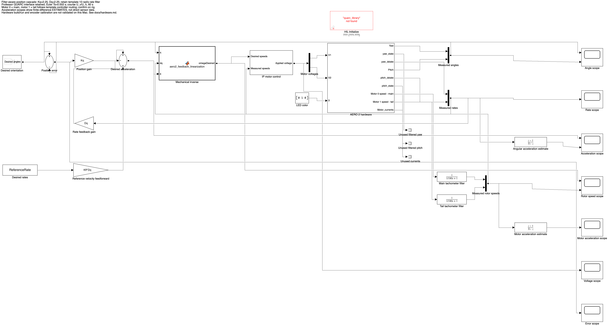
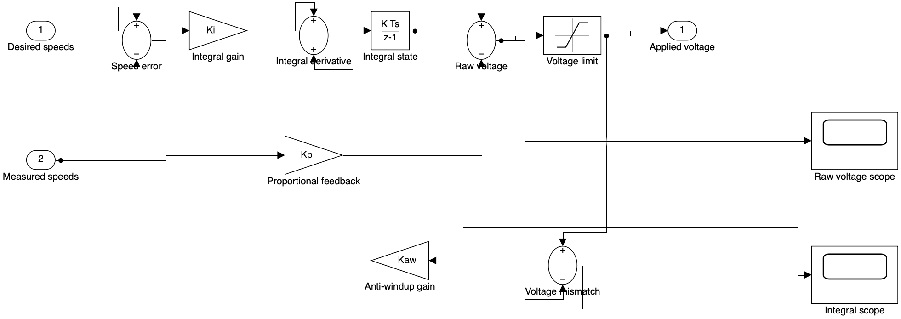
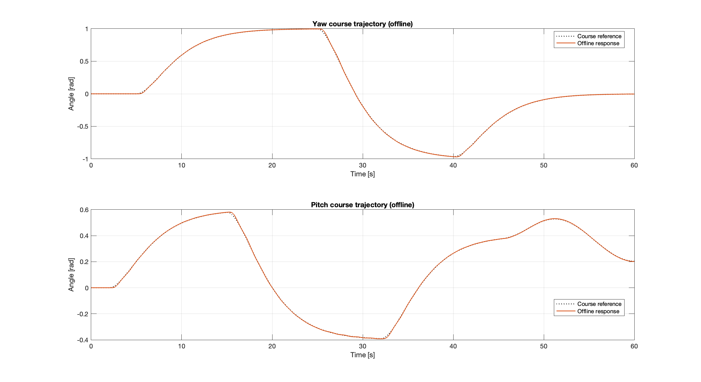
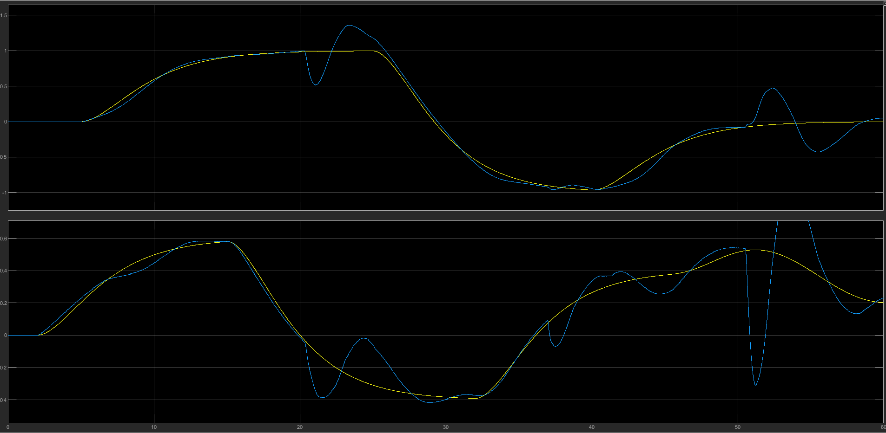
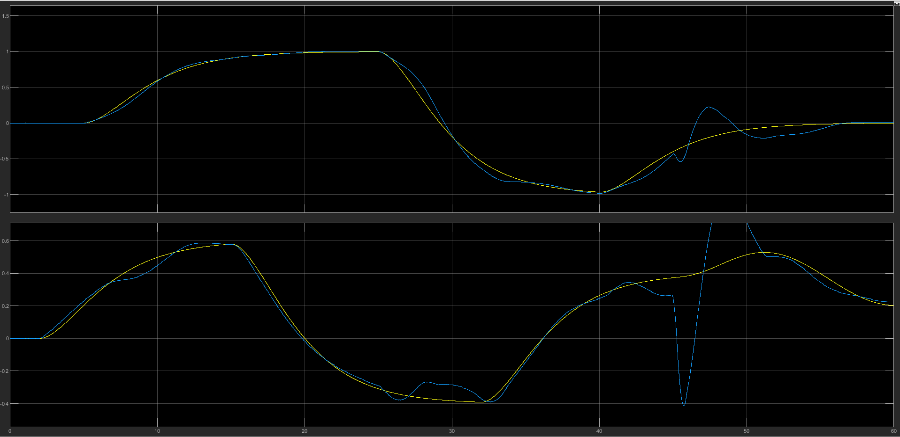

# Full position cascade with the professor's hardware interface

The adapted model controls **yaw and pitch position**, using our Question 5 cascade with filter-aware position gains. It keeps the professor's AERO 2 USB interface. The original four files under `real_hardware/` are unchanged.

**Current status:** physical course-tracking tests are documented by two Scope screenshots supplied from the laboratory. The operator confirmed use of the derived controller and deliberate disturbances applied by hand. The nominal lab-ready candidate uses `Kq=2.25 s^-2`, `Dq=2.25 s^-1`, retaining the 10 rad/s, damping 0.8 filter. Its offline settling is 3.280–3.292 s. The images show qualitative tracking and recovery; they do not independently verify the loaded software/gains, numerical performance or voltage behavior.

## Which file to open

| Purpose | File |
| --- | --- |
| Position controller with actual QUARC interface | [simulink/aero2_hardware_cascade.slx](../simulink/aero2_hardware_cascade.slx) |
| Laboratory MATLAB R2021a export | [simulink/aero2_hardware_cascade_R2021a.slx](../simulink/aero2_hardware_cascade_R2021a.slx) |
| Simulation without QUARC or hardware | [simulink/experiments/aero2_hardware_cascade_offline.slx](../simulink/experiments/aero2_hardware_cascade_offline.slx) |

From the repository as MATLAB's Current Folder:

```matlab
project = setup_project;
% Open only: this command does not build or start a hardware target.
open_system(fullfile(project.simulink,'aero2_hardware_cascade_R2021a.slx'));
```

Use the lab computer with QUARC for the hardware model. Do not run either original `nlc_setup_solucion` script on top of it. Gains, the 2 ms sample period and the course reference are embedded in the model workspace; there is no initialization callback.

For an ordinary simulation on this Mac, open the offline copy instead and press Run:

```matlab
open_system(fullfile(project.experiments,'aero2_hardware_cascade_offline.slx'));
```

## What was connected



This is a Simulink diagram export, not a screenshot or evidence of a hardware run. QUARC library icons may be unresolved on the development Mac.

The chain is:

**Desired angles → PD position controller → mechanical inverse → IP motor controllers with anti-windup → voltage outputs → AERO 2**

The feedback signals are angles, estimated body rates and filtered rotor speeds. Signal order remains `q = [yaw; pitch]`, `dq = [yaw rate; pitch rate]`, `omega = [main; tail]`, `v = [main; tail]`.

| Hardware interface signal | Connection to our controller |
| --- | --- |
| Input 1 / analog output channel 0 | Main-motor voltage |
| Input 2 / analog output channel 1 | Tail-motor voltage |
| Outputs 1 and 4 | Measured yaw and pitch angles |
| Outputs 3 and 5 | Estimated yaw and pitch rates |
| Output 7 / tachometer channel 14000 | Motor 0 speed, routed to the main loop |
| Output 8 / tachometer channel 14001 | Motor 1 speed, routed to the tail loop |
| Input 3 | Green LED color |
| Outputs 2, 6 and 9 | Filtered angles and motor currents, terminated as in the template's control path |

**The supplied speed labels were misleading:** `System/7` was labeled `w_tail` but fed the original main controller, while `System/8` was labeled `w_main` but fed the tail controller. The adapted output labels now state motor 0/main and motor 1/tail. The physical rotor assignment and polarity still need confirmation on the rig; the adaptation follows the professor model's channel routing.

The template reads pitch/yaw encoder channels `[2 3]`, converts them with `[2*pi/2048, 2*pi/4096]`, and estimates rates with a second-order filter at 10 rad/s and damping ratio 0.8. Rotor tachometers use `2*pi/2048` and the template's 180 rad/s first-order filters. These settings are retained, not recalibrated. The [Quanser filter documentation](https://docs.quanser.com/quanser-sdk/documentation/secondorder_lowpass_filter_block.html) identifies the two outputs as filtered position and its derivative.

## What changed in the controller

The inverse and motor controller are copied from Question 5. Position gains are retuned for the retained rate estimator:

```math
a=K_p^q(q_d-q)+K_d^q(\dot q_d-\widehat{\dot q}),
\qquad K_p^q=2.25\ \mathrm{s}^{-2},
\qquad K_d^q=2.25\ \mathrm{s}^{-1}.
```

The motor loops retain `Kp = 0.216370392`, `Ki = 1.841646063`, `Kaw = 20` and the ±24 V voltage limit. The integral state uses **Forward Euler at 0.002 s**. At that integration step, it implements the same update as the continuous integrator in our Euler simulation:

```math
v_k=\mathrm{clip}(I_k-K_p\omega_k,-24,24),
```

```math
I_{k+1}=I_k+T_s\left[K_i(\omega_{d,k}-\omega_k)+K_{\mathrm{aw}}(v_k-v_{\mathrm{raw},k})\right].
```



This is the PD position cascade with analytical course-reference velocity feedforward. There is no optional outer integrator or reference-acceleration feedforward. The course `U_v`/`U_h` trajectory and its sampled analytical derivative are embedded for 60 s. `Kff=1` enables the velocity contribution; sharp-step diagnostics explicitly use `Kff=0` rather than differentiating their discontinuities.

The QUARC target configuration is copied from the professor's model, with its fixed integration step corrected from **0.1 s to 0.002 s**. The HIL board, channels, voltage units, encoder conversions and zero-voltage startup/termination settings are preserved. Quanser documents these analog outputs as motor voltages in the ±24 V range, so no extra DAC scale factor is introduced. See the [AERO 2 driver documentation](https://docs.quanser.com/quarc/documentation/quanser_aero2_usb.html).

## How to visualize it

Double-click these Scopes after a run of the appropriate model:

| Scope | Signals |
| --- | --- |
| Angle scope | Desired and measured yaw/pitch |
| Rate scope | Estimated yaw/pitch angular velocities |
| Acceleration scope | Virtual acceleration command and finite-difference estimate of body acceleration |
| Rotor speed scope | Desired and measured main/tail speeds |
| Motor acceleration scope | Finite-difference estimates of rotor acceleration |
| Voltage scope | Applied main/tail voltages |
| Error scope | Yaw/pitch position errors |
| IP motor control / Raw voltage scope | Requested voltages before saturation |
| IP motor control / Integral scope | Motor integral contributions |

The hardware interface has no direct body-angular-acceleration output. These acceleration estimates use a sampled difference, `(rate[k]-rate[k-1])/Ts`, and can amplify sensor noise. They are passive diagnostics and are not fed into the controller. Unlike the original simulated plant's derivative outputs, they must not be described as exact acceleration measurements.

## Offline evidence

The separate offline copy replaces **all** QUARC/HIL blocks with the supplied nonlinear course plant. It retains the hardware model's controller and tachometer filters, and reproduces the body-rate estimator using ordinary transfer functions. This tests filter delay and controller behavior without opening a device.


| Step test | Settling time, 2% | Overshoot | Peak voltage |
| --- | --- | --- | --- |
| Yaw ±0.1 rad | 3.280 s | 0.0114% | 9.81 V |
| Pitch ±0.1 rad | 3.290 s | 0.0070% | 10.38 V |
| Simultaneous yaw ±0.2, pitch ±0.1 rad | 3.280–3.292 s | <0.010% | 17.32 V |

All signed steps converge within the test window without voltage saturation. Signals remain finite and pitch remains inside the inherited ±60° modeling envelope. Zero reference and zero state remain at rest. Halving the integration step, while keeping the controller sampling at 2 ms, gives 3.278–3.289 s settling and a maximum angle difference of 0.000174 rad.

**The selected candidate passes the working 3 s ±20% offline timing gate for all signed axis responses.** Original gains failed at 5.220–5.222 s: the estimator adds states and delay to damping feedback and nonlinear compensation. `validate_filter_remedies` compares the unchanged controller, a 30 rad/s filter and the selected 2.25/2.25 gain adjustment. Retuning preserves the template filter; raising its cut-off may increase measurement noise. This is an offline result, not professor approval or measured device performance.



For the 60 s course reference, the retuned filtered candidate with velocity feedforward gives ideal-sensor yaw/pitch RMS errors of 0.00999/0.00615 rad, and 0.01004/0.00626 rad with course sensor effects. Peak voltage is 9.98 V with sensor effects, without saturation. These are surrogate simulation results, not measured hardware performance.

The template stores `input_width=10`, `input_zeta=0.8`, `input_init=0`. Its [QUARC block documentation](https://docs.quanser.com/quanser-sdk/documentation/secondorder_lowpass_filter_block.html) specifies rad/s. Our ordinary Simulink equivalent is `H(s)=100/(s^2+16s+100)`, with rate output `s*H(s)`; raw angles and filtered rates enter the controller. Tachometers use `180/(s+180)`, and no extra torque-command filter precedes the signed square root. Thus the nominal filter matches the stored template parameters, but actual QUARC execution has not been checked. A different reported 6.6 s settling result cannot be attributed to the filter parameters alone without matching controller gains, other filtering, sampling and test conditions.

Reproduce the evidence with:

```matlab
project = setup_project;
validate_hardware_cascade;
export_hardware_cascade_figures;
```

Data and CSV tables go to `results/hardware_cascade/`. `TimingMet` records the selected candidate's offline timing result separately from integrity/convergence checks; the original failure remains in `results/filter_remedies/steps.csv`. `python3 validation/audit_hardware_model.py` checks source hashes, preserved HIL settings, channel routing and the absence of hardware blocks from both offline files.

## What remains for the laboratory

The professor needs to review the port before the hardware experiment. Confirm the physical motor/channel assignment and signs, the encoder counts per revolution, propeller orientation and angle-zero convention. The supplied initialization resets encoder counts, so the starting physical orientation must match the model's zero angles. Confirm the allowable travel and test amplitude on the actual setup before starting the course trajectory.

The inherited ±60° pitch assertion is a mathematical operating restriction, not an approved hardware travel limit or a physical emergency-stop system. The template retains zero voltage and amplifier-disable settings on termination, plus its configured watchdog output values; this adaptation does not add or verify a running watchdog timer.

QUARC is absent on this Mac. The `.slx` files and R2021a exports are saved, their wiring is audited, and the offline export runs in R2024b. **Build logs, actual runtime release, real-time timing and exact loaded parameters are not archived. Physical operation is documented by the supplied Scope screenshots.** Follow the professor's section-by-section commissioning procedure on the lab computer.

To rebuild the two separate models without running hardware:

```matlab
build_hardware_cascade;
build_hardware_cascade_offline;
```


## Physical laboratory evidence

The user supplied these original physical Scope records and confirmed that the disturbances were deliberately introduced using their hands. They reported using the derived controller. The nominal lab-ready model is the PD/IP cascade with 2.25/2.25 position gains; exact runtime gains, binary revision and integral setting are not independently logged in the images.





The yellow profiles match the supplied 60 s course signals, with yaw above and pitch below; blue traces are interpreted as measured angles. The first record shows pronounced excursions around 20–25 s and 50–55 s, while the second shows a pronounced response around 45–50 s. These are approximate response intervals, not logged force-application times. The traces subsequently approach the reference again. Some positive pitch excursions exceed the visible plot range, preventing reliable peak extraction.

The manual disturbance magnitude/duration is unknown. These intervals assess qualitative disturbance recovery and cannot be used as undisturbed tracking errors or compared directly with simulated no-disturbance RMS. Exact RMS, 2% settling times, maximum excursions and voltage saturation are not inferred. Separate motor-speed, individual-axis and integral-enabled records were not supplied.

Original files are preserved unchanged in [real_lab_images](../real_lab_images/README.md). Selected copies in `docs/figures/` and `report/images/` are byte-identical; no image processing was performed. Raw numerical experiment recordings remain unavailable.
