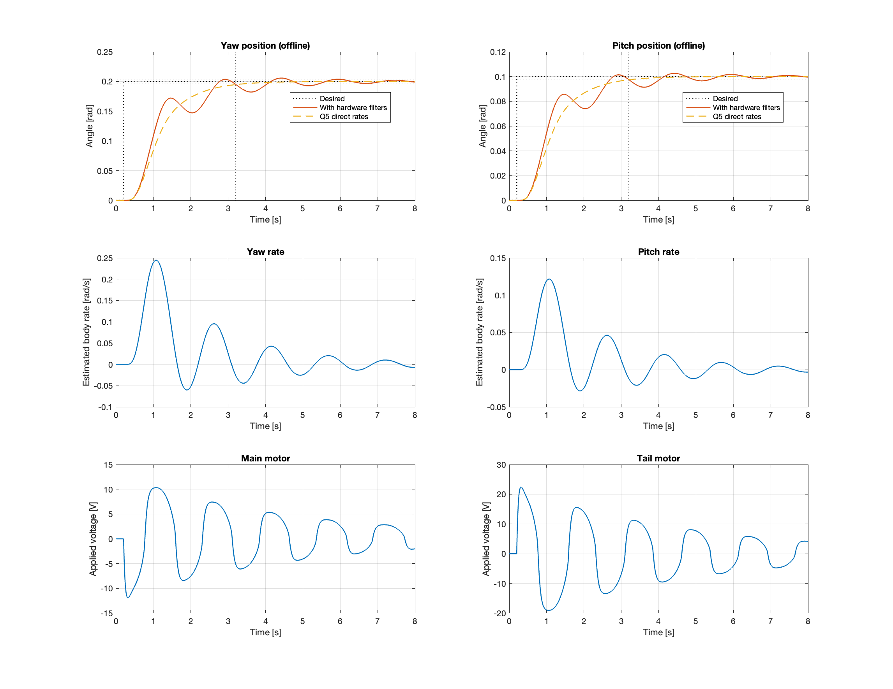

# Full position cascade with the professor's hardware interface

The adapted model controls **yaw and pitch position**, using our Question 5 controller. It keeps the professor's AERO 2 USB interface. The original four files under `real_hardware/` are unchanged.

**Current status:** the controller has been tested with a separate offline surrogate. The hardware model has not been compiled with QUARC or run on the AERO 2. Retaining the template's measurement filters increases simulated step settling to about **5.2 s**, so this port does **not** yet satisfy the 3 s timing target.

## Which file to open

| Purpose | File |
| --- | --- |
| Position controller with actual QUARC interface | [simulink/aero2_hardware_cascade.slx](../simulink/aero2_hardware_cascade.slx) |
| Laboratory MATLAB R2021a export | [simulink/aero2_hardware_cascade_R2021a.slx](../simulink/aero2_hardware_cascade_R2021a.slx) |
| Simulation without QUARC or hardware | [simulink/experiments/aero2_hardware_cascade_offline.slx](../simulink/experiments/aero2_hardware_cascade_offline.slx) |

From the repository as MATLAB's Current Folder:

```matlab
project = setup_project;
% Open only: this command does not build or start a hardware target.
open_system(fullfile(project.simulink,'aero2_hardware_cascade_R2021a.slx'));
```

Use the lab computer with QUARC for the hardware model. Do not run either original `nlc_setup_solucion` script on top of it. Gains, the 2 ms sample period and the course reference are embedded in the model workspace; there is no initialization callback.

For an ordinary simulation on this Mac, open the offline copy instead and press Run:

```matlab
open_system(fullfile(project.experiments,'aero2_hardware_cascade_offline.slx'));
```

## What was connected


This is a Simulink diagram export, not a screenshot or evidence of a hardware run. QUARC library icons may be unresolved on the development Mac.

The chain is:

**Desired angles → PD position controller → mechanical inverse → IP motor controllers with anti-windup → voltage outputs → AERO 2**

The feedback signals are angles, estimated body rates and filtered rotor speeds. Signal order remains `q = [yaw; pitch]`, `dq = [yaw rate; pitch rate]`, `omega = [main; tail]`, `v = [main; tail]`.

| Hardware interface signal | Connection to our controller |
| --- | --- |
| Input 1 / analog output channel 0 | Main-motor voltage |
| Input 2 / analog output channel 1 | Tail-motor voltage |
| Outputs 1 and 4 | Measured yaw and pitch angles |
| Outputs 3 and 5 | Estimated yaw and pitch rates |
| Output 7 / tachometer channel 14000 | Motor 0 speed, routed to the main loop |
| Output 8 / tachometer channel 14001 | Motor 1 speed, routed to the tail loop |
| Input 3 | Green LED color |
| Outputs 2, 6 and 9 | Filtered angles and motor currents, terminated as in the template's control path |

**The supplied speed labels were misleading:** `System/7` was labeled `w_tail` but fed the original main controller, while `System/8` was labeled `w_main` but fed the tail controller. The adapted output labels now state motor 0/main and motor 1/tail. The physical rotor assignment and polarity still need confirmation on the rig; the adaptation follows the professor model's channel routing.

The template reads pitch/yaw encoder channels `[2 3]`, converts them with `[2*pi/2048, 2*pi/4096]`, and estimates rates with a second-order filter at 10 rad/s and damping ratio 0.8. Rotor tachometers use `2*pi/2048` and the template's 180 rad/s first-order filters. These settings are retained, not recalibrated. The [Quanser filter documentation](https://docs.quanser.com/quanser-sdk/documentation/secondorder_lowpass_filter_block.html) identifies the two outputs as filtered position and its derivative.

## What changed in the controller

The position law, inverse mechanics and gains are copied from our existing Question 5 model:

```math
a=K_p^q(q_d-q)-K_d^q\dot q,
\qquad K_p^q=3.781626936,
\qquad K_d^q=3.889281135.
```

The motor loops retain `Kp = 0.216370392`, `Ki = 1.841646063`, `Kaw = 20` and the ±24 V voltage limit. The integral state uses **Forward Euler at 0.002 s**. At that integration step, it implements the same update as the continuous integrator in our Euler simulation:

```math
v_k=\mathrm{clip}(I_k-K_p\omega_k,-24,24),
```

```math
I_{k+1}=I_k+T_s\left[K_i(\omega_{d,k}-\omega_k)+K_{\mathrm{aw}}(v_k-v_{\mathrm{raw},k})\right].
```


This is the baseline PD position cascade. There is no optional outer integrator, reference derivative or acceleration feedforward. The course `U_v`/`U_h` trajectory is the saved default, for 60 s.

The QUARC target configuration is copied from the professor's model, with its fixed integration step corrected from **0.1 s to 0.002 s**. The HIL board, channels, voltage units, encoder conversions and zero-voltage startup/termination settings are preserved. Quanser documents these analog outputs as motor voltages in the ±24 V range, so no extra DAC scale factor is introduced. See the [AERO 2 driver documentation](https://docs.quanser.com/quarc/documentation/quanser_aero2_usb.html).

## How to visualize it

Double-click these Scopes after a run of the appropriate model:

| Scope | Signals |
| --- | --- |
| Angle scope | Desired and measured yaw/pitch |
| Rate scope | Estimated yaw/pitch angular velocities |
| Acceleration scope | Virtual acceleration command and finite-difference estimate of body acceleration |
| Rotor speed scope | Desired and measured main/tail speeds |
| Motor acceleration scope | Finite-difference estimates of rotor acceleration |
| Voltage scope | Applied main/tail voltages |
| Error scope | Yaw/pitch position errors |
| IP motor control / Raw voltage scope | Requested voltages before saturation |
| IP motor control / Integral scope | Motor integral contributions |

The hardware interface has no direct body-angular-acceleration output. These acceleration estimates use a sampled difference, `(rate[k]-rate[k-1])/Ts`, and can amplify sensor noise. They are passive diagnostics and are not fed into the controller. Unlike the original simulated plant's derivative outputs, they must not be described as exact acceleration measurements.

## Offline evidence

The separate offline copy replaces **all** QUARC/HIL blocks with the supplied nonlinear course plant. It retains the hardware model's controller and tachometer filters, and reproduces the body-rate estimator using ordinary transfer functions. This tests filter delay and controller behavior without opening a device.



| Step test | Settling time, 2% | Overshoot | Peak voltage |
| --- | --- | --- | --- |
| Yaw ±0.1 rad | 5.222 s | 2.76% | 12.72 V |
| Pitch ±0.1 rad | 5.222 s | 2.66% | 13.45 V |
| Simultaneous yaw ±0.2, pitch ±0.1 rad | 5.220–5.222 s | 2.55–2.82% | 22.45 V |

All signed steps converge within the test window without voltage saturation. Signals remain finite and pitch remains inside the inherited ±60° modeling envelope. Zero reference and zero state remain at rest. Halving the integration step, while keeping the controller sampling at 2 ms, gives 5.212–5.215 s settling and a maximum angle difference of 0.000295 rad.

**The 3 s ±20% timing gate fails for all eight measured axis responses.** In Question 5, body rates were available directly. Here, their estimator introduces extra states and delay into both damping feedback and nonlinear compensation. The controller gains have deliberately been retained so this difference is visible. Estimator-aware tuning is needed before claiming the timing requirement is met.


For the 60 s course reference, ideal-measurement RMS tracking error is 0.09795 rad yaw and 0.05880 rad pitch, with peak voltage 7.49 V. With the course sensor model enabled, measured-error RMS is 0.09793 and 0.05877 rad, with peak voltage 7.63 V. These are surrogate simulation results, not measured hardware performance or a calibrated model of the real sensors.

Reproduce the evidence with:

```matlab
project = setup_project;
validate_hardware_cascade;
export_hardware_cascade_figures;
```

Data and CSV tables go to `results/hardware_cascade/`. `TimingMet` records the failed timing gate separately from integrity/convergence checks. `python3 validation/audit_hardware_model.py` checks source hashes, preserved HIL settings, channel routing and the absence of hardware blocks from both offline files.

## What remains for the laboratory

The professor needs to review the port before the hardware experiment. Confirm the physical motor/channel assignment and signs, the encoder counts per revolution, propeller orientation and angle-zero convention. The supplied initialization resets encoder counts, so the starting physical orientation must match the model's zero angles. Confirm the allowable travel and test amplitude on the actual setup before starting the course trajectory.

The inherited ±60° pitch assertion is a mathematical operating restriction, not an approved hardware travel limit or a physical emergency-stop system. The template retains zero voltage and amplifier-disable settings on termination, plus its configured watchdog output values; this adaptation does not add or verify a running watchdog timer.

QUARC is absent on this Mac. The `.slx` files and R2021a exports are saved, their wiring is audited, and the offline export runs in R2024b. **QUARC code generation, real-time timing, actual R2021a execution and physical operation remain unverified.** Follow the professor's section-by-section commissioning procedure on the lab computer.

To rebuild the two separate models without running hardware:

```matlab
build_hardware_cascade;
build_hardware_cascade_offline;
```
