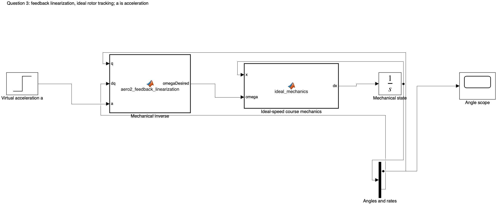

# AERO 2 laboratory report — Part II

This report follows [Part II of the laboratory guide, pages 4–6](../course/Automatic_Control_III_Computer_Room_II.pdf). Questions 1–3 are implemented. The pitch/yaw position controller with a 3 s settling-time target is Question 4 and has not been implemented yet.

## The physical system and signals


The main rotor primarily produces pitch motion; the tail rotor primarily produces yaw motion. Both also affect the other axis through coupling.

| Symbol | Meaning | Order when written as a vector |
|---|---|---|
| $q$ | AERO 2 orientation, rad | Yaw $\psi$, pitch $\theta$ |
| $\dot q$ | Angular velocity, rad/s | Yaw rate, pitch rate |
| $\omega$ | Propeller speed, rad/s | Main rotor, tail rotor |
| $v$ | Applied motor voltage, V | Main motor, tail motor |

The plant inputs `V1` and `V2` are the main and tail motor voltages. Propeller speed and body angular velocity are different quantities. Questions 1–2 control propeller speeds. Later questions use those speeds to control yaw and pitch.

## Which model should I open?

Start with the **simple answer models** in `simulink/`. They contain the essential control connections, a basic reference and basic scopes.

| Question | Simple answer model |
|---|---|
| 1 — PI motor control | [aero2_motor_pi.slx](../simulink/aero2_motor_pi.slx) |
| 2 — IP with anti-windup | [aero2_motor_ip.slx](../simulink/aero2_motor_ip.slx) |
| 3 — Feedback linearization | [aero2_mechanical_linearization.slx](../simulink/aero2_mechanical_linearization.slx) |

Separate copies in `simulink/experiments/` contain recovery-step generators, comparison switches and detailed logging. Those blocks support validation; they are not extra parts of the required controller. Experiment filenames add `_experiment` before `.slx`.

For example, with the repository as MATLAB's Current Folder:

```matlab
project = setup_project;
open_system(fullfile(project.simulink,'aero2_motor_ip.slx'));
open_system('aero2_motor_ip/Speed scope');
open_system('aero2_motor_ip/Voltage scope');
```

Press **Run**. A Scope displays its connected signals against simulation time. Double-click reference blocks to inspect their settings.

## Preparation — Check the supplied simulator

Before designing feedback, we checked that known voltages produce the expected motor response:

$$
\dot\omega=-5.78\omega+96.532v.
$$

The separate [open-loop preparation model](../simulink/aero2_simulator.slx) copies the supplied plant and applies +1 V to the main motor and -1 V to the tail motor from 0.1 to 0.3 s. Its Pulse Generator settings are period 10 s, width 2%, delay 0.1 s and continuous sample time 0. Voltage is limited to ±24 V; simulation ends at 1 s.


Its Voltage, Rotor speed and Body angle scopes show the applied inputs, motor response and resulting yaw/pitch motion. No position feedback is present.

**Result:** zero voltage and zero initial state remain at rest. The maximum speed discrepancy from the analytical motor response is 0.0357 rad/s, below the 0.15 rad/s acceptance threshold. Voltage clipping and the sensor switch also pass their checks. See [validate_simulator.m](../validation/validate_simulator.m).

## Question 1 — PI motor-speed control

### What the guide asks

Design a PI controller for the propeller speeds with approximately **0.3 s settling time**, and verify it in simulation.

### How we chose the gains

The supplied motor equation gives the transfer function

$$
P(s)=\frac{96.532}{s+5.78}.
$$

Define the speed error $e=\omega_d-\omega$. The PI controller is

$$
v_{\mathrm{raw}}=K_pe+I,\qquad \dot I=K_ie.
$$

The closed-loop denominator is

$$
s^2+(5.78+96.532K_p)s+96.532K_i.
$$

We match it to $(s+\lambda)^2$, giving two repeated real poles. Using $T_s\approx4/\lambda$ as a starting estimate:

$$
\lambda=\frac4{0.3}=13.3333,\qquad
K_p=\frac{2\lambda-5.78}{96.532}=0.2163704,\qquad
K_i=\frac{\lambda^2}{96.532}=1.8416461.
$$

Both motors use these gains because their supplied motor equations are identical. The calculation is in [motor_pi_parameters.m](../matlab/parameters/motor_pi_parameters.m).

The PI transfer function also has a numerator zero. Therefore, repeated real poles alone do not guarantee zero overshoot or an exact 0.3 s settling time; we measure the response in simulation.

### Simple implementation


Each loop calculates speed error, adds proportional and integral action, limits voltage to ±24 V and feeds back measured speed.

| Setting | Value |
|---|---|
| Main reference | 0 → +100 rad/s at 0.1 s |
| Tail reference | 0 → -100 rad/s at 0.1 s |
| Initial motor speeds and integral states | Zero |
| Step block sample time | 0, continuous |
| Sensors | Ideal setting, `meas_on=0` |
| Solver / stop time | Forward Euler, 0.002 s step / 1 s |
| Speed scope | Main desired/measured speed, then tail desired/measured speed |
| Voltage scope | Main/tail voltages after the ±24 V limits |

The controller computes voltage; we no longer prescribe voltage pulses. The AERO 2's yaw and pitch are not regulated at this stage.

### Simulation and result

The [PI experiment copy](../simulink/experiments/aero2_motor_pi_experiment.slx) adds error plots and logging. We test each motor independently, both command signs, simultaneous commands and zero reference using [validate_motor_pi.m](../validation/validate_motor_pi.m).


| Measured result | Both motors, either command sign |
|---|---:|
| Settling time | **0.318 s** |
| Overshoot | 3.70% |
| Absolute final error at 1 s | 0.00312 rad/s |
| Peak absolute voltage | 21.64 V |
| Time in saturation | 0 s |

**Conclusion:** the PI meets our agreed 0.24–0.36 s interpretation of “approximately 0.3 s.” A 0.001 s integration step gives 0.319 s, supporting the timing result.

## Question 2 — IP control with anti-windup

### What the guide asks

Replace PI with IP **using the same gains**, and include anti-windup feedback.

### What changes from PI

The integral term still uses the speed error. Proportional action now uses measured speed:

$$
\text{PI:}\quad v_{\mathrm{raw}}=I+K_p(\omega_d-\omega),
$$

$$
\text{IP:}\quad v_{\mathrm{raw}}=I-K_p\omega.
$$

A reference step therefore causes no immediate proportional voltage jump in IP. Keeping the gains preserves the closed-loop poles, but removes the PI reference-response zero. With our repeated real poles, the ideal IP step response is monotonic and slower. IP does not guarantee zero overshoot for arbitrary gains or plants.

### Why we add anti-windup

The amplifier cannot apply more than ±24 V. During saturation, ordinary integral action can keep accumulating error even though the requested voltage cannot be applied. This stored action can delay recovery when the reference changes. Saturation can also occur temporarily for a reachable reference.

We feed the difference between applied and requested voltage back into the integrator:

$$
v_{\mathrm{sat}}=\mathrm{sat}_{[-24,24]}(v_{\mathrm{raw}}),
$$

$$
\dot I=K_i(\omega_d-\omega)+K_{\mathrm{aw}}(v_{\mathrm{sat}}-v_{\mathrm{raw}}),
\qquad K_{\mathrm{aw}}=\frac1{0.05}=20\ \mathrm{s^{-1}}.
$$

If raw voltage exceeds +24 V, the correction is negative and opposes integral buildup. Without saturation, the correction is zero. The integral contribution is not itself clipped to ±24 V; it must also compensate the term $-K_p\omega$.

### Simple implementation


The reference settings, gains, initial states, solver and two basic scopes are the same as Question 1. The visible additions calculate `applied voltage - raw voltage`, multiply it by `Kaw`, and add it before the integrator. Settings are in [motor_ip_parameters.m](../matlab/parameters/motor_ip_parameters.m).

**There is one reference Step per motor.** Recovery steps and PI/IP selection are only in the [IP experiment copy](../simulink/experiments/aero2_motor_ip_experiment.slx).

### Simulation and result

[validate_motor_ip.m](../validation/validate_motor_ip.m) first compares identical ±100 rad/s commands:

| Measured result | PI | IP, with or without anti-windup |
|---|---:|---:|
| Settling time | 0.318 s | **0.434 s** |
| Overshoot | 3.70% | **0%** |
| Peak absolute voltage | 21.64 V | 7.36 V |
| Time in saturation | 0 s | 0 s |


IP settles more slowly because its numerator changed. We retain the gains as instructed by Question 2. The unsaturated IP results are identical with anti-windup enabled and disabled.

To test windup, the experiment requests ±800 rad/s at 0.1 s, then returns to ±100 rad/s at 1.1 s. The second Step adds ∓700 rad/s to the first reference. The initial request is unreachable: the nominal motor approaches only about 401 rad/s at 24 V. Simulation ends at 5 s.


| Measured result | Without anti-windup | With anti-windup |
|---|---:|---:|
| Recovery time after the return command | 1.898 s | **0.570 s** |
| Peak absolute integral contribution | 869.91 V | **147.26 V** |
| Time saturated after the return | 1.372 s | **0.042 s** |

Both motors and both sign directions give these results. Applied voltage remains within ±24 V. A 0.001 s step gives 0.572 s recovery.

**Conclusion:** IP gives the expected same-gain comparison, and anti-windup reduces excess integral accumulation and improves recovery. It does not make an unreachable speed achievable.

## Question 3 — Mechanical feedback linearization

### What the guide asks

Assume perfect motor tracking, $\omega=\omega_d$. Find a control law that linearizes the yaw/pitch dynamics, identify its states and state where it is valid.

### Equations and control law

The simplified mechanical model is

$$
M_q(q)\ddot q+c_q(q,\dot q)+g_q(q)=\Gamma(\theta)s,
\qquad s=\begin{bmatrix}\omega_m|\omega_m|\\\omega_t|\omega_t|\end{bmatrix}.
$$

Here $M_q$ describes inertia, $c_q$ contains velocity-dependent terms, $g_q$ describes gravity and $\Gamma$ maps rotor action to yaw/pitch torque. Their expressions from page 5 of the guide are

$$
M_q=\begin{bmatrix}J_\psi\cos^2\theta+j_\psi\sin^2\theta&0\\0&J_\theta\end{bmatrix},
$$

$$
c_q=\begin{bmatrix}-(J_\psi-j_\psi)\sin(2\theta)\dot\theta\dot\psi\\
\frac12(J_\psi-j_\psi)\sin(2\theta)\dot\psi^2\end{bmatrix},
\qquad g_q=\begin{bmatrix}0\\G\sin\theta\end{bmatrix},
$$

$$
\Gamma(\theta)=\begin{bmatrix}\cos\theta&0\\0&1\end{bmatrix}
\begin{bmatrix}-k_t&Lk_f\\Lk_f&k_t\end{bmatrix}.
$$

Choose a virtual acceleration $a=[a_\psi,a_\theta]^T$. The control law has three steps:

1. Calculate the torque needed for that acceleration: $\tau_d=M_q a+c_q+g_q$.
2. Solve $\Gamma(\theta)s=\tau_d$ for the signed squared rotor speeds.
3. Recover the desired speeds: $\omega_d=\mathrm{sign}(s)\sqrt{|s|}$, component by component.

Substitution shows why this works:

$$
\ddot q=M_q^{-1}(\Gamma s-c_q-g_q)
=M_q^{-1}(M_q a+c_q+g_q-c_q-g_q)=a.
$$

This is **feedback linearization**, not a Taylor approximation around an equilibrium. The nonlinear terms are evaluated at the current state and canceled in the ideal model.

The implementation uses a matrix solve and signed square root in [aero2_feedback_linearization.m](../matlab/mechanics/aero2_feedback_linearization.m). The equations and constants are in [aero2_mechanical_terms.m](../matlab/mechanics/aero2_mechanical_terms.m) and [aero2_mechanical_parameters.m](../matlab/parameters/aero2_mechanical_parameters.m).

### Linearized states and validity range

The four mechanical states remain

$$
z=\begin{bmatrix}\psi&\theta&\dot\psi&\dot\theta\end{bmatrix}^T.
$$

Their dynamics become

$$
\dot z_1=z_3,\quad\dot z_2=z_4,\quad
\dot z_3=a_\psi,\quad\dot z_4=a_\theta.
$$

These are two double integrators. The motor states are excluded by the perfect-tracking assumption. Each angle is obtained by integrating its virtual acceleration twice.

The control law has these limits:

- **Pitch singularity:** $\det\Gamma=-\cos\theta[k_t^2+(Lk_f)^2]$. The inverse requires $\cos\theta\ne0$ and fails at $\theta=\pi/2+k\pi$. We enforce the narrower **simulation envelope** $|\theta|\le60^\circ$. Crossing it stops the run; this is not a hardware travel limit.
- **Zero speed:** the signed square root returns zero correctly, but its derivative is unbounded there. Algebraic cancellation is defined at zero; the smooth local feedback interpretation requires nonzero rotor speeds and an invertible torque map.
- **Physical limits:** exact cancellation assumes correct parameters, exact state measurements and perfect rotor tracking. Real motors have finite voltage and bandwidth. The ideal inverse does not enforce those constraints.

### Simple implementation



The simple model starts with zero angles and rates. One vector Step changes virtual acceleration from `[0;0]` to `[0.15;-0.1]` rad/s² at 0.2 s. It runs for 2 s with the 0.002 s Euler step. The Angle scope shows yaw and pitch.

This model commands acceleration, not angle setpoints. The inverse calculates rotor speeds; the ideal-speed mechanics uses them immediately. Its state integrator returns angles and rates for feedback. There is no position controller yet.

### Separate simulation experiment and result

The [feedback-linearization experiment](../simulink/experiments/aero2_mechanical_linearization_experiment.slx) uses a different demonstration input to test the cancellation:

| Setting | Experiment value |
|---|---|
| Initial yaw/pitch | 0.1 / 0.2 rad |
| Initial yaw/pitch rates | -0.05 / +0.04 rad/s |
| Acceleration pulse | Yaw +0.15, pitch -0.10 rad/s² from 0.2 to 0.6 s |
| Pulse settings | Period 10 s, width 4%, delay 0.2 s, continuous sample time 0 |
| Solver / stop time | Euler, 0.002 s / 2 s |

Its scopes show requested/recovered acceleration, angles, rates, rotor commands and acceleration error. [validate_feedback_linearization.m](../validation/validate_feedback_linearization.m) also substitutes computed rotor speeds into the original course equations at 180 representative states and acceleration commands.


Read this figure by rows:

- **Top:** requested and recovered accelerations overlap, confirming the cancellation.
- **Middle:** the dotted curves are analytical double-integrator responses; the orange curves come from the nonlinear course mechanics. Yaw first decreases because its initial velocity is negative. The positive pulse reverses it, leaving +0.01 rad/s afterward. Pitch initially increases; the negative pulse reduces its velocity to zero, so it becomes flat near 0.216 rad.
- **Bottom:** the acceleration error is around $10^{-17}$ rad/s². The spikes are floating-point roundoff, not sensor noise or physical oscillation.

| Check | Measured result |
|---|---:|
| Maximum acceleration error across 180 substitutions | $2.22\times10^{-16}$ rad/s² |
| Maximum acceleration error during the time simulation | $5.55\times10^{-17}$ rad/s² |
| Maximum angle error against analytical response, 0.002 s step | $6.0\times10^{-5}$ rad |
| Same comparison with a 0.001 s step | $3.0\times10^{-5}$ rad |
| Zero input at zero state | Exactly zero rotor commands |
| Leaving the pitch envelope | Simulation stops with a diagnostic |

**Conclusion:** the compensated ideal mechanics behaves as two double integrators. No equilibrium approximation was needed. Choosing $a$ to regulate position and meet the 3 s target is Question 4.

## Rebuild and repeat the checks

Saved models can be opened without rebuilding. To regenerate both the simple answers and their experiment copies:

```matlab
project = setup_project;
build_motor_pi;
build_motor_ip;
build_feedback_linearization;
```

Builders overwrite generated models. Put lasting diagram changes in the builder code.

Run the experiment checks and regenerate their figures with:

```matlab
validate_motor_pi;
validate_motor_ip;
validate_feedback_linearization;
validate_question_models;
export_motor_pi_figures;
export_motor_ip_figures;
export_feedback_linearization_figures;
```

`validate_question_models` confirms that simple and experiment copies give the same dynamics under matching inputs and initial conditions. The maximum recorded difference is **0** for all three questions. For Question 3 it matches the experiment input and initial state to the simple model before comparing them.

To open a detailed experiment, use its full path:

```matlab
open_system(fullfile(project.experiments,'aero2_motor_ip_experiment.slx'));
```

Only the experiment copies save detailed data: motor experiments return `out.motor_data`, and the linearization experiment returns `out.linearization_data` when run with `out = sim(model)`. Validation saves raw recordings and numerical tables under ignored `results/`. The simple answer models have no saved diagnostic logging blocks.

## How to interpret the evidence

Settling time is measured from the command change until the response enters and stays within ±2% of the step amplitude, through the end of the run. The ±20% allowance around 0.3 s is our planning convention, subject to the professor's interpretation of “approximately.”

Controller-performance results use ideal measurements and the supplied simplified model. Figures are actual Simulink diagram exports or plots of logged signals, not native Scope-window screenshots. The original course files are unchanged.

Validation was performed in MATLAB R2024b. The models include R2021a exports tested in R2024b; actual execution in R2021a and physical hardware testing remain unverified.
