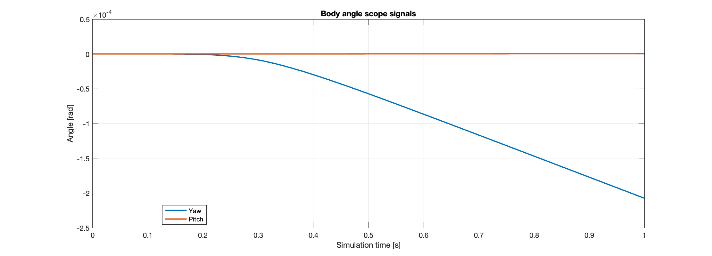
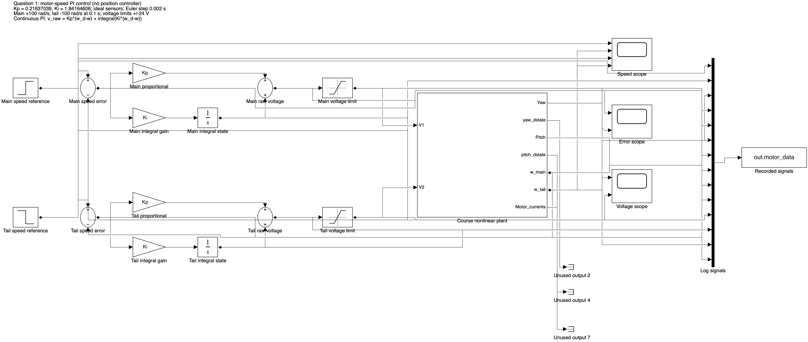

# AERO 2 laboratory development report

This report grows with each feature PR. It records the reasoning, the implemented configuration, and the validation evidence. The work begins with simulator setup, followed by Question 1 motor PI control.

## Simulator setup

### Purpose and changes

We need to see the plant's response to a known voltage before designing a controller. The supplied top-level diagram has incomplete controller wiring and an initialization callback that calls the missing `nlc_setup` script.

`matlab/build_simulator.m` creates `simulink/aero2_simulator.slx`, copying the course's **Twin rotor (simplified model)** subsystem unchanged into a new, connected diagram. Its dynamics, zero initial state, internal amplifier and sensors are preserved. The new model has no missing initialization callback. Its sensor switch `meas_on = 0` is stored in the model workspace, so opening it does not require running the old initialization script or leaving variables in MATLAB's base workspace.

There is no controller in this model. The signal path is:

```text
Voltage pulse → voltage limit → course nonlinear plant → scopes and logging
```

### Voltage inputs

The two Pulse Generator blocks represent voltages, not speed references. Their parameters are saved in the diagram and can be inspected by double-clicking each block.

| Setting | Main voltage input | Tail voltage input |
|---|---:|---:|
| Pulse type | Time based | Time based |
| Amplitude | +1 V | -1 V |
| Period | 10 s | 10 s |
| Pulse width | 2% | 2% |
| Phase delay | 0.1 s | 0.1 s |
| Sample time | 0, continuous | 0, continuous |

Pulse width is specified as a percentage of the period: `10 s × 2/100 = 0.2 s`. Consequently, each voltage turns on at 0.1 s and off at 0.3 s. Simulation stops at 1 s, before a second pulse can occur. Opposite signs make it easy to distinguish the two motor channels.

Each input passes through a visible Saturation block with limits of -24 and +24 V. The voltage scope and log receive the signal after this limit, so they show the voltage passed into the plant. The course subsystem retains its own internal amplifier limit as well. For the default ±1 V test neither limit clips the signal.

### What each scope shows

A Scope is Simulink's time-domain signal viewer: the horizontal axis is simulation time, while the vertical axis is the signal value. These scopes observe signals; they do not control or modify the plant.

| Scope | Traces | What to look for |
|---|---|---|
| Voltage scope | Main and tail voltages, V | Rectangular +1/-1 V pulses between 0.1 and 0.3 s |
| Rotor speed scope | Main and tail speeds, rad/s | Speeds rise in opposite directions during the pulse, then decay toward zero |
| Body angle scope | Yaw and pitch, rad | Mechanical response caused by the voltage experiment; these angles are not regulated |

Legends, grids, unit labels and a 1 s time span are configured for all three scopes. Signal names are written on the diagram and carried into the viewers.

### Solver and recording

The model uses fixed-step forward Euler (`ode1`) with a 0.002 s step. Sensor timing is retained from the course plant. `Recorded signals` saves a time series every 0.002 s in `out.simulator_data`:

| Column | Signal |
|---|---|
| 1–2 | Main and tail voltages after the visible limits |
| 3–4 | Main and tail measured rotor speeds |
| 5–6 | Measured yaw and pitch |
| 7–8 | Measured yaw and pitch rates |

The default `meas_on = 0` disables the supplied sensor noise and makes the quantization numerically negligible. The validation script also runs a separate noise-enabled smoke test. No hardware is connected.

### Reproduce the experiment

With this repository as MATLAB's Current Folder:

```matlab
project = setup_project;
model = build_simulator;              % Recreate the working model
checks = validate_simulator;          % Run the baseline checks
export_simulator_figures;            % Regenerate selected documentation figures
open_system(model);
open_system([model '/Voltage scope']);
open_system([model '/Rotor speed scope']);
open_system([model '/Body angle scope']);
out = sim(model);                     % Run the default ±1 V experiment
```

If the models already exist, `build_simulator` is unnecessary: use `open_system(fullfile(project.simulink, 'aero2_simulator.slx'))`, then press Run. The builder overwrites the working model from its source commands, so commit intentional manual diagram changes or update the builder before rebuilding.

The builder also exports `aero2_simulator_R2021a.slx`. An export alone is not proof of execution in the laboratory's actual R2021a installation.

### Validation method

`validation/validate_simulator.m` checks zero-input equilibrium, each motor channel separately, both channels together, voltage clipping and the sensor toggle. It compares the rotor responses with the independently calculated response of the course equation:

```text
ω_dot = -5.78 ω + 96.532 v
```

For a constant voltage starting from rest, speed approaches `(96.532/5.78) v` exponentially. Once the pulse ends, speed decays exponentially with rate 5.78 s⁻¹. The permitted maximum discrepancy for the ±1 V tests is 0.15 rad/s, accounting for the supplied Euler approximation. Input amplitudes, signs and pulse times are checked separately.

The tests also compare the copied dynamics script and selected plant/sensor parameters directly with the original course subsystem. Raw experiment data and the numerical check table are written to ignored `results/`.

### Diagram and scope traces

The diagram below is exported directly from the working Simulink model. The three trace figures plot the exact logged signals connected to the Scope blocks; they are not screenshots of the native Scope window or parameter dialogs. Native window capture was unreliable during this session. Double-click the blocks in the model to inspect their actual dialogs and Scope controls.


**Voltage scope.** The two channels should remain at zero outside the short test pulse. This verifies what voltage actually reaches each input after the visible limits.


**Rotor speed scope.** Each motor accelerates during the pulse, then slows after voltage returns to zero. The negative tail trace is intentional and matches its negative input. These speeds are responses, not commanded speed references.


**Body angle scope.** The arm can move because motor torque acts on the mechanical system. We observe this response without attempting to hold either angle. In particular, yaw can continue changing after the pulse because the course model has no mechanical damping and there is no yaw feedback controller yet. The small numerical scale matters: this low-voltage experiment causes only a small angle change.



### Recorded outcomes

The R2024b simulator checks pass. The dynamics script, selected amplifier/sensor parameters and initial condition match the copied course subsystem. Source course files are also checked against the baseline commit.

| Check | Measured outcome | Acceptance |
|---|---:|---|
| Scope wiring | 6 input channels verified | Voltage, rotor-speed and angle viewers receive their intended signals |
| Zero-voltage equilibrium | Maximum recorded value 0 | Below 1e-10 |
| Main-only voltage error | 0 V | Correct sign, amplitude and timing |
| Tail-only voltage error | 0 V | Correct sign, amplitude and timing |
| Both-motor voltage error | 0 V | Correct independent channels |
| Maximum motor-model discrepancy in each ±1 V test | 0.0356842 rad/s | Below 0.15 rad/s |
| Deliberate ±30 V request | Limited to ±24 V | Exact amplifier limit |
| Noise-enabled smoke test | 501 finite recorded samples with sensor effects | Sensor switch works |

This establishes a usable baseline for the next feature, the motor PI controller. It does not test a controller settling-time target, physical hardware, or execution in actual MATLAB R2021a.

## Question 1 — Motor-speed PI control

### Physical meaning and objective


The annotated photograph comes from Part II, page 4 of the supplied guide. In this helicopter configuration, the main rotor has a horizontal propeller plane and primarily produces pitch motion; the tail rotor has a vertical propeller plane and primarily produces yaw motion. Both motors also contribute coupling torques. Motor spin speeds `w_main` and `w_tail` are distinct from the body's yaw and pitch angles. The course plant inputs `V1` and `V2` are main and tail motor voltages, respectively.

Question 1 asks for PI control of the blade speed with approximately 0.3 s settling time, verified in the supplied simulation. Our desired inputs are now **speeds**, not voltages. The two PI controllers compute the voltages needed to make measured speeds follow those references. The mechanical body remains free to move; position regulation belongs to later questions.

### Derivation and gain selection

Each motor obeys the identical supplied equation

$$\dot\omega=-5.78\omega+96.532v.$$

For zero initial conditions, its voltage-to-speed transfer function is

$$P(s)=\frac{\Omega(s)}{V(s)}=\frac{96.532}{s+5.78}.$$

With error $e=\omega_d-\omega$, choose

$$v_{\mathrm{raw}}=K_pe+I,\qquad\dot I=K_ie.$$

Thus $C(s)=K_p+K_i/s$, and the unsaturated closed-loop transfer function is

$$\frac{\Omega(s)}{\Omega_d(s)}=
\frac{96.532K_ps+96.532K_i}
{s^2+(5.78+96.532K_p)s+96.532K_i}.$$

Match its denominator to critically damped poles $(s+\lambda)^2$. Using the familiar initial 2% estimate $T_s\approx4/\lambda$, set $\lambda=4/0.3=13.3333\ \mathrm{s^{-1}}$. Matching coefficients gives

$$K_p=\frac{2\lambda-5.78}{96.532}=0.2163703919,$$

$$K_i=\frac{\lambda^2}{96.532}=1.8416460633.$$

The authoritative gains are calculated from these equations in `matlab/parameters/motor_pi_parameters.m`; rounded values here are for reading. Both motors use the same gains because their supplied motor dynamics are identical. The units of $K_p$ and $K_i$ are V/(rad/s) and V/rad, respectively.

Critical damping describes the poles. The PI numerator has a zero, so the reference response can still overshoot and its exact settling time differs from $4/\lambda$. For a step of amplitude $A$ at time zero, the independent continuous-time solution is

$$\omega(t)=A\left[1-e^{-\lambda t}\left(1+(5.78-\lambda)t\right)\right].$$

This expression is used as a check against the simulation, rather than asserting that critically damped poles guarantee zero overshoot. With integral action, constant reachable references have zero steady-state error in this ideal motor model.

### Implemented Simulink solution

`matlab/build_motor_pi.m` generates `simulink/aero2_motor_pi.slx` and an R2021a export. The separate open-loop baseline remains available. The new model copies the original course nonlinear plant, internal amplifier, sensor model and zero initial state. Ideal measurements are selected with `meas_on=0` in the model workspace. Gains `Kp` and `Ki` are also stored there, so the saved model runs independently of base-workspace variables.

Each motor loop is assembled from visible Sum, Gain, Integrator and Saturation blocks:

```text
Desired speed → error → [Kp in parallel with Ki/s] → raw voltage
                  ↑                                  ↓
             measured speed ← course plant ← ±24 V limit
```

The proportional path acts on error. This is PI control; the IP rearrangement and anti-windup are Question 2 and have not been introduced here. The integral state is initialized to zero and logged in volts because it is the integral contribution to the controller output.

| Configuration | Value |
|---|---|
| Main speed Step block | 0 → +100 rad/s at 0.1 s |
| Tail speed Step block | 0 → -100 rad/s at 0.1 s |
| Step sample time | 0, continuous |
| Controller | Continuous PI integrated by the Simulink solver |
| Voltage limits | -24 to +24 V, outside and inside the copied plant |
| Solver | Fixed-step forward Euler, 0.002 s |
| Stop time | 1 s |
| Initial motor speeds and integral contributions | Zero |

The voltage is now the **controller output**, rather than a configured voltage pulse. To edit the default experiment, double-click `Main speed reference` or `Tail speed reference` and change the Step block's final speed. To inspect gains, open the model workspace or the parameter function and rebuild. There is no angle command at this stage.

| Scope | Signals |
|---|---|
| Speed scope | Main desired/measured speed, then tail desired/measured speed; four traces in rad/s |
| Error scope | Main and tail speed errors in rad/s |
| Voltage scope | Main and tail applied voltages after the visible limits, in V |

`out.motor_data` logs 14 columns: main/tail references (1–2), measured speeds (3–4), errors (5–6), raw voltages (7–8), applied voltages (9–10), integral contributions (11–12), then yaw/pitch angles (13–14). Logging uses the solver rate, so the refinement experiment also records its smaller step. All logged signals must remain finite.



### Validation and reproduction

From the repository Current Folder:

```matlab
project = setup_project;
model = build_motor_pi;
metrics = validate_motor_pi;
export_motor_pi_figures;
open_system(model);
open_system([model '/Speed scope']);
open_system([model '/Error scope']);
open_system([model '/Voltage scope']);
out = sim(model);
```

For a saved model, rebuilding is optional: `open_system(fullfile(project.simulink,'aero2_motor_pi.slx'))`, open the scopes and press Run. Builders overwrite their generated models; implement lasting diagram changes in the builder.

`validation/validate_motor_pi.m` tests +100 and -100 rad/s on each motor independently, simultaneous opposite-sign steps, and a zero-reference equilibrium. Independent-channel tests detect swapped feedback or accidental coupling of speed commands. Signed tests detect incorrect feedback signs. Every commanded channel is compared with the analytical solution above, which detects an incorrect motor model or controller realization.

Settling time is measured **relative to the 0.1 s step**, at the first recorded sample after the last departure from a ±2 rad/s band, remaining inside until the 1 s simulation end. Acceptance is 0.24–0.36 s under our agreed ±20% interpretation of approximately 0.3 s. Final error must be below 1 rad/s. Nominal tests must have no saturation; raw and applied voltages are compared sample by sample. A half-step run at 0.001 s must preserve the timing result within 0.01 s. Raw runs, integral states, the refinement run and the metrics CSV are saved under ignored `results/`.


These are plots of the signals connected to the Scope blocks and an actual model diagram export, rather than native Scope-window screenshots. The positive and negative single-motor tests are overlaid; the simultaneous test is checked numerically and retained in the raw data.

### Measured results and conclusion

The ±100 rad/s single-axis tests and both simultaneous opposite-sign tests give the same motor metrics because the supplied motor equations are identical and independent of the mechanical body motion.

| Metric | Main motor, either sign | Tail motor, either sign |
|---|---:|---:|
| 2% settling time, measured from step | 0.318 s | 0.318 s |
| Overshoot | 3.7021% | 3.7021% |
| Absolute final error at 1 s | 0.003124 rad/s | 0.003124 rad/s |
| Peak absolute applied voltage | 21.6370 V | 21.6370 V |
| Time in voltage saturation | 0 s | 0 s |
| Maximum discrepancy from continuous analytical solution | 0.81949 rad/s | 0.81949 rad/s |

The discrepancy from the continuous formula includes the supplied Euler discretization; the independent solution has no numerical integration error. The 0.318 s result is 6% longer than the nominal 0.3 s target and lies inside our agreed 0.24–0.36 s acceptance band. The small overshoot is consistent with the PI zero despite repeated real poles. The initial proportional action demands about 21.64 V for a 100 rad/s error; the final holding voltage is about 5.99 V, matching $5.78(100)/96.532$.

Question 1 passes the stated simulation criteria. These gains have only been assessed for these reachable nominal speed commands with ideal measurements. Larger commands may saturate and wind up the integral term; Question 2 introduces IP control and anti-windup. Body-angle regulation, sensor-noise performance and physical experiments remain later stages.

With the integration step reduced to 0.001 s, both motors settle in **0.319 s**, a 0.001 s change from the nominal simulation. The exact continuous-time expression predicts approximately 0.31924 s. This supports the timing conclusion and explains the small numerical difference. All original open-loop simulator checks also pass, the copied PI-model dynamics and sensor settings match the course plant, and the five course files remain byte-identical to `course-baseline`.

MATLAB R2024b Code Analyzer reports no issues in the four new MATLAB functions. The R2021a-exported model was loaded and simulated in R2024b after clearing the workspace; its logged signals are finite. Actual R2021a execution and hardware validation have not been performed.
