# Control III laboratory report — Parts I and II

The concise submission-style report is now maintained in [LaTeX](../report/main.tex), with [build and evidence instructions](../report/README.md). Its current draft covers Part I, Questions 1–3; the detailed implementation record below remains available. Test counts and software compatibility checks are kept here rather than in the academic report.

## Part I — Question 1(a): nonlinear inverted pendulum

Reference: the laboratory guide, page 2, Question 1(a). The angle is measured from the **upright** vertical. The cart dynamics are excluded by the exercise's assumption.

Choose the states $x_1=\theta$ (rad) and $x_2=\dot\theta$ (rad/s). Differentiating these definitions gives $\dot x_1=x_2$ and $\dot x_2=\ddot\theta$. Substitution into the supplied equation gives the nonlinear state-space model:

```math
\dot x=\underbrace{\begin{bmatrix}x_2\\(g/l)\sin x_1-\bigl(k/(ml^2)\bigr)x_2\end{bmatrix}}_{f(x)}
+\underbrace{\begin{bmatrix}0\\\cos x_1/(ml^2)\end{bmatrix}}_{b(x)}u,
\qquad y=x_1=\begin{bmatrix}1&0\end{bmatrix}x.
```

The output is the pendulum angle, anticipating the output specified in 1(b). With $ml^2=0.05$, $g/l=19.62$, $k/(ml^2)=1$ and $1/(ml^2)=20$:

```math
\boxed{\dot x_1=x_2,\qquad\dot x_2=19.62\sin x_1-x_2+20\cos x_1\,u,\qquad y=x_1.}
```

This is the original nonlinear model: no small-angle approximation is used. Gravity has a positive sign because a small positive tilt from upright produces positive angular acceleration; friction opposes angular velocity. The guide describes $u$ as torque/force control ambiguously. The implementation follows the supplied equation exactly; dimensionally, $u$ must have torque units (N m) in this equation. A force in newtons would require an additional length factor.

### Simulink construction and settings

Open [part1_pendulum.slx](../simulink/part1_pendulum.slx), or [the R2021a export](../simulink/part1_pendulum_R2021a.slx) on the laboratory machines. The model is independent of the Part II AERO 2 plant.

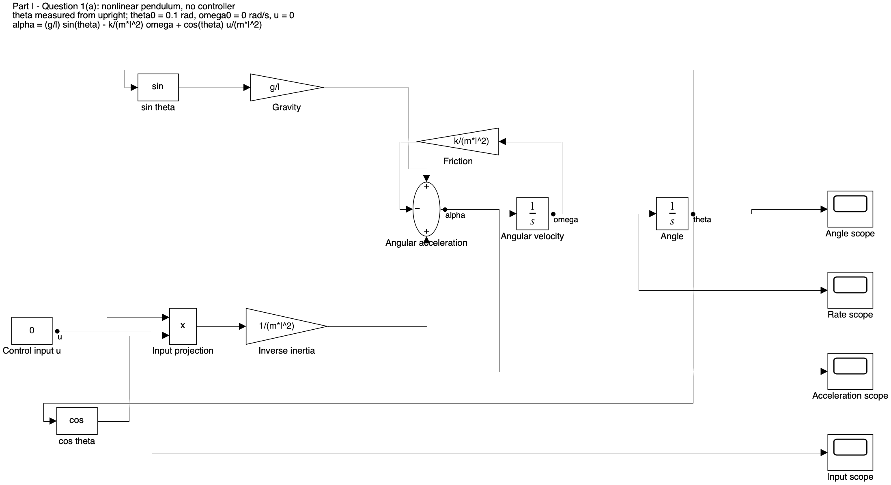

This image is a **diagram export**, not an actual UI screenshot. The Sum block calculates angular acceleration with signs `+-+`. Two Integrators implement $\ddot\theta\to\dot\theta\to\theta$. The three branches compute gravity $(g/l)\sin\theta$, friction $k\dot\theta/(ml^2)$ and the projected input $u\cos\theta/(ml^2)$. Keep the sine and cosine blocks in radians.

| Setting | Value |
|---|---|
| Control input u, Constant block | 0 |
| Angle Integrator initial condition | `theta0 = 0.1` rad (about 5.73 degrees) |
| Angular velocity Integrator initial condition | `omega0 = 0` rad/s |
| Simulation duration | 2 s |
| Solver | Variable-step `ode45` |
| Relative / absolute tolerance | $10^{-8}$ / $10^{-10}$ |
| Maximum step | 0.005 s |

Physical parameters and initial conditions are stored in the model workspace, so the saved model runs without executing an initializer. Change initial conditions in Model Explorer's Model Workspace, or edit the Integrators directly. Double-click **Angle scope**, **Rate scope**, **Acceleration scope** and **Input scope** to inspect the corresponding signals. There is no controller in 1(a).

At the initial condition, the expected acceleration is $19.62\sin(0.1)=1.95873$ rad/s². The small tilt therefore grows. Starting exactly at $\theta=\dot\theta=0$ with $u=0$ instead gives a perfectly stationary simulation; this equilibrium does not demonstrate stability.

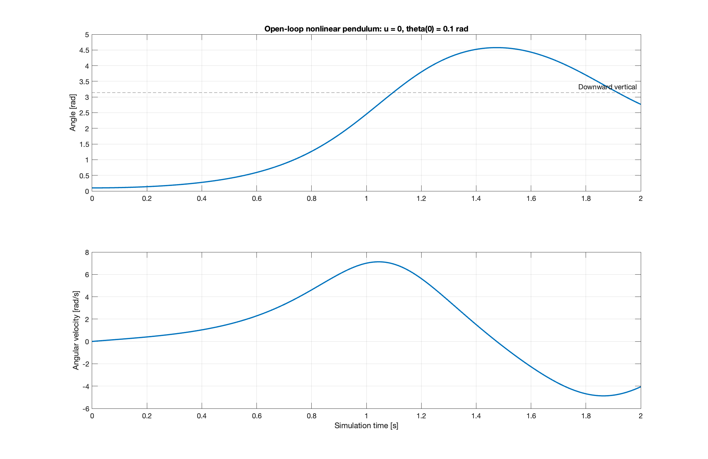

These are **plots of logged simulation signals**, not Scope UI screenshots. The angle passes the downward vertical ($\theta=\pi$); this is a free falling and oscillating pendulum, not a stabilized upright pendulum. At 2 s, the default trajectory has $\theta=2.7669$ rad and $\dot\theta=-4.0592$ rad/s.

Validation in MATLAB/Simulink R2024b passed five cases: exact upright equilibrium; initial angles $\pm0.1$ rad with zero input; and inputs $\pm0.02$ from zero state. The largest absolute discrepancy across angle and rate samples against independent ODE integration was $2.016\times10^{-10}$ (rad or rad/s, respectively), below the $2\times10^{-6}$ acceptance threshold. The acceleration residual was at most $1.78\times10^{-15}$ rad/s². Unforced energy was nonincreasing within tolerance, sign-reversed trajectories matched within tolerance, and the R2021a export matched the working model's default dynamics. **The export was executed in R2024b; execution in R2021a remains unverified.**

Reproduce the model, checks and figures from the repository as MATLAB's Current Folder:

```matlab
setup_project;
build_pendulum;
metrics = validate_pendulum;
export_pendulum_figures;
open_system('part1_pendulum');
open_system('part1_pendulum/Angle scope');
```

The validation instruments the model only in memory and closes it without saving the diagnostic logging. It checks zero-input upright equilibrium, both signs of an initial tilt, and both signs of a constant input from rest against independent `ode45` integration. Unforced energy $E=\frac12ml^2\dot\theta^2+mgl\cos\theta$ must be nonincreasing, since $\dot E=-k\dot\theta^2$ when $u=0$. It also compares the exported model's default trajectory. Generated raw results are kept in ignored `results/`. No hardware results are claimed.

## Part I — Question 1(b): input-output feedback linearization

For $y=\theta$, the first derivative is $\dot y=\dot\theta$ and does not contain the input. Differentiate again:

```math
\ddot y=\underbrace{(g/l)\sin\theta-k\dot\theta/(ml^2)}_{a(x)}
+\underbrace{\cos\theta/(ml^2)}_{b(x)}u.
```

The relative degree is two wherever $\cos\theta\ne0$. Solving $a(x)+b(x)u=v$ gives

```math
u=\frac{ml^2v-mgl\sin\theta+k\dot\theta}{\cos\theta}
=\frac{0.05v-0.981\sin\theta+0.05\dot\theta}{\cos\theta}.
```

Substitution cancels the gravity and friction terms exactly, leaving $\ddot\theta=v$. The new input $v$ is angular acceleration, not a desired angle. The state coordinates remain $z_1=\theta$, $z_2=\dot\theta$, with $\dot z_1=z_2$ and $\dot z_2=v$. Since the relative degree equals the two-state dimension, no internal dynamics remain.

The controller is defined where $\theta\ne\pi/2+j\pi$, $j\in\mathbb Z$. The connected interval containing upright is $-\pi/2<\theta<\pi/2$. It is valid only while the trajectory stays away from its boundary; near horizontal, the required input can grow without bound. The model does not clip the denominator or saturate the input, because either operation would change the exact cancellation. This is an ideal simulation with exact parameters and state feedback. It does not establish hardware feasibility or robust stabilization.

### Simulink implementation

Open [part1_pendulum_linearization.slx](../simulink/part1_pendulum_linearization.slx), or its [R2021a export](../simulink/part1_pendulum_linearization_R2021a.slx). Question 1(a)'s saved model remains available separately.

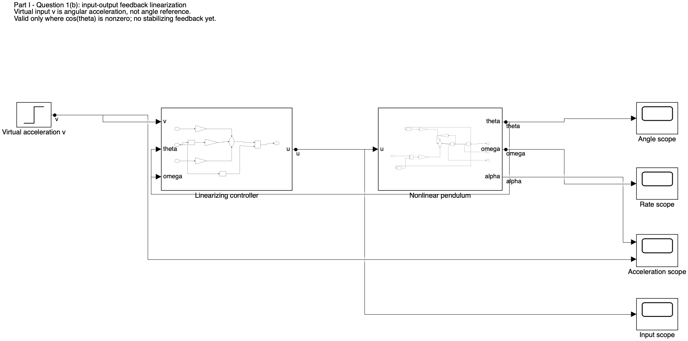

The **Nonlinear pendulum** subsystem copies the nine plant blocks and their equations from Question 1(a). Its input is $u$, and its outputs are angle, angular velocity and angular acceleration. The angle and rate are fed back to **Linearizing controller**. No numerical Derivative block is needed: angular velocity is already an integrator state.

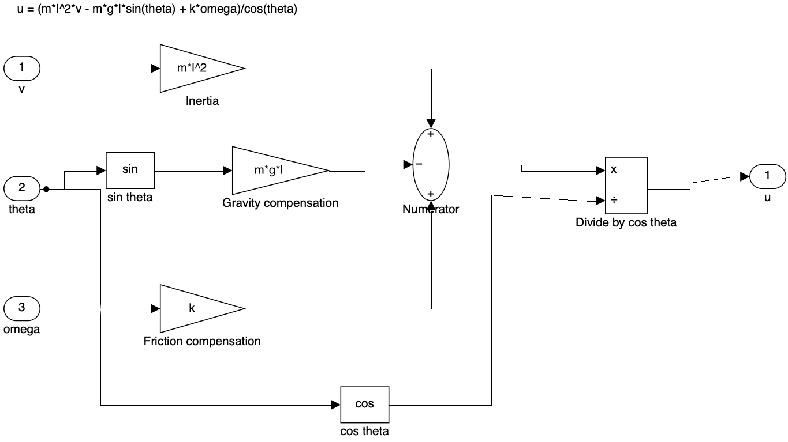

Inside the controller, three Gain blocks and a `+-+` Sum form $ml^2v-mgl\sin\theta+k\dot\theta$. A Product block configured as `*/` divides this numerator by $\cos\theta$. Sine and cosine use radians. These figures are **Simulink diagram exports**, not UI screenshots.

The saved model starts at $\theta(0)=0.1$ rad and $\dot\theta(0)=0$. The **Virtual acceleration v** Step changes from 0 to 0.2 rad/s² at 0.2 s; simulation ends at 2 s. It uses the same `ode45` tolerances and maximum step as Question 1(a). Model parameters and initial conditions live in the model workspace.

Press Run and open **Acceleration scope**: actual acceleration and virtual input should overlap. **Angle scope**, **Rate scope** and **Input scope** show the angle, angular velocity and physical plant input. Before the step, cancellation holds the initial angle. After the step, the expected response is

```math
\theta(t)=0.1+\tfrac12(0.2)\max(t-0.2,0)^2,
\qquad \dot\theta(t)=0.2\max(t-0.2,0).
```

Thus the expected final angle is 0.424 rad and final rate is 0.36 rad/s. This deliberately demonstrates acceleration control without the stabilizing law from Question 1(c). Even with $v=0$, a nonzero initial velocity produces drift.

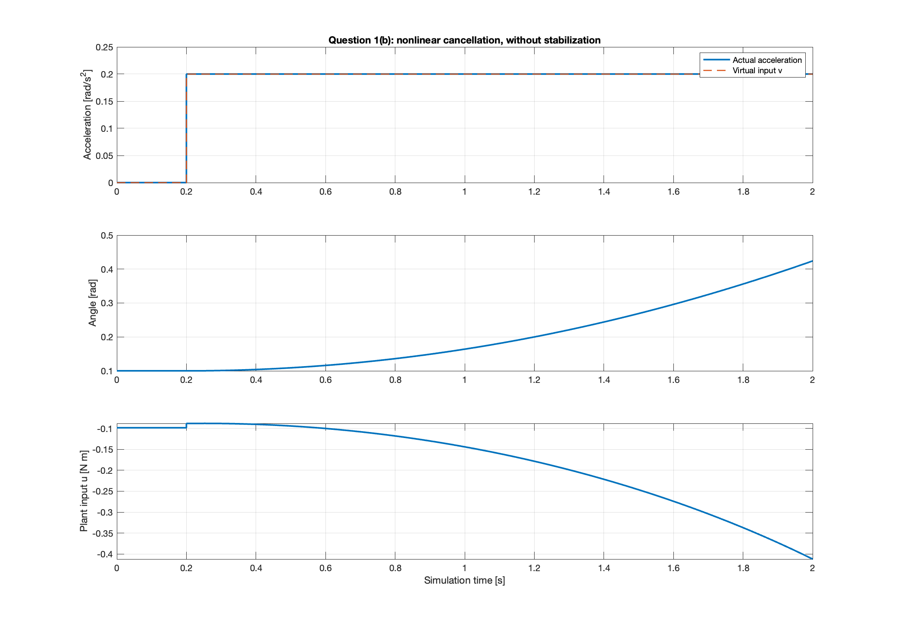

The response figure contains **plots of logged simulation signals**, not Scope UI screenshots. Validation temporarily enables logging in memory, then discards those instrumentation changes. It tests both signs of virtual acceleration, drift with nonzero initial rate, and zero-acceleration holds at $\theta=\pm1.3$ rad. Each trajectory is compared with the analytical double-integrator solution; actual acceleration must match $v$ within $10^{-10}$ rad/s² and angle/rate errors must stay below $2\times10^{-7}$ in their respective units. Raw recordings are stored in ignored `results/`.

All five cases passed in MATLAB/Simulink R2024b. Maximum angle error was $7.75\times10^{-15}$ rad, maximum rate error was $4.45\times10^{-15}$ rad/s, and maximum acceleration discrepancy was $1.61\times10^{-15}$ rad/s² (rounded up). The default trajectory ended at 0.424 rad and 0.36 rad/s. The $\pm1.3$ rad holds required input magnitude 3.5337 N m, illustrating increasing control demand away from upright. No actuator limit is specified for this theoretical exercise. The R2021a export reproduced the default trajectory when run in R2024b; actual execution in R2021a remains unverified. No hardware experiments were performed.

```matlab
setup_project;
build_pendulum_linearization;
validate_pendulum_linearization;
export_pendulum_linearization_figures;
open_system('part1_pendulum_linearization');
open_system('part1_pendulum_linearization/Acceleration scope');
```

## Part I — Question 1(c): stabilize upright in approximately one second

After the cancellation from 1(b), the system is $\ddot\theta=v$. Choose a linear state-feedback law

```math
v=-k_p\theta-k_d\dot\theta.
```

The resulting equation is $\ddot\theta+k_d\dot\theta+k_p\theta=0$, whose characteristic polynomial is $s^2+k_ds+k_p$. Compare it with $s^2+2\zeta\omega_ns+\omega_n^2$. Choose critical damping ($\zeta=1$) and $\omega_n=6$ rad/s:

```math
(s+6)^2=s^2+12s+36,
\qquad \boxed{k_p=36,\quad k_d=12,\quad v=-36\theta-12\dot\theta.}
```

Both poles are at $-6$, so the linearized origin $(\theta,\dot\theta)=(0,0)$ is asymptotically stable. For the specified initial angle $\theta_0=0.1$ rad and zero initial rate, the exact response is

```math
\theta(t)=0.1(1+6t)e^{-6t},
\qquad\dot\theta(t)=-3.6te^{-6t}.
```

Use a **2% settling band relative to the initial angular error**, namely $|\theta|\le0.002$ rad for this run. Since the zero-rate response is monotonic, settling is found from $(1+6T_s)e^{-6T_s}=0.02$, yielding $T_s=0.97232$ s, approximately one second. The common approximation $T_s\approx4/(\zeta\omega_n)$ should not be used as the exact critically damped result: it omits the polynomial factor $(1+6t)$.

The complete physical input, including the nonlinear cancellation, is

```math
u=\frac{-1.8\theta-0.55\dot\theta-0.981\sin\theta}{\cos\theta}.
```

Only $v$ is linear state feedback; $u$ remains nonlinear. The validity restrictions from 1(b) still apply. Stability of the double integrator establishes regulation of the exact nonlinear plant only while the state stays in a nonsingular operating region and the required input can be applied. For zero initial rate, the signed angle decays monotonically, so every initial angle strictly between $-\pi/2$ and $\pi/2$ stays in that interval under the ideal model. Arbitrary large initial rates do not have this guarantee. No actuator limit or hardware performance is inferred.

### Simulink model and verification

Open [part1_pendulum_regulation.slx](../simulink/part1_pendulum_regulation.slx), or its [R2021a export](../simulink/part1_pendulum_regulation_R2021a.slx). The Question 1(a) and 1(b) models remain available separately. The nonlinear plant and cancellation subsystems are reused from 1(b). The virtual-acceleration Step is replaced with **Linear state feedback**; its two inputs are the plant angle and rate.

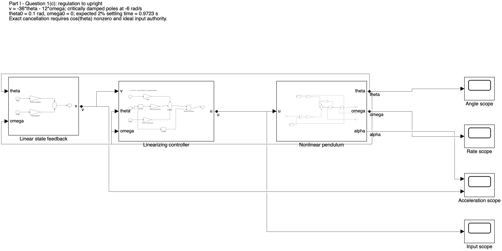

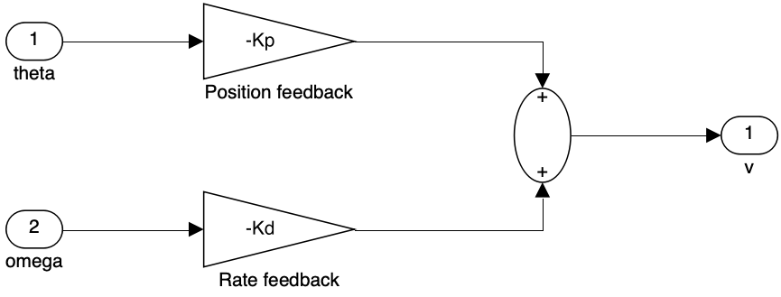

Inside **Linear state feedback**, two Gain blocks (`-Kp`, `-Kd`) and an addition implement $v=-36\theta-12\dot\theta$. Parameters `Kp=36`, `Kd=12`, `theta0=0.1`, and `omega0=0` live in the model workspace. The angle target is zero, so there is no external reference generator. Run for 2 s and open **Angle scope** to observe regulation, **Rate scope** for angular velocity, **Acceleration scope** to compare $v$ with actual acceleration, and **Input scope** for $u$. Solver settings are inherited from 1(b).

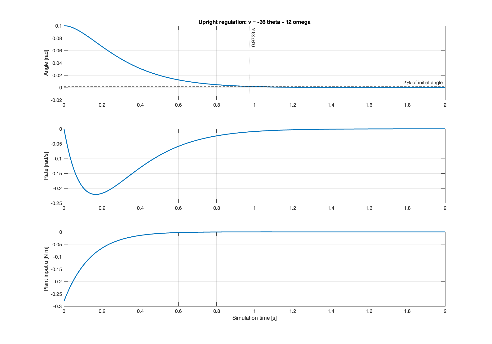

The block figures are **diagram exports**; the response is a **plot of logged simulation signals**, not a Scope UI screenshot. Validation temporarily logs the simple model in memory, without saving diagnostic blocks. It compares seven cases with the analytical solution $\theta(t)=[\theta_0+(\dot\theta_0+6\theta_0)t]e^{-6t}$: signed nominal tilts, larger zero-rate tilts, nonzero initial rate and the exact origin. It checks cancellation, feedback gains, nominal settling, absence of zero-rate overshoot, singularity margin and exported dynamics. A nonzero initial rate can change settling time; the one-second specification is evaluated for the agreed zero-rate initial state.

All seven cases passed in MATLAB/Simulink R2024b. For $[\theta_0,\dot\theta_0]=[0.1,0]$, the first recorded sample after permanent entry into the 2% band was at 0.97618 s, consistent with the exact 0.97232 s crossing and the 0.005 s maximum sampling gap. No overshoot was observed, and peak input magnitude was 0.27933 N m. Across all cases, maximum angle and rate discrepancies against the analytical solution were $1.37\times10^{-11}$ rad and $1.02\times10^{-10}$ rad/s, respectively (rounded up). Maximum cancellation residual was $1.43\times10^{-14}$ rad/s². The zero-rate $\pm1.3$ rad tests required 12.2814 N m peak magnitude, reinforcing that simulated mathematical validity does not establish actuator feasibility. The origin remained stationary. The R2021a export matched the default trajectory when executed in R2024b; execution in R2021a remains unverified. These are simulation results only.

```matlab
setup_project;
build_pendulum_regulation;
validate_pendulum_regulation;
export_pendulum_regulation_figures;
open_system('part1_pendulum_regulation');
open_system('part1_pendulum_regulation/Angle scope');
```

## Part II — AERO 2

This report follows [Part II of the laboratory guide, pages 4–6](../course/Automatic_Control_III_Computer_Room_II.pdf). Questions 1–5 and the optional position-integral controller are implemented and simulated. Question 4 tests ideal motor tracking; Question 5 connects the IP motor loops to the supplied nonlinear plant. A separate hardware-interface port is now available; its offline checks and outstanding hardware validation are documented below.

## The physical system and signals

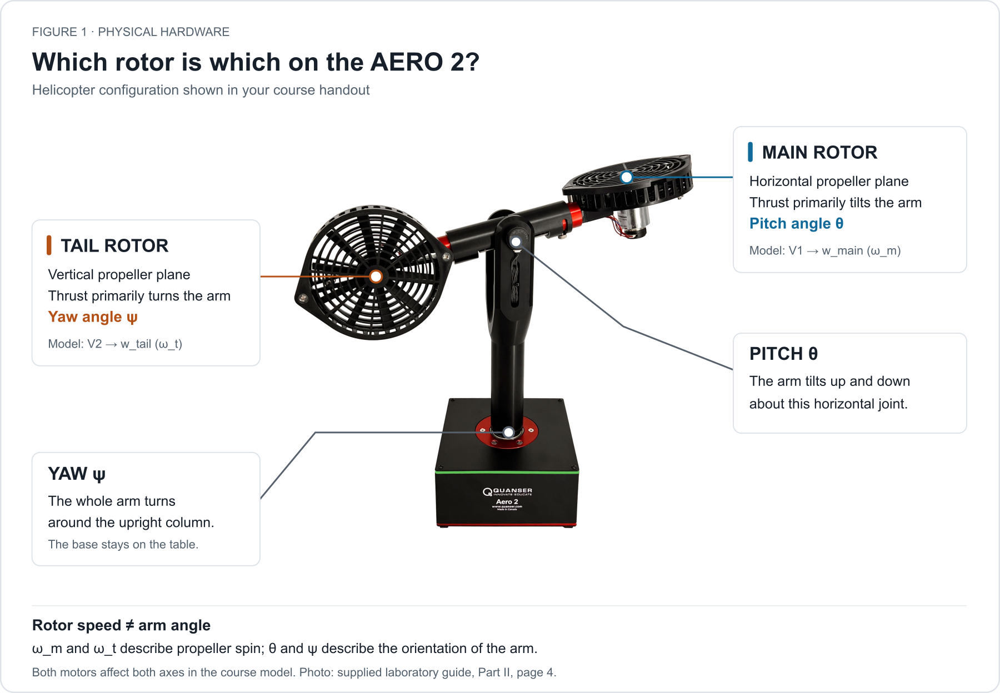

The main rotor primarily produces pitch motion; the tail rotor primarily produces yaw motion. Both also affect the other axis through coupling.

| Symbol | Meaning | Order when written as a vector |
|---|---|---|
| $q$ | AERO 2 orientation, rad | Yaw $\psi$, pitch $\theta$ |
| $\dot q$ | Angular velocity, rad/s | Yaw rate, pitch rate |
| $\omega$ | Propeller speed, rad/s | Main rotor, tail rotor |
| $v$ | Applied motor voltage, V | Main motor, tail motor |

The plant inputs `V1` and `V2` are the main and tail motor voltages. Propeller speed and body angular velocity are different quantities. Questions 1–2 control propeller speeds. Later questions use those speeds to control yaw and pitch.

## Which model should I open?

Start with the **simple answer models** in `simulink/`. They contain the essential control connections, a basic reference and basic scopes.

| Activity | File to open in Simulink | Available views |
|---|---|---|
| Preparation | [aero2_simulator.slx](../simulink/aero2_simulator.slx) | Voltage, rotor speed/acceleration, body angle/rate/acceleration |
| 1 — PI motor-speed control | [aero2_motor_pi.slx](../simulink/aero2_motor_pi.slx) | Speed, speed error, motor acceleration, voltage |
| 2 — IP with anti-windup | [aero2_motor_ip.slx](../simulink/aero2_motor_ip.slx) | Speed, error, motor acceleration, applied/raw voltage, motor integral |
| 3 — Feedback linearization | [aero2_mechanical_linearization.slx](../simulink/aero2_mechanical_linearization.slx) | Body angle, rate, commanded/actual acceleration |
| 4 — Ideal position control | [aero2_position_control.slx](../simulink/aero2_position_control.slx) | Body angle, rate, commanded/actual acceleration, position error, rotor commands |
| 5 — Complete cascade | [aero2_cascade_control.slx](../simulink/aero2_cascade_control.slx) | Body motion, position error, rotor speed/acceleration, voltage and motor integral |
| Optional — Position integral action | [aero2_position_integral.slx](../simulink/aero2_position_integral.slx) | Body motion, rotor speed/acceleration, voltage, motor and position integrals |

Open the file in the table, press **Run**, then double-click a Scope. Use the files directly under `simulink/` for the activity answers. Files under `simulink/experiments/` are the separate diagnostic tests. On laboratory MATLAB R2021a, open the matching `_R2021a.slx` export (for example, `aero2_motor_pi_R2021a.slx`).

Separate copies in `simulink/experiments/` contain recovery-step generators, comparison switches and detailed logging. Those blocks support validation; they are not extra parts of the required controller. Experiment filenames add `_experiment` before `.slx`.

For example, with the repository as MATLAB's Current Folder:

```matlab
project = setup_project;
open_system(fullfile(project.simulink,'aero2_motor_ip.slx'));
open_system('aero2_motor_ip/Speed scope');
open_system('aero2_motor_ip/Voltage scope');
```

Press **Run**. A Scope displays its connected signals against simulation time. Double-click reference blocks to inspect their settings.

### Where to find the Scopes

- **Questions 1–2:** `Speed scope` compares desired/measured main and tail speeds; `Error scope` shows speed error; `Motor acceleration scope` shows actual rotor acceleration; `Voltage scope` shows applied voltage. Question 2 also has `Raw voltage scope` and `Integral scope`.
- **Questions 3–4:** `Angle scope` shows yaw/pitch position, `Rate scope` shows body angular velocity, and `Acceleration scope` compares commanded and actual body acceleration. Question 4 adds `Error scope` and `Rotor command scope`.
- **Question 5 and optional:** open `Angle scope`, `Rate scope`, `Acceleration scope`, `Rotor speed scope`, `Motor acceleration scope` and `Voltage scope`. Open **IP motor control** for its `Raw voltage scope` and `Integral scope`. Question 5 has a top-level `Error scope`; the optional model has `Error scope` and `Integral scope` inside **Position integral control**.
- **Preparation:** `Body angle scope`, `Rate scope`, `Acceleration scope`, `Rotor speed scope`, `Motor acceleration scope` and `Voltage scope` show the open-loop motion.

Body and rotor accelerations have the same units (rad/s²) but describe different physical motion. Actual acceleration is observed directly from the plant's existing derivative signals; no numerical differentiation is introduced. The extra plant outputs are passive monitors: the mechanical/motor equations, sensor settings, controller gains and references are preserved. In the full cascade, actual body acceleration can differ from the commanded acceleration because motor tracking takes time.

The Scope audit checks all seven activity models and their exports in R2024b. Required inputs are connected, acceleration discrepancies stay below $10^{-10}$ rad/s², and the Question 1–5 and optional simple/experiment pairs match exactly.

The simulation comparisons and recovery generators remain in the experiment copies. Questions 4–5 and the optional controller default to the course trajectory. Validation explicitly selects the step, disturbance and recovery inputs used for the performance tables below. A separate [hardware-interface port](hardware.md) now connects Question 5 to the professor's QUARC interface. Its offline results include measurement-filter delay; actual hardware validation still requires professor review and laboratory checks.

### Default course reference for position control

**Pressing Run in Question 4, Question 5 or the optional model now runs the supplied 60 s angle trajectory.** Their saved experiment copies use the same default trajectory. Questions 1–2 retain motor-speed inputs, and Question 3 retains its virtual-acceleration input.

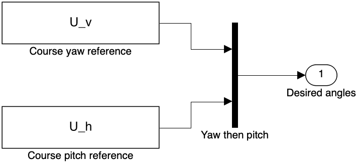

Double-click **Desired orientation** in a simple position model. Its two **From Workspace** blocks read `U_v` for yaw and `U_h` for pitch, in that order. The time series are stored in the model workspace, so the saved model runs without an initialization callback. [aero2_course_reference.m](../matlab/parameters/aero2_course_reference.m) reproduces the course script exactly: `Ts=0.002` s, `tmax=60` s, `Tr=2.5` s, all original transitions and the slow sine, including `2*yaw_ref` and `2*pitch_ref`. Linear interpolation matches the supplied model's From Workspace behavior. Simulation and Scope duration are both 60 s.

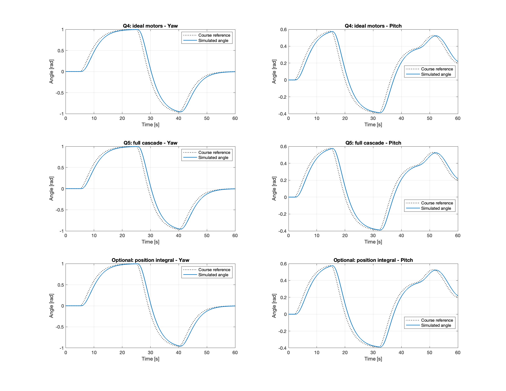

| Model, ideal measurements | Yaw tracking-error RMS | Pitch tracking-error RMS |
|---|---:|---:|
| Question 4: ideal motors | 0.09964 rad | 0.05981 rad |
| Question 5: full motor cascade | 0.09941 rad | 0.05975 rad |
| Optional position integral | 0.09956 rad | 0.05977 rad |

These are RMS errors over the full 60 s trajectory. The small differences do not establish that one controller is better in general. All three show tracking lag with the existing position/rate feedback. The course's smoothing time `Tr` is a property of the desired trajectory; it is not the controller's settling time.

The numerical step specifications are still tested separately. Validation overrides only the experiment reference and run duration for those cases; it does not change the saved course-reference defaults or add selectors to the simple diagrams.

```matlab
project = setup_project;
open_system(fullfile(project.simulink,'aero2_cascade_control.slx'));
open_system('aero2_cascade_control/Angle scope');
% Press Run: the course trajectory starts automatically and runs for 60 s.
validate_course_reference;
export_course_reference_figures;
```

The reference check executes the original course initializer in an isolated function workspace and compares every generated sample, then verifies the delivered references and default trajectories. Original course files are not modified.

## Preparation — Check the supplied simulator

**File to open in Simulink:** [aero2_simulator.slx](../simulink/aero2_simulator.slx).

Before designing feedback, we checked that known voltages produce the expected motor response:

```math
\dot\omega=-5.78\omega+96.532v.
```

The separate [open-loop preparation model](../simulink/aero2_simulator.slx) copies the supplied plant and applies +1 V to the main motor and -1 V to the tail motor from 0.1 to 0.3 s. Its Pulse Generator settings are period 10 s, width 2%, delay 0.1 s and continuous sample time 0. Voltage is limited to ±24 V; simulation ends at 1 s.

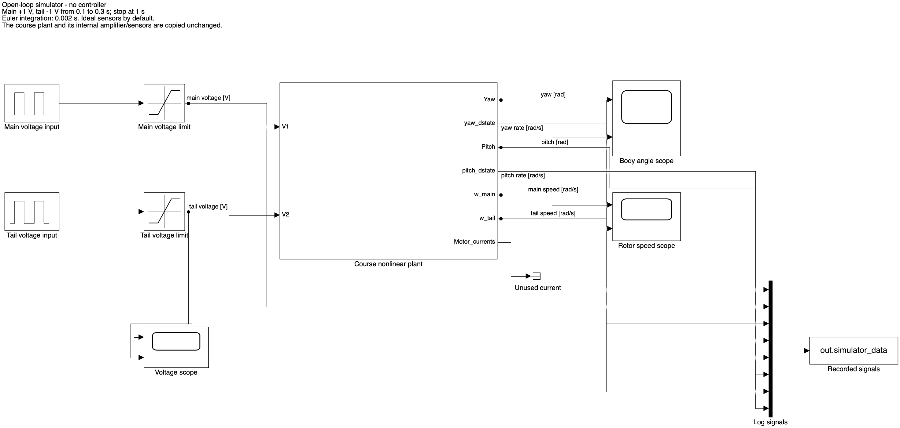

Its Voltage, Rotor speed and Body angle scopes show the applied inputs, motor response and resulting yaw/pitch motion. No position feedback is present.

**Result:** zero voltage and zero initial state remain at rest. The maximum speed discrepancy from the analytical motor response is 0.0357 rad/s, below the 0.15 rad/s acceptance threshold. Voltage clipping and the sensor switch also pass their checks. See [validate_simulator.m](../validation/validate_simulator.m).

## Question 1 — PI motor-speed control

**File to open in Simulink:** [aero2_motor_pi.slx](../simulink/aero2_motor_pi.slx).

### What the guide asks

Design a PI controller for the propeller speeds with approximately **0.3 s settling time**, and verify it in simulation.

### How we chose the gains

The supplied motor equation gives the transfer function

```math
P(s)=\frac{96.532}{s+5.78}.
```

Define the speed error $e=\omega_d-\omega$. The PI controller is

```math
v_{\mathrm{raw}}=K_pe+I,\qquad \dot I=K_ie.
```

The closed-loop denominator is

```math
s^2+(5.78+96.532K_p)s+96.532K_i.
```

We match it to $(s+\lambda)^2$, giving two repeated real poles. Using $T_s\approx4/\lambda$ as a starting estimate:

```math
\lambda=\frac4{0.3}=13.3333.
```

```math
K_p=\frac{2\lambda-5.78}{96.532}=0.2163704.
```

```math
K_i=\frac{\lambda^2}{96.532}=1.8416461.
```

Both motors use these gains because their supplied motor equations are identical. The calculation is in [motor_pi_parameters.m](../matlab/parameters/motor_pi_parameters.m).

The PI transfer function also has a numerator zero. Therefore, repeated real poles alone do not guarantee zero overshoot or an exact 0.3 s settling time; we measure the response in simulation.

### Simple implementation

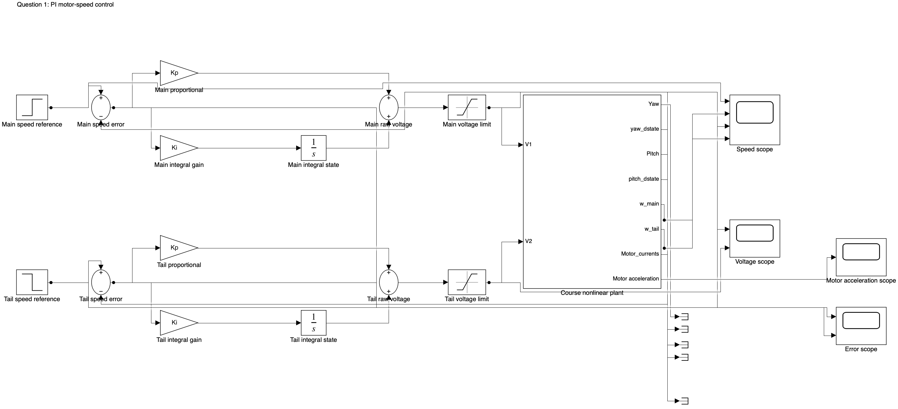

Each loop calculates speed error, adds proportional and integral action, limits voltage to ±24 V and feeds back measured speed.

| Setting | Value |
|---|---|
| Main reference | 0 → +100 rad/s at 0.1 s |
| Tail reference | 0 → -100 rad/s at 0.1 s |
| Initial motor speeds and integral states | Zero |
| Step block sample time | 0, continuous |
| Sensors | Ideal setting, `meas_on=0` |
| Solver / stop time | Forward Euler, 0.002 s step / 1 s |
| Speed scope | Main desired/measured speed, then tail desired/measured speed |
| Voltage scope | Main/tail voltages after the ±24 V limits |

The controller computes voltage; we no longer prescribe voltage pulses. The AERO 2's yaw and pitch are not regulated at this stage.

### Simulation and result

The [PI experiment copy](../simulink/experiments/aero2_motor_pi_experiment.slx) adds diagnostic logging for repeatable tests. We test each motor independently, both command signs, simultaneous commands and zero reference using [validate_motor_pi.m](../validation/validate_motor_pi.m).

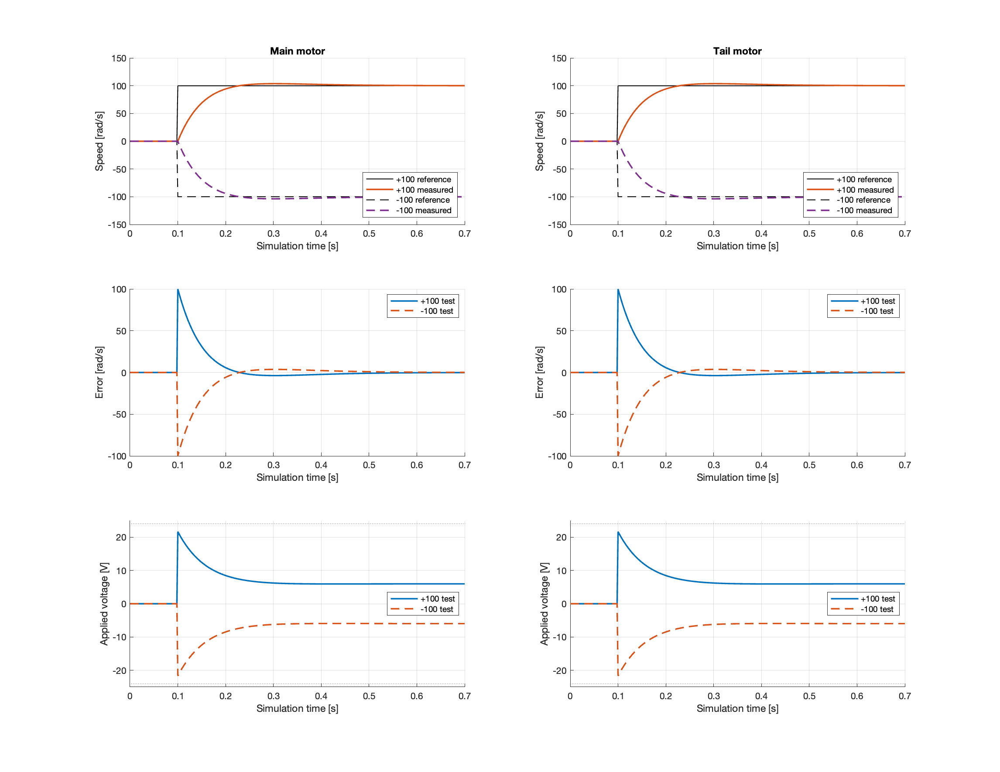

| Measured result | Both motors, either command sign |
|---|---:|
| Settling time | **0.318 s** |
| Overshoot | 3.70% |
| Absolute final error at 1 s | 0.00312 rad/s |
| Peak absolute voltage | 21.64 V |
| Time in saturation | 0 s |

**Conclusion:** the PI meets our agreed 0.24–0.36 s interpretation of “approximately 0.3 s.” A 0.001 s integration step gives 0.319 s, supporting the timing result.

## Question 2 — IP control with anti-windup

**File to open in Simulink:** [aero2_motor_ip.slx](../simulink/aero2_motor_ip.slx).

### What the guide asks

Replace PI with IP **using the same gains**, and include anti-windup feedback.

### What changes from PI

The integral term still uses the speed error. Proportional action now uses measured speed:

```math
\text{PI:}\quad v_{\mathrm{raw}}=I+K_p(\omega_d-\omega),
```

```math
\text{IP:}\quad v_{\mathrm{raw}}=I-K_p\omega.
```

A reference step therefore causes no immediate proportional voltage jump in IP. Keeping the gains preserves the closed-loop poles, but removes the PI reference-response zero. With our repeated real poles, the ideal IP step response is monotonic and slower. IP does not guarantee zero overshoot for arbitrary gains or plants.

### Why we add anti-windup

The amplifier cannot apply more than ±24 V. During saturation, ordinary integral action can keep accumulating error even though the requested voltage cannot be applied. This stored action can delay recovery when the reference changes. Saturation can also occur temporarily for a reachable reference.

We feed the difference between applied and requested voltage back into the integrator:

```math
v_{\mathrm{sat}}=\mathrm{sat}_{[-24,24]}(v_{\mathrm{raw}}),
```

```math
\dot I=K_i(\omega_d-\omega)+K_{\mathrm{aw}}(v_{\mathrm{sat}}-v_{\mathrm{raw}}),
```

```math
K_{\mathrm{aw}}=\frac1{0.05}=20\ \mathrm{s^{-1}}.
```

If raw voltage exceeds +24 V, the correction is negative and opposes integral buildup. Without saturation, the correction is zero. The integral contribution is not itself clipped to ±24 V; it must also compensate the term $-K_p\omega$.

### Simple implementation


The reference settings, gains, initial states, solver and two basic scopes are the same as Question 1. The visible additions calculate `applied voltage - raw voltage`, multiply it by `Kaw`, and add it before the integrator. Settings are in [motor_ip_parameters.m](../matlab/parameters/motor_ip_parameters.m).

**There is one reference Step per motor.** Recovery steps and PI/IP selection are only in the [IP experiment copy](../simulink/experiments/aero2_motor_ip_experiment.slx).

### Simulation and result

[validate_motor_ip.m](../validation/validate_motor_ip.m) first compares identical ±100 rad/s commands:

| Measured result | PI | IP, with or without anti-windup |
|---|---:|---:|
| Settling time | 0.318 s | **0.434 s** |
| Overshoot | 3.70% | **0%** |
| Peak absolute voltage | 21.64 V | 7.36 V |
| Time in saturation | 0 s | 0 s |


IP settles more slowly because its numerator changed. We retain the gains as instructed by Question 2. The unsaturated IP results are identical with anti-windup enabled and disabled.

To test windup, the experiment requests ±800 rad/s at 0.1 s, then returns to ±100 rad/s at 1.1 s. The second Step adds ∓700 rad/s to the first reference. The initial request is unreachable: the nominal motor approaches only about 401 rad/s at 24 V. Simulation ends at 5 s.


| Measured result | Without anti-windup | With anti-windup |
|---|---:|---:|
| Recovery time after the return command | 1.898 s | **0.570 s** |
| Peak absolute integral contribution | 869.91 V | **147.26 V** |
| Time saturated after the return | 1.372 s | **0.042 s** |

Both motors and both sign directions give these results. Applied voltage remains within ±24 V. A 0.001 s step gives 0.572 s recovery.

**Conclusion:** IP gives the expected same-gain comparison, and anti-windup reduces excess integral accumulation and improves recovery. It does not make an unreachable speed achievable.

## Question 3 — Mechanical feedback linearization

**File to open in Simulink:** [aero2_mechanical_linearization.slx](../simulink/aero2_mechanical_linearization.slx).

### What the guide asks

Assume perfect motor tracking, $\omega=\omega_d$, and find a control law that linearizes the yaw/pitch dynamics. The guide also explicitly asks us to:

> Identify the state variables of the linearized system and determine the validity range of the resulting control law.

### Start with the mechanical equations

The simplified mechanical model is

```math
M_q(q)\ddot q+c_q(q,\dot q)+g_q(q)=\Gamma(\theta)s,
```

```math
s=\begin{bmatrix}
\omega_m|\omega_m| \\
\omega_t|\omega_t|
\end{bmatrix}.
```

Here $M_q$ describes inertia, $c_q$ contains velocity-dependent terms, $g_q$ describes gravity and $\Gamma$ maps rotor action to yaw/pitch torque. Their expressions from page 5 of the guide are

```math
M_q=\begin{bmatrix}
J_\psi\cos^2\theta+j_\psi\sin^2\theta&0 \\
0&J_\theta
\end{bmatrix},
```

```math
c_q=\begin{bmatrix}
-(J_\psi-j_\psi)\sin(2\theta)\dot\theta\dot\psi \\
\frac12(J_\psi-j_\psi)\sin(2\theta)\dot\psi^2
\end{bmatrix},
```

```math
g_q=\begin{bmatrix}
0 \\
G\sin\theta
\end{bmatrix},
```

```math
\Gamma(\theta)=\begin{bmatrix}
\cos\theta&0 \\
0&1
\end{bmatrix}
\begin{bmatrix}
-k_t&Lk_f \\
Lk_f&k_t
\end{bmatrix}.
```

### Write the plant as state space

The mechanical equation above is second order. To write it as $\dot x=f(x,u)$, include both angles and angular velocities in the state:

```math
x=\begin{bmatrix}
x_1 & x_2 & x_3 & x_4
\end{bmatrix}^{T}
=\begin{bmatrix}
\psi & \theta & \dot\psi & \dot\theta
\end{bmatrix}^{T}.
```

The mechanical plant inputs are the two propeller spin speeds:

```math
u=\begin{bmatrix}
u_1 \\
u_2
\end{bmatrix}
=\begin{bmatrix}
\omega_m \\
\omega_t
\end{bmatrix}.
```

Under perfect tracking, these equal the commanded speeds. They are inputs here, rather than extra motor states. Rearranging the mechanical equation gives the two accelerations. In first-order form:

```math
\dot x=f(x,u)=\begin{bmatrix}
x_3 \\
x_4 \\
F_\psi(x,u) \\
F_\theta(x,u)
\end{bmatrix}.
```

For the supplied model, define $\Delta J=J_\psi-j_\psi$ and $D(x_2)=J_\psi\cos^2x_2+j_\psi\sin^2x_2$. Then

```math
F_\psi(x,u)=
\frac{\cos x_2[-k_tu_1|u_1|+Lk_fu_2|u_2|]
+\Delta J\sin(2x_2)x_3x_4}{D(x_2)},
```

```math
F_\theta(x,u)=
\frac{Lk_fu_1|u_1|+k_tu_2|u_2|
-\frac12\Delta J\sin(2x_2)x_3^2-G\sin x_2}{J_\theta}.
```

The first two state equations describe how angles change. The last two calculate body angular acceleration from the current state and rotor speeds. The measured output is $y=[x_1,x_2]^T=q$.

### What the nonlinear inverse does

Introduce a new command $a=[a_\psi,a_\theta]^T$: the **desired yaw and pitch angular accelerations**, in rad/s². It specifies how we want the body angular velocities to change. It is not the current acceleration, a new state, or a propeller speed.

The inverse $u=\alpha(x,a)$ answers: “Given the current angles and angular velocities, which rotor speeds will produce acceleration $a$?” Its calculation has three steps:

1. Calculate the torque needed for that acceleration: $\tau_d=M_q a+c_q+g_q$.
2. Solve $\Gamma(\theta)s=\tau_d$ for the signed squared rotor speeds.
3. Recover the desired speeds: $\omega_d=\mathrm{sign}(s)\sqrt{|s|}$, component by component.

Writing these steps together defines the nonlinear controller:

```math
u=\alpha(x,a)=\mathrm{sign}(s)\sqrt{|s|},
\qquad s=\Gamma(\theta)^{-1}(M_q a+c_q+g_q).
```

The code solves the matrix equation with `\` rather than calculating an explicit inverse. The functions $M_q$, $c_q$, $g_q$ and $\Gamma$ are evaluated at the current state $x$.

Substitution shows why this works:

```math
\begin{aligned}
\ddot q &= M_q^{-1}(\Gamma s-c_q-g_q) \\
&= M_q^{-1}(M_q a+c_q+g_q-c_q-g_q) \\
&= a.
\end{aligned}
```

This is **feedback linearization**, not a Taylor approximation around an equilibrium. The nonlinear terms are evaluated at the current state and canceled in the ideal model.

The implementation uses a matrix solve and signed square root in [aero2_feedback_linearization.m](../matlab/mechanics/aero2_feedback_linearization.m). The equations and constants are in [aero2_mechanical_terms.m](../matlab/mechanics/aero2_mechanical_terms.m) and [aero2_mechanical_parameters.m](../matlab/parameters/aero2_mechanical_parameters.m).

### State variables of the linearized system

The state coordinates do not change: $z=x$. Substituting $u=\alpha(x,a)$ into the plant gives

```math
\dot z=f\bigl(z,\alpha(z,a)\bigr)=\begin{bmatrix}
z_3 \\
z_4 \\
a_\psi \\
a_\theta
\end{bmatrix}.
```

Equivalently, this is the familiar linear form $\dot z=Az+Ba$:

```math
\dot z=
\begin{bmatrix}
0&0&1&0 \\
0&0&0&1 \\
0&0&0&0 \\
0&0&0&0
\end{bmatrix}z+
\begin{bmatrix}
0&0 \\
0&0 \\
1&0 \\
0&1
\end{bmatrix}a.
```

The four states are still **yaw angle, pitch angle, yaw angular velocity and pitch angular velocity**. Acceleration appears in the derivatives of the velocity states; it is not an additional state.

| System | State | Input |
|---|---|---|
| Mechanical plant alone | $x=[\psi,\theta,\dot\psi,\dot\theta]^T$ | Propeller speeds $u=[\omega_m,\omega_t]^T$ |
| Nonlinear inverse + mechanical plant | The same state, $z=x$ | Desired body angular acceleration $a=[a_\psi,a_\theta]^T$ |

The physical plant still receives rotor speeds. The inverse makes the combined system respond to $a$ as two double integrators: $\ddot\psi=a_\psi$ and $\ddot\theta=a_\theta$.

### Why this helps with position control

The next controller can ask for a body acceleration without directly handling gravity and rotor coupling. The inverse handles those effects when it calculates the propeller speeds.

Question 4 below chooses an acceleration of the form

```math
a=K_p^q(q_d-q)-K_d^q\dot q.
```

The first term accelerates toward the desired orientation; the second brakes according to angular velocity. Since the compensated mechanics gives $\ddot q=a$, the result is

```math
\ddot q+K_d^q\dot q+K_p^q q=K_p^q q_d.
```

This is a linear second-order position-control problem. Its gains are selected for the 3 s settling-time target in Question 4 below. These position gains are separate from the motor PI/IP gains.

### Validity range of the control law

The cancellation is exact for the ideal model, subject to these conditions:

- **Pitch:** $\det\Gamma=-\cos\theta[k_t^2+(Lk_f)^2]$, so we require $\cos\theta\ne0$. Around horizontal pitch, the mathematical interval is $-90^\circ<\theta<90^\circ$. At either endpoint the rotor torque map is singular. The inertia matrix remains invertible because its diagonal entries are positive.
- **Implemented envelope:** the simulation uses the narrower interval $|\theta|\le60^\circ$ and stops if it is exceeded. This is our simulation restriction, not a hardware travel limit or an equilibrium-based approximation.
- **Zero rotor speed:** the signed square root is defined at zero, but its derivative is unbounded there. Algebraic cancellation remains evaluable at zero; a smooth local inverse additionally requires both commanded rotor speeds to be nonzero.
- **Physical feasibility:** the derivation assumes correct parameters, exact angles/rates and perfect motor tracking. Real motors have finite voltage and bandwidth. The inverse can request speeds or speed changes they cannot achieve, so the full cascade must be checked separately.

### Simple implementation


The simple model starts with zero angles and rates. One vector Step changes virtual acceleration from `[0;0]` to `[0.15;-0.1]` rad/s² at 0.2 s. It runs for 2 s with the 0.002 s Euler step. The Angle scope shows yaw and pitch.

This model commands acceleration, not angle setpoints. The inverse calculates rotor speeds; the ideal-speed mechanics uses them immediately. The mechanics block outputs `dx`, the four state derivatives. The **Mechanical state** integrator produces `x`; **Angles and rates** separates it into `q` and `dq` for feedback. There is no position controller yet.

The simple model now exposes all three motion quantities directly:

| Scope | Signals | Units |
|---|---|---|
| **Angle scope** | Yaw and pitch position | rad |
| **Rate scope** | Yaw and pitch body angular velocity | rad/s |
| **Acceleration scope** | Commanded yaw/pitch acceleration on input 1; actual yaw/pitch acceleration on input 2 | rad/s² |

Actual acceleration comes directly from the mechanical equations, not from numerically differentiating a measured velocity. The command and actual traces should overlap under ideal motor tracking. These body velocities are distinct from the main/tail propeller speeds.

```matlab
open_system('aero2_mechanical_linearization/Angle scope');
open_system('aero2_mechanical_linearization/Rate scope');
open_system('aero2_mechanical_linearization/Acceleration scope');
```

Press **Run** to fill the Scopes. The report's plots below use the separate pulse experiment and nonzero initial rates. The simple model retains its original acceleration step and zero initial state, so its curves differ: acceleration stays constant after 0.2 s, velocity ramps, and position follows a parabola.

### Separate simulation experiment and result

The [feedback-linearization experiment](../simulink/experiments/aero2_mechanical_linearization_experiment.slx) uses a different demonstration input to test the cancellation:

| Setting | Experiment value |
|---|---|
| Initial yaw/pitch | 0.1 / 0.2 rad |
| Initial yaw/pitch rates | -0.05 / +0.04 rad/s |
| Acceleration pulse | Yaw +0.15, pitch -0.10 rad/s² from 0.2 to 0.6 s |
| Pulse settings | Period 10 s, width 4%, delay 0.2 s, continuous sample time 0 |
| Solver / stop time | Euler, 0.002 s / 2 s |

Its scopes show requested/recovered acceleration, angles, rates, rotor commands and acceleration error. [validate_feedback_linearization.m](../validation/validate_feedback_linearization.m) also substitutes computed rotor speeds into the original course equations at 180 representative states and acceleration commands.


Read this figure by rows:

- **Top:** requested and recovered accelerations overlap, confirming the cancellation.
- **Middle — angular velocity:** yaw starts at -0.05 rad/s. The positive acceleration pulse brakes it, crosses zero near 0.533 s, and leaves +0.01 rad/s after 0.6 s. Pitch starts at +0.04 rad/s; its negative pulse brings it to zero at 0.6 s. These are body angular velocities, not propeller spin speeds.
- **Bottom — position:** yaw decreases while its velocity is negative and increases after its velocity becomes positive. It is not being commanded back to its initial angle: it will pass that angle if the simulation continues. Pitch becomes flat because its final velocity is zero. The dotted curves are the analytical responses; the orange curves come from the nonlinear course mechanics.

The angular-velocity prediction is obtained by integrating the acceleration pulse once:

```math
\dot q(t)=\dot q(0)+a_0\left[\max(t-0.2,0)-\max(t-0.6,0)\right].
```

Here $a_0=[0.15,-0.10]^T$ rad/s². After the pulse, the final rates are $[-0.05,0.04]^T+0.4[0.15,-0.10]^T=[0.01,0]^T$ rad/s. Zero acceleration then preserves these rates; it does not stop yaw motion or mean the motors are switched off.


The separate residual figure shows acceleration errors around $10^{-17}$ rad/s². Its spikes are floating-point roundoff, not sensor noise or physical oscillation.

| Check | Measured result |
|---|---:|
| Maximum acceleration error across 180 substitutions | $2.22\times10^{-16}$ rad/s² |
| Maximum acceleration error during the time simulation | $5.55\times10^{-17}$ rad/s² |
| Maximum angle error against analytical response, 0.002 s step | $6.0\times10^{-5}$ rad |
| Same comparison with a 0.001 s step | $3.0\times10^{-5}$ rad |
| Zero input at zero state | Exactly zero rotor commands |
| Leaving the pitch envelope | Simulation stops with a diagnostic |

**Conclusion:** the compensated ideal mechanics behaves as two double integrators. No equilibrium approximation was needed. Choosing $a$ to regulate position and meet the 3 s target is Question 4.

## Question 4 — AERO 2 yaw/pitch position control

**File to open in Simulink:** [aero2_position_control.slx](../simulink/aero2_position_control.slx).

### What the guide asks

Using measured angles $q$ and angular velocities $\dot q$, design a linear controller that drives the AERO 2 to a desired orientation $q_d$ with approximately **3 s settling time**.

We retain Question 3's ideal motor-tracking assumption. This question closes the position loop around the compensated mechanics; it does not yet include the actual motor response or voltage limits.

### Control law and gain selection

Question 3 gives $\ddot q=a$. We now calculate $a$ from the position error and angular velocity:

```math
a=K_p^q(q_d-q)-K_d^q\dot q.
```

The proportional term accelerates toward the target. The rate term provides braking. The nonlinear inverse then converts this desired body acceleration into the required main/tail rotor speeds.

For a constant target, the error $e=q_d-q$ obeys

```math
\ddot e+K_d^q\dot e+K_p^q e=0.
```

Use identical, independent critically damped dynamics for yaw and pitch. Matching the characteristic polynomial to $(s+\lambda)^2$ gives

```math
K_p^q=\lambda^2 I_2,\qquad K_d^q=2\lambda I_2.
```

For a step from rest, the normalized error is $(1+\lambda t)e^{-\lambda t}$. Its exact 2% settling condition is

```math
(1+3\lambda)e^{-3\lambda}=0.02.
```

Solving it gives $\lambda=1.9446406$ s⁻¹, so the scalar gains applied to each axis are

```math
K_q=3.7816269,\qquad D_q=3.8892811.
```

The familiar $4/\lambda$ rule is only an estimate. Here we use the exact critically damped step response to target 3 s directly. The calculation is in [position_control_parameters.m](../matlab/parameters/position_control_parameters.m). There is no reference differentiation or outer-loop integral action.

### Simple implementation

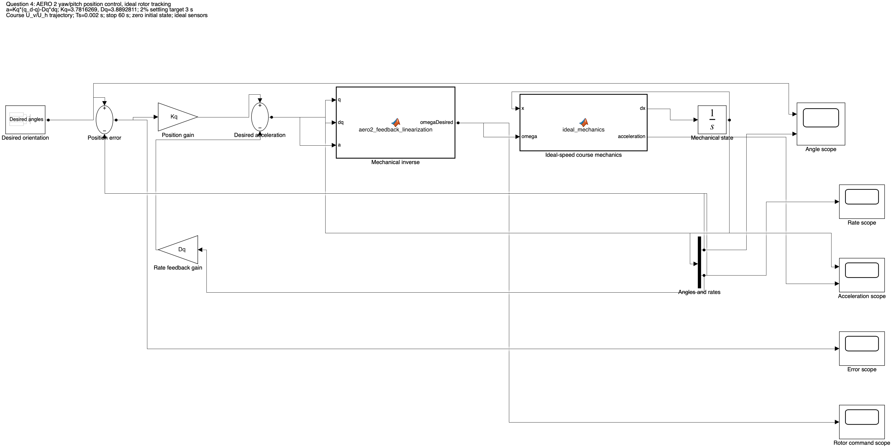

Open [aero2_position_control.slx](../simulink/aero2_position_control.slx). Its signal chain is:

```text
Desired yaw/pitch → position/rate feedback → desired acceleration a
                 → nonlinear inverse → rotor speeds → ideal-speed mechanics
```

The **Position error** block forms $q_d-q$. **Position gain** multiplies it by `Kq`; **Rate feedback gain** multiplies $\dot q$ by `Dq`. **Desired acceleration** subtracts the rate contribution. The inverse, mechanical state and angle/rate feedback are inherited from Question 3.

| Setting | Value |
|---|---|
| Desired orientation | Course `U_v` yaw and `U_h` pitch time series |
| Reference sampling / smoothing | 0.002 s / `Tr=2.5` s, as supplied |
| Reference source | **Desired orientation** subsystem, two From Workspace blocks |
| Initial angles and angular velocities | Zero |
| Gains in the model workspace | `Kq=3.7816269`, `Dq=3.8892811` (stored at full precision) |
| Solver / stop time | Forward Euler, 0.002 s / 60 s |
| Measurements and motors | Ideal state measurements and perfect rotor-speed tracking |
| Pitch simulation envelope | ±60°, enforced by the inverse |

The **Angle scope** receives desired yaw/pitch on its first vector input and measured yaw/pitch on its second. **Rate scope** shows body angular velocities; **Acceleration scope** compares commanded and actual body acceleration. **Error scope** and **Rotor command scope** show the remaining position-controller signals. There are no experiment selectors or logging bundles in this simple answer.

### Separate experiments and measured results

The [position-control experiment](../simulink/experiments/aero2_position_control_experiment.slx) adds acceleration-residual checks and detailed logging; its motion Scopes are inherited from the simple model. [validate_position_control.m](../validation/validate_position_control.m) tests yaw-only ±0.1 rad, pitch-only ±0.1 rad, and simultaneous commands `[0.2;0.1]` and `[-0.2;-0.1]` rad.

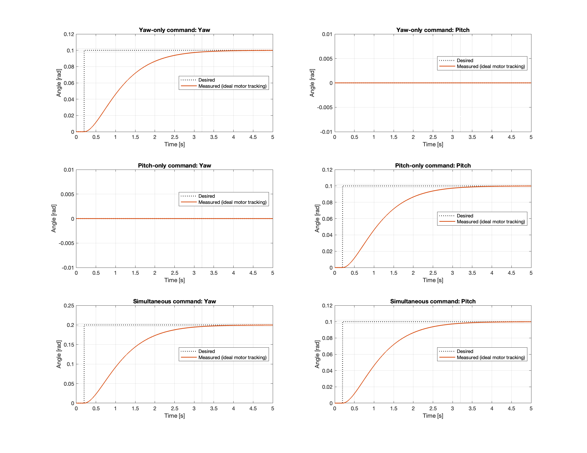

The dotted reference is compared with the simulated angle. Single-axis tests also show that the uncommanded axis stays at zero. The vertical line is **3 s after the command**, at absolute simulation time 3.2 s; the settling-time measurement starts at the 0.2 s step.

| Metric | Result across the signed step tests |
|---|---:|
| 2% settling time | **2.996 s** |
| Rise time, 10–90% | 1.724 s |
| Overshoot | 0% |
| Largest absolute final position error at 8 s | $8.15\times10^{-7}$ rad |
| Largest requested main/tail rotor speed | 178.56 / 298.00 rad/s |
| Maximum uncommanded-axis motion in the single-axis tests | $2.05\times10^{-19}$ rad |
| Settling time with a 0.001 s integration step | **2.998 s** |


The tests also compare the trajectories with the analytical critically damped response, check zero-reference equilibrium, and verify convergence from nonzero initial angles and rates. A deliberately excessive pitch reference confirms that the simulation stops on leaving the envelope. All recorded signals remain finite in the accepted runs.

**Conclusion:** the ideal yaw/pitch position controller meets the 3 s settling target. It controls orientation rather than rotor speed. The requested rotor speeds can change instantly in this ideal simulation; this is not possible with finite-voltage motors. Question 5 must replace that assumption with the IP loops and measure the resulting performance.

### Reproduce Question 4

```matlab
project = setup_project;
build_position_control;
build_position_control_experiment;
metrics = validate_position_control;
export_position_control_figures;
open_system(fullfile(project.simulink,'aero2_position_control.slx'));
open_system('aero2_position_control/Angle scope');
open_system('aero2_position_control/Rate scope');
open_system('aero2_position_control/Acceleration scope');
```

Press **Run** to view the simple model. Rebuilding is optional for the saved models. `build_position_control` creates the simple answer; `build_position_control_experiment` makes the diagnostic copy. Only that copy records `out.position_data`, with paired columns for references (1–2), angles (3–4), rates (5–6), virtual acceleration (7–8), main/tail speeds (9–10), position errors (11–12), recovered acceleration (13–14) and acceleration residuals (15–16).

## Question 5 — Connect and validate the complete controller

**File to open in Simulink:** [aero2_cascade_control.slx](../simulink/aero2_cascade_control.slx).

### What the guide asks

Implement the complete controller in the supplied simulator and check the specifications. We now replace Question 4's perfect motor tracking with the actual motor equations and the IP controllers from Question 2. No gains are retuned.

### What changes physically

The nonlinear inverse requests rotor speeds. Motors cannot reach them instantly: the IP loops must generate a voltage, limited to ±24 V, to accelerate or brake each rotor.

The complete chain is:

```text
Desired angles → position/rate feedback → desired body acceleration
               → nonlinear inverse → desired rotor speeds
               → IP + anti-windup → motor voltages → supplied nonlinear plant
```

The plant state is now $x=[\psi,\theta,\dot\psi,\dot\theta,\omega_m,\omega_t]^T$. Its physical inputs are the two motor voltages. The controller also has two integral states, one per motor. Unlike the ideal model, the complete closed loop is not just two double integrators.

Writing $s(\omega)=[\omega_m|\omega_m|,\omega_t|\omega_t|]^T$, the actual body acceleration is

```math
\ddot q=a+M_q(q)^{-1}\Gamma(\theta)\left[s(\omega)-s(\omega_d)\right].
```

The extra term is zero only when the motors track perfectly. It explains why the complete cascade can differ from Question 4 even though the position gains have not changed.

### Simple implementation, inputs and scopes

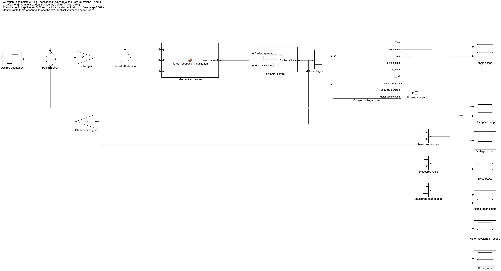

Open [aero2_cascade_control.slx](../simulink/aero2_cascade_control.slx). The position feedback and **Mechanical inverse** come from Question 4. **IP motor control** contains two identical, independent loops, represented together using two-element main/tail vectors:

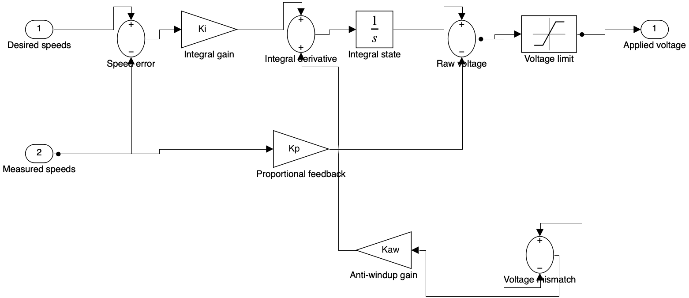

The proportional term uses measured speed. The integral term uses speed error and the difference between limited and raw voltage. The supplied **Course nonlinear plant**, including its amplifier, mechanical/motor equations, noise and quantizer, retains its equations and sensor/amplifier settings; passive acceleration outputs are added.

| Setting | Value |
|---|---|
| Desired orientation | Exact course yaw/pitch trajectory from stored `U_v` / `U_h` |
| Position gains | `Kq=3.7816269`, `Dq=3.8892811` |
| Motor gains | `Kp=0.2163704`, `Ki=1.8416461`, `Kaw=20` |
| Initial plant state and IP integral states | Zero |
| Motor voltage | Generated by the IP loops; each channel limited to ±24 V |
| Measurement effects | Model workspace `meas_on=0` for ideal sensors; `1` enables supplied noise and quantization |
| Solver / stop time | Forward Euler, 0.002 s / 60 s |
| Sensor-noise update period | Supplied 0.002 s; unchanged during solver refinement |
| Pitch simulation envelope | ±60°, enforced by the nonlinear inverse |

These figures are Simulink diagram exports, not UI screenshots. There is no manually imposed voltage pulse in Question 5: voltage is the controller's output.

| Basic Scope | Connected signals |
|---|---|
| **Angle scope** | Desired and measured yaw/pitch vectors |
| **Rate scope** | Measured yaw/pitch body angular velocities |
| **Acceleration scope** | Commanded and actual body angular accelerations |
| **Rotor speed scope** | Desired and measured main/tail speed vectors |
| **Motor acceleration scope** | Actual main/tail rotor angular accelerations |
| **Voltage scope** | Applied main/tail voltages |

The simple model has no logging bundle or experiment selectors. The [experiment copy](../simulink/experiments/aero2_cascade_control_experiment.slx) adds a selectable reference recording and detailed logging. It also exposes the true simulated state for comparison with noisy measurements, without changing the dynamics.

### Step-test results

[validate_cascade_control.m](../validation/validate_cascade_control.m) repeats the positive and negative yaw-only 0.1 rad, pitch-only 0.1 rad, and simultaneous `[0.2;0.1]` rad tests. Settling is measured from the 0.2 s command, using ±2% of each commanded angle.


| Ideal-measurement test | Ideal motors, Q4 | Complete cascade, Q5 | Peak applied voltage, either motor |
|---|---:|---:|---:|
| Yaw-only ±0.1 rad | 2.996 s | 3.204 s | 12.33 V |
| Pitch-only ±0.1 rad | 2.996 s | 3.210 s | 13.04 V |
| Simultaneous ±`[0.2;0.1]` rad | 2.996 s | Yaw 3.206 s; pitch 3.210 s | 21.76 V |

All these tests have **0% overshoot and no voltage saturation**. The largest final angle error at 8 s is $7.98\times10^{-6}$ rad. Integral contributions remain below 70.38 V; they are internal controller terms, not applied voltages. A large integral contribution can cancel the proportional feedback while the applied voltage remains below 24 V.

The real motor dynamics increase settling time by about **0.21 s**, or 7% relative to the ideal result. The cascade meets our working interpretation of approximately 3 s: **2.4–3.6 s**, pending the professor's convention.


The rotor commands change before the measured speeds can follow. Raw and applied voltage overlap in these nominal tests because neither motor saturates. Question 2's separate recovery experiment remains the evidence for anti-windup under saturation.

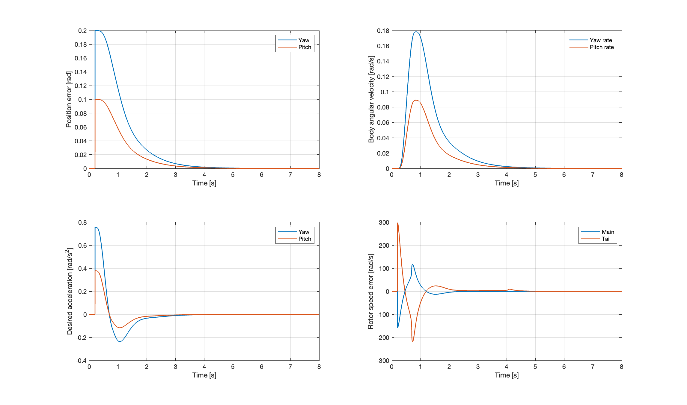

The additional checks confirm zero-input rest, convergence from nonzero initial angles/rates, and a stop when an excessive pitch command leaves the envelope. Halving the integration step to 0.001 s gives settling times **3.207–3.212 s** in the representative tests. The largest coarse/fine angle difference is $1.74\times10^{-4}$ rad, so the timing conclusion is unchanged. The simple and experiment models give identical default signals, with maximum difference **0**.

### Sensor effects

All six signed tests are repeated with the supplied sensor effects. We report final-window statistics over 6–8 s, rather than using noisy crossings to claim a deterministic settling time.

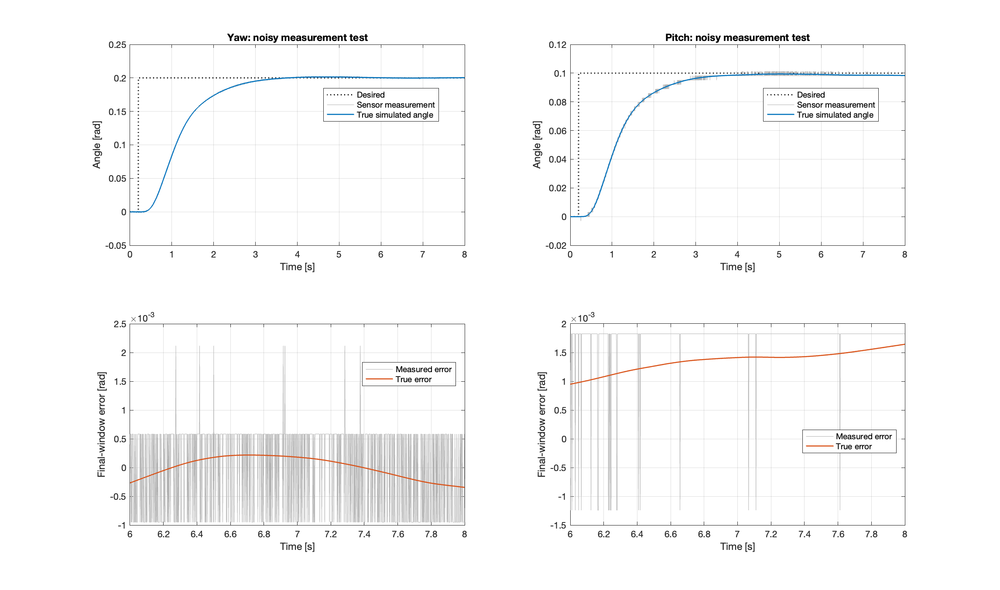

For the simultaneous positive command:

| Metric over 6–8 s | Yaw | Pitch |
|---|---:|---:|
| True angle-error RMS | 0.000181 rad | 0.001368 rad |
| Measured angle-error mean | 0.0000247 rad | 0.001758 rad |
| Measured angle-error standard deviation | 0.000760 rad | 0.000450 rad |

Across all signed sensor tests, final true-error RMS stays below 0.000440 rad for yaw and 0.001790 rad for pitch; peak voltage is 21.90 V. The sensor model quantizes yaw in approximately 0.001534 rad increments and pitch in 0.003068 rad increments. The physical simulated angle can therefore differ from the value reported by the sensor, leaving a small offset rather than exact convergence to the reference. These are simulation results, not hardware measurements.

### Supplied smooth reference

The saved simple and experiment models now use the original initialization script's 60 s references by default, including its factor of two. The validation script uses the same shared generator. This tests tracking; it does not establish step settling time. The controller still uses position and measured-velocity feedback, with no desired-velocity or acceleration feedforward.

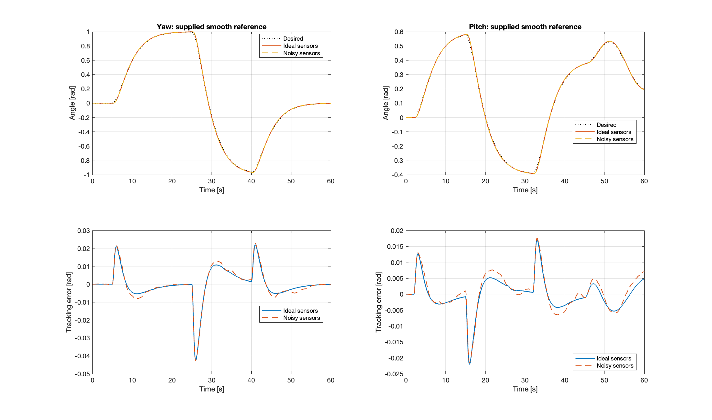

| Tracking result over the full 60 s | Ideal sensors | Noise and quantization |
|---|---:|---:|
| Yaw error RMS | 0.09941 rad | 0.09945 rad |
| Pitch error RMS | 0.05975 rad | 0.05969 rad |
| Peak absolute yaw error | 0.2866 rad | 0.2879 rad |
| Peak absolute pitch error | 0.1407 rad | 0.1425 rad |
| Peak applied voltage | 6.47 V | 6.92 V |

Signals and integrators remain bounded, and peak absolute pitch stays below 0.575 rad (32.95°). There is visible tracking lag. Passing the constant-step specification does not imply accurate tracking of a changing reference. Trajectory feedforward would be a separate extension, not part of this implementation.

**Conclusion:** the complete simulated cascade meets the nominal angle-step timing criterion with the original gains, while respecting voltage and pitch limits. Sensor effects leave small residual errors; moving references show lag. The next required stage is professor review before section-by-section hardware validation. The optional position integrator is developed separately below; it does not replace this baseline.

### Reproduce and visualize Question 5

```matlab
project = setup_project;
build_cascade_control;
build_cascade_control_experiment;
metrics = validate_cascade_control;
validate_question_models(5);
export_cascade_control_figures;
open_system(fullfile(project.simulink,'aero2_cascade_control.slx'));
open_system('aero2_cascade_control/Angle scope');
open_system('aero2_cascade_control/Rate scope');
open_system('aero2_cascade_control/Acceleration scope');
open_system('aero2_cascade_control/Rotor speed scope');
open_system('aero2_cascade_control/Voltage scope');
```

Press **Run** to visualize the saved simple model; rebuilding is optional. Double-click **IP motor control** to inspect its connections. Raw recordings and four metric tables are saved under `results/cascade_*`. The diagnostic output `out.cascade_data` has columns: reference angles 1–2, measured angles 3–4, measured rates 5–6, desired acceleration 7–8, desired rotor speeds 9–10, measured rotor speeds 11–12, raw voltages 13–14, applied voltages 15–16, IP integral states 17–18, true angles 19–20, true rates 21–22 and true rotor speeds 23–24.

The saved models and R2021a exports are simulated in MATLAB R2024b. Actual R2021a execution and hardware testing remain unverified.

## Optional — Position integral action

**File to open in Simulink:** [aero2_position_integral.slx](../simulink/aero2_position_integral.slx).

### Purpose and controller

The guide asks us to add position integral action without significantly changing settling time. The motor IP integrators already control rotor speed; these new integrators accumulate **yaw/pitch position error**. They help reject persistent external torques that the nominal inverse does not know about.

Question 5 remains the controller baseline. The separate optional controller uses

```math
\dot J=K_i^q(q_d-q),\qquad
 a=K_p^q(bq_d-q)-K_d^q\dot q+J.
```

Here $J$ is an acceleration contribution, in rad/s². It already includes the integral gain. The reference weight $b$ prevents the new integral action from substantially changing the nominal step response. Derivative feedback still acts on measured velocity, so there is no differentiated reference step.

### Gain selection

With ideal motor tracking and a constant reference, each axis has characteristic polynomial

```math
s^3+K_d^q s^2+K_p^q s+K_i^q.
```

Choose the three stable poles at $-\lambda$, using Question 4's $\lambda=1.9446406$ s⁻¹. Matching $(s+\lambda)^3$ gives

```math
K_d^q=3\lambda,\qquad K_p^q=3\lambda^2,\qquad K_i^q=\lambda^3.
```

We also choose $b=1/3$. The ideal reference-to-angle transfer function becomes

```math
\frac{Q(s)}{Q_d(s)}
=\frac{bK_p^q s+K_i^q}{s^3+K_d^q s^2+K_p^q s+K_i^q}
=\frac{\lambda^2(s+\lambda)}{(s+\lambda)^3}
=\frac{\lambda^2}{(s+\lambda)^2}.
```

This preserves the original ideal 3 s step response from rest. The additional pole remains part of the internal and disturbance dynamics; it has not disappeared from the system. The matching is nominal and does not guarantee an identical response with finite motor tracking or saturation.

[The parameter function](../matlab/parameters/position_integral_parameters.m) stores the gains. The diagram uses `Kref=b*Kpos`, so the acceleration sum is `Kref*q_d - Kpos*q - Dpos*dq + J`.

| Parameter | Value |
|---|---:|
| `Kref` | 3.7816269 |
| `Kpos` | 11.3448808 |
| `Dpos` | 5.8339217 |
| `Kint` | 7.3539 (stored at full precision) |
| Reference weight `b` | 1/3 |

### Simple model and outer anti-windup


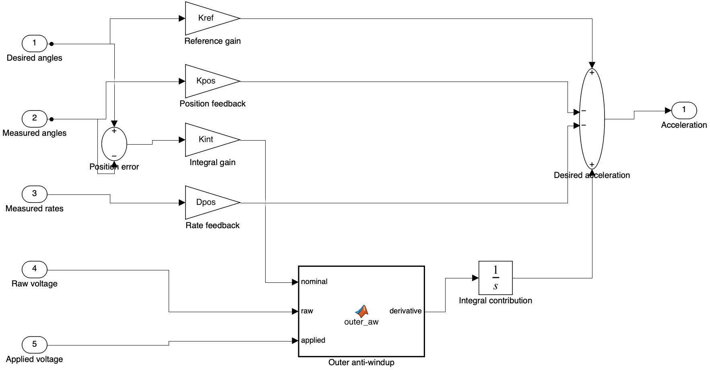

The figures above are Simulink diagram exports. Open [aero2_position_integral.slx](../simulink/aero2_position_integral.slx). Double-click **Position integral control** to see the gains, integral contribution and anti-windup gate. The default input is now the full 60 s course trajectory from rest; the nominal step comparisons below remain separate validation cases. The motor IP gains, nominal ±24 V limits, 0.002 s solver step, ideal sensors and the body/motor motion Scopes are retained from Question 5. The two integral contributions are visible inside their respective controller subsystems.

The new outer anti-windup rule pauses **both** position integrators whenever either motor's raw voltage differs from its limited voltage. Otherwise, $\dot J=K_i^q(q_d-q)$. Both axes pause because rotor action is coupled. This conservative rule prevents accumulation during voltage saturation; it does not actively discharge stored integral action or account for every possible hardware constraint. The motor-loop back-calculation remains active as well.

The simple plant retains its equations and sensor/amplifier settings; passive acceleration outputs are added. Only the [experiment copy](../simulink/experiments/aero2_position_integral_experiment.slx) adds external torque injection, temporary voltage-authority changes, an outer anti-windup comparison parameter and logging. External torque is added through $\Delta\ddot q=M_q(q)^{-1}\tau_d$; the nonlinear inverse is not told its value.

### Nominal results and tradeoff

The same six signed single-axis and simultaneous steps used in Question 5 are repeated.

| Metric | Question 5 PD | Optional integral controller |
|---|---:|---:|
| Settling time | 3.204–3.210 s | **3.042–3.050 s** |
| Overshoot | 0% | Less than 0.025% |
| Peak voltage across nominal tests | 21.76 V | **23.66 V** |
| Nominal saturation duration | 0 s | 0 s |
| Largest final angle error at 8 s | $7.98\times10^{-6}$ rad | $1.03\times10^{-5}$ rad |


The optional controller keeps settling near 3 s, with a very small overshoot. It uses more voltage and leaves less actuator margin. Its main benefit is disturbance rejection, not a large improvement in the already accurate nominal model. A nonzero final $J$ is normal: it balances the weighted proportional feedback even when the position error is zero.

### Constant-disturbance comparison

At 5 s, apply an unknown constant yaw torque of +0.010 N m and pitch torque of -0.008 N m. Hold the desired angles at `[0.2;0.1]` rad. Both controllers use the same disturbed plant, with a constant angle reference explicitly selected by validation. Measure the final errors over 18–20 s with ideal sensors.

| Axis | PD mean position error | With integral action |
|---|---:|---:|
| Yaw | -0.004166 rad | Below $10^{-9}$ rad in magnitude |
| Pitch | +0.002953 rad | Below $10^{-9}$ rad in magnitude |

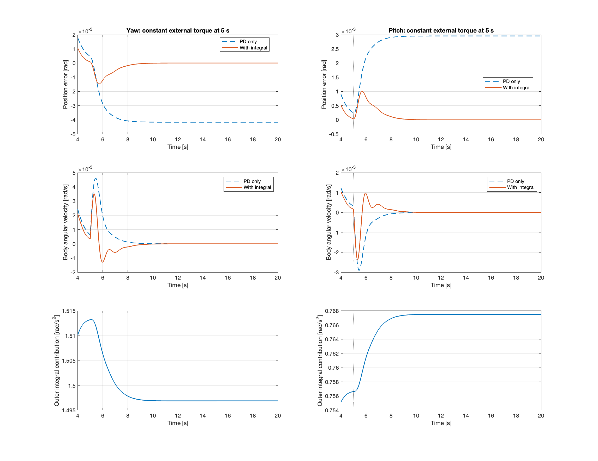

The PD controller needs a persistent position error to generate the acceleration command that balances the unknown torque. The integrator stores that compensation, allowing the angle error to return to numerical zero. The tests also reverse both torque signs and verify rejection again. These tiny residuals belong to the ideal simulated model, not a claim of achievable hardware accuracy.

### Outer windup and recovery

A separate stress experiment temporarily reduces the available voltage to **±2 V** until 4 s, then restores **±24 V**. The yaw reference is 0.4 rad from 0.2 s; at 4 s it changes to 0.05 rad. Pitch stays at zero. This is an artificial loss-of-authority test, not a different nominal actuator specification.

| Stress-test metric | Outer anti-windup off | Outer anti-windup on |
|---|---:|---:|
| Peak outer integral contribution | 10.368 rad/s² | 0.3783 rad/s² |
| Peak yaw angle over the full test | 1.0475 rad | 0.1028 rad |
| Settling after the 4 s return, ±0.001 rad band | 7.534 s | 4.786 s |

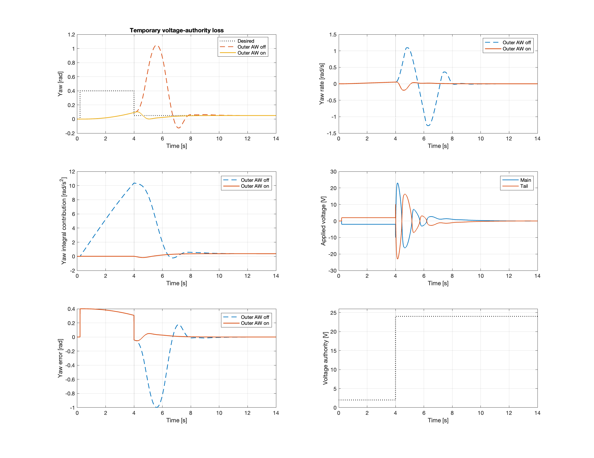

The motor-loop anti-windup is enabled in both runs. It cannot prevent the separate position integrators from accumulating. Pausing the outer integrators sharply reduces stored action and subsequent overshoot, although recovery is still not instantaneous. The validation checks that $J$ is unchanged over each saturated Euler update when outer anti-windup is enabled.

### Other checks and reproduction

Validation also checks the independent ideal augmented-state response, zero-reference rest, the ±60° pitch stop, noisy measurements, and solver refinement. With integral action disabled and the original PD gains restored in the experiment, the default Question 5 angles/rates agree within $10^{-10}$. The optional simple and experiment copies give identical default signals (maximum difference 0).

With sensor effects enabled, final-window true-error RMS over 6–8 s is 0.000607 rad for yaw and 0.000341 rad for pitch. Exact convergence is not expected. Halving the integration step gives nominal settling of 3.050 s for yaw and 3.044 s for pitch, preserves disturbance rejection, and changes anti-windup recovery from 4.786 to 4.790 s. R2021a exports are run in the available R2024b installation; actual R2021a execution and hardware testing remain separate checks.

```matlab
project = setup_project;
build_position_integral;
build_position_integral_experiment;
validate_position_integral;
validate_position_integral_models;
export_position_integral_figures;
open_system(fullfile(project.simulink,'aero2_position_integral.slx'));
open_system('aero2_position_integral/Angle scope');
open_system('aero2_position_integral/Rate scope');
open_system('aero2_position_integral/Acceleration scope');
```

The experiment records `out.integral_data`. Its first 24 columns match the Question 5 logging order; columns 25–26 are the outer integral contribution and 27–28 are the applied external torques. Raw data and metrics go under `results/position_integral_*`.

**Conclusion:** optional integral action rejects constant model-mismatch torques while retaining approximately 3 s nominal settling. It adds tuning complexity, slightly more overshoot and higher peak voltage. Outer anti-windup is necessary when actuator saturation prevents the position loop from achieving its command.

## Rebuild and repeat the checks

Saved models can be opened without rebuilding. To regenerate both the simple answers and their experiment copies:

```matlab
project = setup_project;
build_motor_pi;
build_motor_ip;
build_feedback_linearization;
build_position_control;
build_position_control_experiment;
build_cascade_control;
build_cascade_control_experiment;
```

Builders overwrite generated models. Put lasting diagram changes in the builder code.

Run the experiment checks and regenerate their figures with:

```matlab
validate_motor_pi;
validate_motor_ip;
validate_feedback_linearization;
validate_course_reference;
export_course_reference_figures;
validate_position_control;
validate_cascade_control;
validate_activity_scopes;
validate_question_models;
export_motor_pi_figures;
export_motor_ip_figures;
export_feedback_linearization_figures;
export_position_control_figures;
export_cascade_control_figures;
```

`validate_question_models` confirms that simple and experiment copies give the same dynamics under matching inputs and initial conditions. The maximum recorded difference is **0** for Questions 1–5. For Question 3 it matches the experiment input and initial state to the simple model before comparing them.

To open a detailed experiment, use its full path:

```matlab
open_system(fullfile(project.experiments,'aero2_motor_ip_experiment.slx'));
```

Only the experiment copies save detailed data: motor experiments return `out.motor_data`, the linearization experiment returns `out.linearization_data`, the position experiment returns `out.position_data`, and the cascade experiment returns `out.cascade_data` when run with `out = sim(model)`. Validation saves raw recordings and numerical tables under ignored `results/`. The simple answer models have no saved diagnostic logging blocks.

## How to interpret the evidence

Settling time is measured from the command change until the response enters and stays within ±2% of the step amplitude, through the end of the run. The ±20% allowance around 0.3 s is our planning convention, subject to the professor's interpretation of “approximately.”

Controller-performance results use ideal measurements and the supplied simplified model. Figures are actual Simulink diagram exports or plots of logged signals, not native Scope-window screenshots. The original course files are unchanged.

Validation was performed in MATLAB R2024b. The models include R2021a exports tested in R2024b; actual execution in R2021a and physical hardware testing remain unverified.


## Hardware-interface port of the full position cascade

Open [aero2_hardware_cascade_R2021a.slx](../simulink/aero2_hardware_cascade_R2021a.slx) on the laboratory computer with QUARC. It connects our Question 5 PD position controller, mechanical inverse and IP motor loops to the professor's AERO 2 USB interface. The four original files in `real_hardware/` are preserved unchanged. The course reference and controller gains are embedded in the adapted model.


This is a diagram export, not a hardware screenshot. For simulation on this Mac, use the separate [offline copy](../simulink/experiments/aero2_hardware_cascade_offline.slx). It has no HIL/QUARC blocks and includes equivalent measurement filters with the course nonlinear plant.


The template estimates body rates with a 10 rad/s second-order filter and filters rotor speed at 180 rad/s. With these filters and our retained gains, signed angle steps settle in **5.220–5.222 s**, with 2.55–2.82% overshoot and peak voltage 22.45 V. They converge without saturation, but **fail the 3 s ±20% timing gate**. This differs from Question 5's approximately 3.2 s because estimated rates introduce additional dynamics into damping feedback and mechanical compensation. Estimator-aware tuning remains necessary before claiming the timing target.

The 60 s course-reference test gives RMS tracking error 0.09795 rad yaw and 0.05880 rad pitch with ideal measurements. The zero-state test stays at rest; signals remain finite; reducing the integration step preserves the response. The offline R2021a export also runs in R2024b. Actual R2021a execution, QUARC compilation and physical testing remain unverified.

The hardware model includes angle, velocity, acceleration, rotor-speed, voltage and error Scopes. Its acceleration traces are sampled-difference estimates, unlike the exact derivative signals available in the simulated course plant. The template's main/tail speed output labels were reversed relative to its controller routing; the adapted labels identify motor 0/main and motor 1/tail. Physical assignment, polarity, encoder calibration and operating limits still need checking on the rig.

See [Hardware implementation and offline evidence](hardware.md) for the exact file to open, channel table, gains, Scope connections and commands. `validate_hardware_cascade` saves the repeatable results under `results/hardware_cascade/`; its `TimingMet` column explicitly records the failed timing criterion.

## Part I — Question 2(a–b): DC motor with quadratic drag

Reference: [laboratory guide, page 2](../course/Automatic_Control_III_Computer_Room_II.pdf). This motor is a separate theoretical plant, not the Part II AERO 2 motor model.

### State-space model and output derivatives

Choose $x_1=\theta$, $x_2=\omega=\dot\theta$, $x_3=i_a$. The input $u$ is armature voltage and the output is $y=\theta$. With the given parameters,

```math
\dot x_1=x_2,\qquad
\dot x_2=20x_3-x_2-0.5x_2|x_2|,\qquad
\dot x_3=-4x_2-40x_3+20u.
```

Differentiate the output until the voltage appears:

```math
y=x_1,\qquad \dot y=x_2,\qquad
\ddot y=\alpha=20x_3-x_2-0.5x_2|x_2|.
```

The voltage has not yet appeared explicitly. Since $\frac{d}{d\omega}(\omega|\omega|)=2|\omega|$ (including at zero), another derivative gives

```math
y^{(3)}=20\dot x_3-(1+|x_2|)\dot x_2
=\underbrace{-80x_2-800x_3-(1+|x_2|)\alpha}_{a(x)}+\underbrace{400}_{b(x)}u.
```

The relative degree is $r=3$. The physical motor input sets the third position derivative (angular jerk), rather than directly setting acceleration as in the pendulum.

### Input-output linearizing voltage

Impose $y^{(3)}=v$ and solve for $u$:

```math
\boxed{u=\frac{v+80x_2+800x_3+(1+|x_2|)\alpha}{400},\quad
\alpha=20x_3-x_2-0.5x_2|x_2|.}
```

For clarity, the symbolic physical-parameter form is

```math
u=\frac{JL_a}{K_T}v+R_ai_a+K_e\omega
+\frac{L_a}{K_T}(d_1+2d_2|\omega|)\alpha,
\qquad \alpha=\frac{K_Ti_a-d_1\omega-d_2\omega|\omega|}{J}.
```

The controller uses measured speed and current, plus the model parameters. It calculates acceleration algebraically; it does not differentiate sampled measurements. Position is the chosen output but does not appear in this cancellation law because the plant equations have no angle-dependent terms. Position feedback is a later tracking-controller step, Question 2(c).

### New states and validity

Use the output and its first two derivatives as the transformed coordinates:

```math
\boxed{z_1=\theta,\qquad z_2=\omega,\qquad
z_3=\alpha=\frac{K_Ti_a-d_1\omega-d_2\omega|\omega|}{J}.}
```

They satisfy the linear chain

```math
\dot z_1=z_2,\qquad\dot z_2=z_3,\qquad\dot z_3=v,\qquad y=z_1.
```

The inverse transformation is

```math
\theta=z_1,\quad\omega=z_2,\quad
i_a=\frac{Jz_3+d_1z_2+d_2z_2|z_2|}{K_T}.
```

The coordinate Jacobian determinant is $K_T/J=20\ne0$, and the input coefficient is $K_T/(JL_a)=400\ne0$. Thus the transformation and cancellation are globally defined for all finite states of this ideal model with the specified nonzero parameters. Relative degree equals the state dimension, so there are no remaining internal dynamics. Unlike the pendulum, there is no angle or speed at which the denominator vanishes.

The drag function $\omega|\omega|$ is continuously differentiable, though not twice differentiable at zero. The derivative needed here exists and is zero there; the transformation is globally $C^1$ with a $C^1$ inverse. No division by speed or sign selection is needed at reversal. Higher-order smoothness is not claimed. Practical validity still depends on model accuracy, available speed/current feedback, and achievable voltage/current; this simulation supplies no hardware-limit evidence.

### Simulink models, inputs and scopes

The open-loop plant is [part1_dc_motor.slx](../simulink/part1_dc_motor.slx). Its [R2021a export](../simulink/part1_dc_motor_R2021a.slx) is supplied separately. Three Integrators store angle, speed and current. Two Fcn blocks implement the mechanical and electrical state derivatives. A passive algebraic observation calculates jerk from the physical acceleration and current derivative without affecting the state equations.

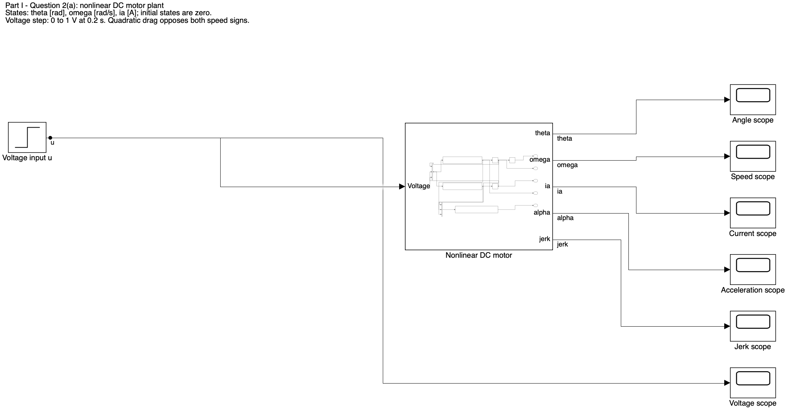

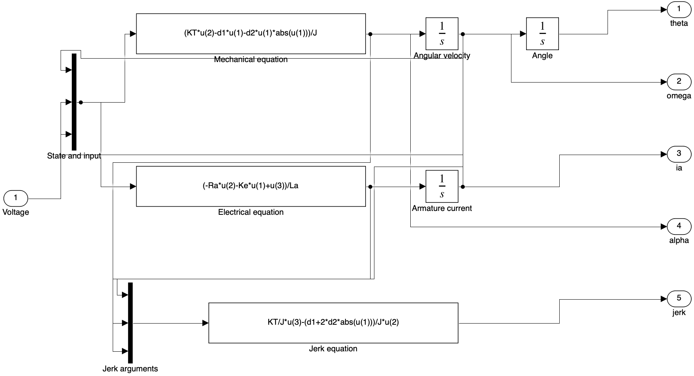

The linearized model is [part1_dc_motor_linearization.slx](../simulink/part1_dc_motor_linearization.slx), with an [R2021a export](../simulink/part1_dc_motor_linearization_R2021a.slx). It copies the same plant subsystem and replaces the voltage source with the controller. The plant speed and current feed the controller; the virtual input $v$ is a jerk command in rad/s³.

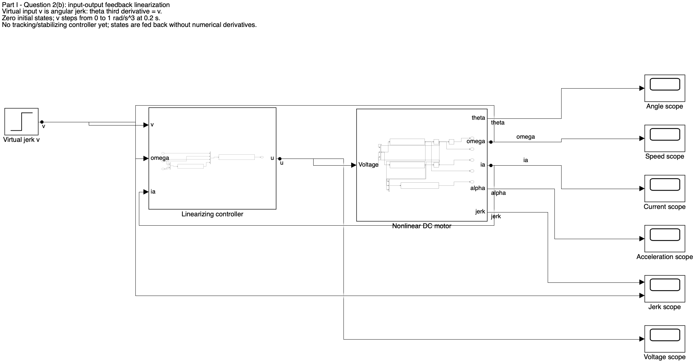

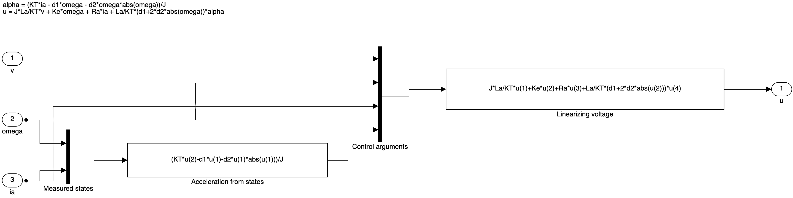

These are **diagram exports**, not actual UI screenshots. Double-click **Linearizing controller** to inspect **Acceleration from states** and **Linearizing voltage**. Both use ordinary Fcn blocks and explicitly ordered Mux inputs. No numerical Derivative block, saturation, or tracking controller is added.

| Setting | Open-loop plant | Linearized plant |
|---|---|---|
| Initial states $[\theta,\omega,i_a]$ | $[0,0,0]$ | $[0,0,0]$ |
| Input Step time | 0.2 s | 0.2 s |
| Step before / after | 0 / 1 V | 0 / 1 rad/s³ |
| Stop time | 2 s | 2 s |
| Solver | `ode45`, variable step | Same |
| Relative / absolute tolerance | $10^{-8}$ / $10^{-10}$ | Same |
| Maximum step | 0.002 s | Same |

Physical parameters and initial conditions live in each model workspace, so saved models run without an initialization callback. Open **Angle scope**, **Speed scope**, **Current scope**, **Acceleration scope**, **Jerk scope**, and **Voltage scope**. In the linearized model, **Jerk scope** compares actual jerk with $v$. For the default run, with $\tau=\max(t-0.2,0)$, the exact expected signals are $\theta=\tau^3/6$, $\omega=\tau^2/2$, and $\alpha=\tau$. At 2 s these are 0.972 rad, 1.62 rad/s and 1.8 rad/s². A nonzero jerk input produces growing motion: linearization by itself does not stabilize position.

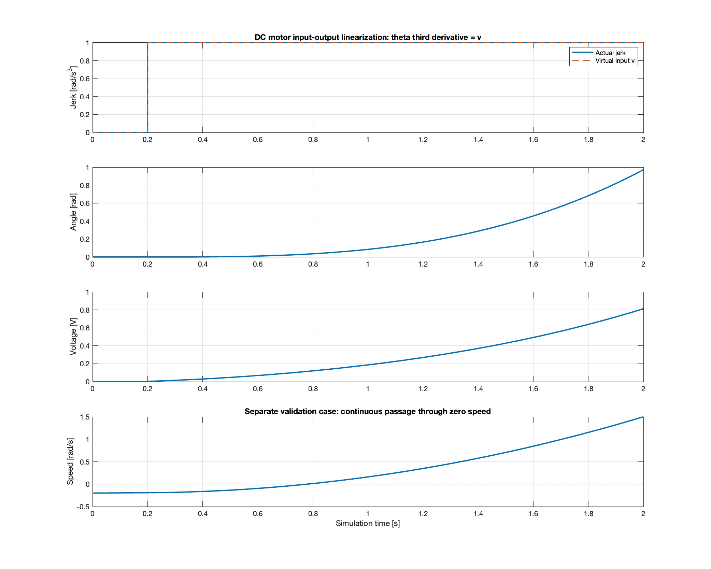

This figure contains **plots of logged simulation signals**, not Scope-window screenshots. Its last panel is a separate validation case that passes through zero speed. Diagnostic logging is enabled temporarily in memory and discarded; the saved answer models contain basic scopes. Raw recordings and numerical tables are stored under ignored `results/`.

Reproduce from the repository as MATLAB's Current Folder:

```matlab
setup_project;
build_dc_motor;
build_dc_motor_linearization;
validate_dc_motor;
export_dc_motor_figures;
open_system('part1_dc_motor_linearization');
open_system('part1_dc_motor_linearization/Jerk scope');
```

Validation compares four physical-plant cases with independent ODE integration and seven linearized cases with analytical triple-integrator motion. It covers rest, both input signs, nonzero initial states/acceleration and speed reversal in both directions. Plant equations must match between the two models; actual jerk must match $v$ within $10^{-9}$ rad/s³, and analytical angle/speed/acceleration/current errors must stay below $2\times10^{-7}$ in their respective units. Each export is compared with its working model in the installed MATLAB release.

All eleven cases passed in MATLAB/Simulink R2024b. The largest physical-state discrepancy against independent ODE integration was $8.38\times10^{-11}$ (rad, rad/s or A, rounded up). Across linearization cases, maximum angle, speed, acceleration and current errors were $2.21\times10^{-8}$ rad, $3.62\times10^{-8}$ rad/s, $2.97\times10^{-8}$ rad/s² and $6.01\times10^{-9}$ A, respectively (rounded up); the largest discrepancies occurred during speed reversal, where the drag has reduced smoothness. Maximum jerk discrepancy was $4.53\times10^{-14}$ rad/s³ (rounded up). The default run ended at the expected 0.972 rad, 1.62 rad/s and 1.8 rad/s², with peak voltage 0.81151 V. Both R2021a exports matched their working-model default trajectories when executed in R2024b; execution in R2021a remains unverified. No hardware validation is claimed.

### Question 2(c–d): linear tracking control and closed-loop validation

For a constant reference $r$, use $v=54872(r-\theta)-4332\omega-114\alpha$. The error polynomial is $(s+38)^3$, so all three poles are stable at $-38$. For a step from rest, the relative error is $e^{-38t}[1+38t+(38t)^2/2]$. Its exact 2% crossing is approximately 0.198 s. A smooth moving reference additionally requires its first, second and third derivatives in the feedforward law; the saved model tests piecewise constant setpoints.

The simple model [part1_dc_motor_tracking.slx](../simulink/part1_dc_motor_tracking.slx) preserves the motor plant and nonlinear cancellation, adding **Linear tracking control** and **Angle reference**. It computes acceleration from speed/current to avoid an artificial direct-feedthrough dependency through the grouped plant input. No numerical differentiation, delay, saturation or integrator reset is introduced. Angle scope compares the reference/output; Jerk scope compares actual jerk and virtual input. Initial states are zero; the reference steps from 0 to 0.1 rad at 0.05 s. Run for 0.5 s with `ode45`, maximum step 0.0005 s, and the existing $10^{-8}/10^{-10}$ tolerances.

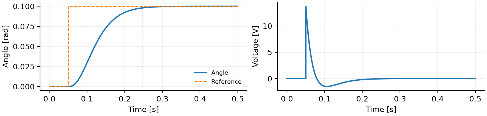

This is a plot of logged simulation signals, not a Scope screenshot. The sampled nominal 2% settling time is approximately 0.198 s with no overshoot; peak voltage is 13.718 V. Six cases cover positive/negative steps, larger steps, nonzero initial states and equilibrium. The analytical third-order transient, nonlinear cancellation and R2021a-export dynamics are checked in R2024b. A 0.2 rad step requires 27.436 V peak in this ideal model; actuator feasibility is not established. Actual execution in R2021a and hardware validation remain unverified.

```matlab
setup_project;
build_dc_motor_tracking;
validate_dc_motor_tracking;
open_system('part1_dc_motor_tracking');
```

## Part I — Question 3: non-isothermal CSTR

Let $\kappa(T)=7.2\times10^{10}e^{-8750/T}$ min$^{-1}$. In seconds the state equations are $\dot C_A=[1-C_A-\kappa(T)C_A]/60$ and $\dot T=[350-2T+200\kappa(T)C_A+T_c]/60$. The factor of 60 is essential: the guide asks for a 5-second transient despite giving minute-based rates. Output $T$ has relative degree one, and $T_c=60v-350+2T-200\kappa(T)C_A$ yields $\dot T=v$. No numerical differentiation is used.

New coordinates are $z_1=T$, $\eta=C_A$. The map is an invertible permutation; the input coefficient is the nonzero constant $1/60$. The law is defined for physical temperatures $T>0$ and nonnegative concentration; actual operation additionally requires feasible coolant commands. With $T=330$ K, the shifted zero dynamics are $\dot\eta=(1-1.219759929\eta)/60$. Their unique equilibrium is 0.819833457 mol/L, with pole $-0.020329332$ s$^{-1}$ and time constant 49.19 s, so the internal state is stable.

Choose $v=K(T_d-T)$ with $K=\ln50/5=0.782404601$ s$^{-1}$. The exact 2% temperature settling time is 5 s. Initial conditions are the 310 K equilibrium: $C_A=0.961796454$ mol/L, $T_c=262.359291$ K. The desired temperature steps from 310 to 330 K at 1 s. Default simulation time is 180 s to observe the slower concentration dynamics; `ode45` uses maximum step 0.02 s and tolerances $10^{-8}/10^{-10}$.

The simple models are `part1_cstr.slx`, `part1_cstr_linearization.slx`, and `part1_cstr_tracking.slx`. The tracking model adds a reference-error Sum and a Gain ahead of the nonlinear cancellation. Temperature scope compares desired/actual temperature; Temperature rate scope compares $v$ and actual rate; Concentration scope and Coolant scope monitor the internal state and applied input. Exports target R2021a; actual R2021a execution remains unverified.

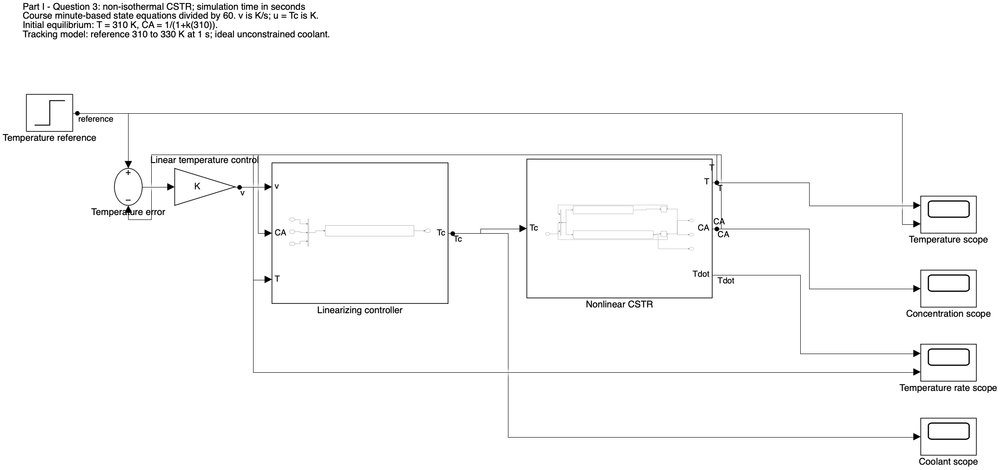

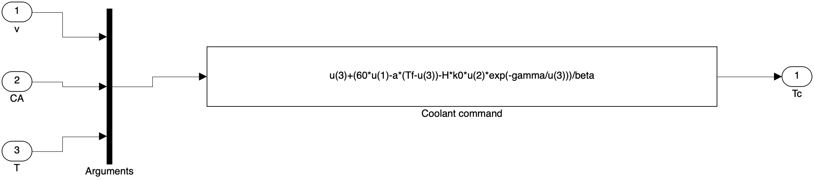

These are diagram exports, not UI screenshots. The academic report uses the following plots of logged simulation signals:

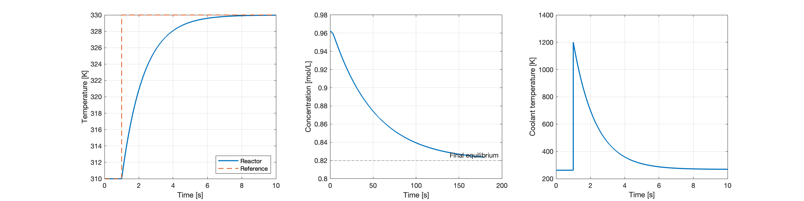

`validate_cstr` compares the physical plant with an independently integrated two-state ODE; signed virtual inputs with exact linear temperature motion; tracking with the exact first-order transient; and the internal state with an independently integrated concentration equation. A separate constant-330 K test checks the analytical zero-dynamics solution. Model/export default trajectories are compared in R2024b. Diagnostic logging is enabled only in memory and discarded; raw data stay in ignored `results/`.

The initial step requires $T_c\approx1201$ K in the unconstrained model. This is a material limitation of the requested fast transient, not a demonstrated coolant operating condition. Concentration settling is not required to take 5 s, and its slow convergence must not be confused with failure of the temperature specification.

In R2024b, the nominal sampled 2% settling time is 5.02 s, consistent with the exact 5 s crossing and maximum output spacing 0.02 s. There is no overshoot; nominal peak coolant is 1201.245 K and concentration at 180 s is 0.82370 mol/L. Two open-loop, two virtual-rate and five closed-loop/internal-dynamics cases passed, including the analytical shifted zero-dynamics solution. Maximum tracking-temperature discrepancy is below $2\times10^{-12}$ K; the concentration comparison is below $2.2\times10^{-14}$ mol/L. All three exports matched their working-model default dynamics in R2024b. These software-check details are deliberately excluded from the academic LaTeX text.

```matlab
setup_project;
build_cstr;
validate_cstr;
export_cstr_figures;
```
