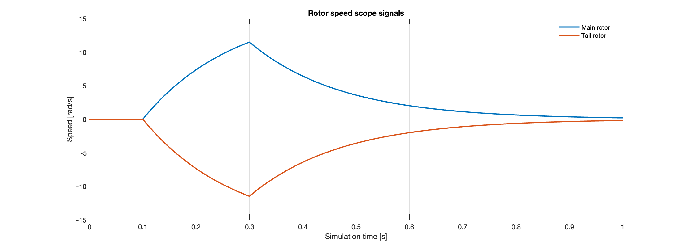

# AERO 2 laboratory development report

This report grows with each feature PR. It records the reasoning, the implemented configuration, and the validation evidence. The work begins with simulator setup; motor PI control is a later feature.

## Simulator setup

### Purpose and changes

We need to see the plant's response to a known voltage before designing a controller. The supplied top-level diagram has incomplete controller wiring and an initialization callback that calls the missing `nlc_setup` script.

`matlab/build_simulator.m` creates `simulink/aero2_simulator.slx`, copying the course's **Twin rotor (simplified model)** subsystem unchanged into a new, connected diagram. Its dynamics, zero initial state, internal amplifier and sensors are preserved. The new model has no missing initialization callback. Its sensor switch `meas_on = 0` is stored in the model workspace, so opening it does not require running the old initialization script or leaving variables in MATLAB's base workspace.

There is no controller in this model. The signal path is:

```text
Voltage pulse → voltage limit → course nonlinear plant → scopes and logging
```

### Voltage inputs

The two Pulse Generator blocks represent voltages, not speed references. Their parameters are saved in the diagram and can be inspected by double-clicking each block.

| Setting | Main voltage input | Tail voltage input |
|---|---:|---:|
| Pulse type | Time based | Time based |
| Amplitude | +1 V | -1 V |
| Period | 10 s | 10 s |
| Pulse width | 2% | 2% |
| Phase delay | 0.1 s | 0.1 s |
| Sample time | 0, continuous | 0, continuous |

Pulse width is specified as a percentage of the period: `10 s × 2/100 = 0.2 s`. Consequently, each voltage turns on at 0.1 s and off at 0.3 s. Simulation stops at 1 s, before a second pulse can occur. Opposite signs make it easy to distinguish the two motor channels.

Each input passes through a visible Saturation block with limits of -24 and +24 V. The voltage scope and log receive the signal after this limit, so they show the voltage passed into the plant. The course subsystem retains its own internal amplifier limit as well. For the default ±1 V test neither limit clips the signal.

### What each scope shows

A Scope is Simulink's time-domain signal viewer: the horizontal axis is simulation time, while the vertical axis is the signal value. These scopes observe signals; they do not control or modify the plant.

| Scope | Traces | What to look for |
|---|---|---|
| Voltage scope | Main and tail voltages, V | Rectangular +1/-1 V pulses between 0.1 and 0.3 s |
| Rotor speed scope | Main and tail speeds, rad/s | Speeds rise in opposite directions during the pulse, then decay toward zero |
| Body angle scope | Yaw and pitch, rad | Mechanical response caused by the voltage experiment; these angles are not regulated |

Legends, grids, unit labels and a 1 s time span are configured for all three scopes. Signal names are written on the diagram and carried into the viewers.

### Solver and recording

The model uses fixed-step forward Euler (`ode1`) with a 0.002 s step. Sensor timing is retained from the course plant. `Recorded signals` saves a time series every 0.002 s in `out.simulator_data`:

| Column | Signal |
|---|---|
| 1–2 | Main and tail voltages after the visible limits |
| 3–4 | Main and tail measured rotor speeds |
| 5–6 | Measured yaw and pitch |
| 7–8 | Measured yaw and pitch rates |

The default `meas_on = 0` disables the supplied sensor noise and makes the quantization numerically negligible. The validation script also runs a separate noise-enabled smoke test. No hardware is connected.

### Reproduce the experiment

With this repository as MATLAB's Current Folder:

```matlab
project = setup_project;
model = build_simulator;              % Recreate the working model
checks = validate_simulator;          % Run the baseline checks
export_simulator_figures;            % Regenerate selected documentation figures
open_system(model);
open_system([model '/Voltage scope']);
open_system([model '/Rotor speed scope']);
open_system([model '/Body angle scope']);
out = sim(model);                     % Run the default ±1 V experiment
```

If the models already exist, `build_simulator` is unnecessary: use `open_system(fullfile(project.simulink, 'aero2_simulator.slx'))`, then press Run. The builder overwrites the working model from its source commands, so commit intentional manual diagram changes or update the builder before rebuilding.

The builder also exports `aero2_simulator_R2021a.slx`. An export alone is not proof of execution in the laboratory's actual R2021a installation.

### Validation method

`validation/validate_simulator.m` checks zero-input equilibrium, each motor channel separately, both channels together, voltage clipping and the sensor toggle. It compares the rotor responses with the independently calculated response of the course equation:

```text
ω_dot = -5.78 ω + 96.532 v
```

For a constant voltage starting from rest, speed approaches `(96.532/5.78) v` exponentially. Once the pulse ends, speed decays exponentially with rate 5.78 s⁻¹. The permitted maximum discrepancy for the ±1 V tests is 0.15 rad/s, accounting for the supplied Euler approximation. Input amplitudes, signs and pulse times are checked separately.

The tests also compare the copied dynamics script and selected plant/sensor parameters directly with the original course subsystem. Raw experiment data and the numerical check table are written to ignored `results/`.

### Diagram and scope traces

The diagram below is exported directly from the working Simulink model. The three trace figures plot the exact logged signals connected to the Scope blocks; they are not screenshots of the native Scope window or parameter dialogs. Native window capture was unreliable during this session. Double-click the blocks in the model to inspect their actual dialogs and Scope controls.


**Voltage scope.** The two channels should remain at zero outside the short test pulse. This verifies what voltage actually reaches each input after the visible limits.


**Rotor speed scope.** Each motor accelerates during the pulse, then slows after voltage returns to zero. The negative tail trace is intentional and matches its negative input. These speeds are responses, not commanded speed references.



**Body angle scope.** The arm can move because motor torque acts on the mechanical system. We observe this response without attempting to hold either angle. In particular, yaw can continue changing after the pulse because the course model has no mechanical damping and there is no yaw feedback controller yet. The small numerical scale matters: this low-voltage experiment causes only a small angle change.


### Recorded outcomes

The R2024b simulator checks pass. The dynamics script, selected amplifier/sensor parameters and initial condition match the copied course subsystem. Source course files are also checked against the baseline commit.

| Check | Measured outcome | Acceptance |
|---|---:|---|
| Scope wiring | 6 input channels verified | Voltage, rotor-speed and angle viewers receive their intended signals |
| Zero-voltage equilibrium | Maximum recorded value 0 | Below 1e-10 |
| Main-only voltage error | 0 V | Correct sign, amplitude and timing |
| Tail-only voltage error | 0 V | Correct sign, amplitude and timing |
| Both-motor voltage error | 0 V | Correct independent channels |
| Maximum motor-model discrepancy in each ±1 V test | 0.0356842 rad/s | Below 0.15 rad/s |
| Deliberate ±30 V request | Limited to ±24 V | Exact amplifier limit |
| Noise-enabled smoke test | 501 finite recorded samples with sensor effects | Sensor switch works |

This establishes a usable baseline for the next feature, the motor PI controller. It does not test a controller settling-time target, physical hardware, or execution in actual MATLAB R2021a.
