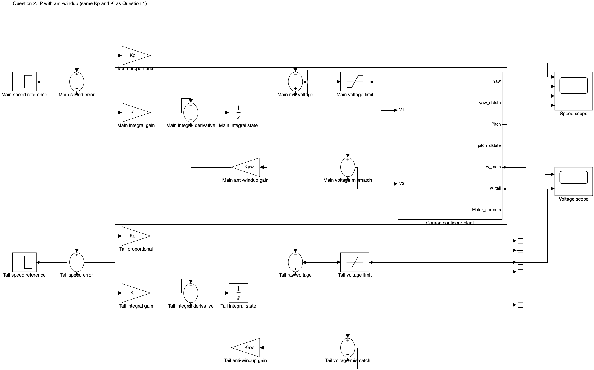
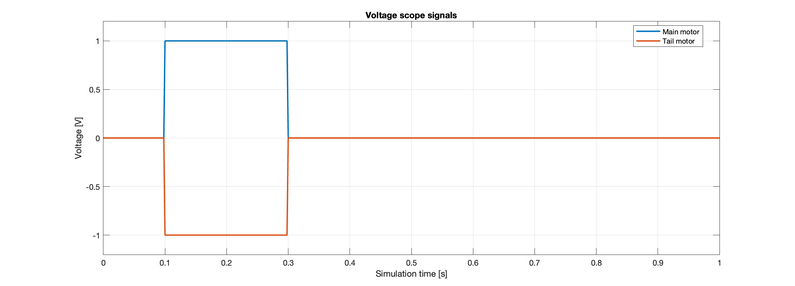
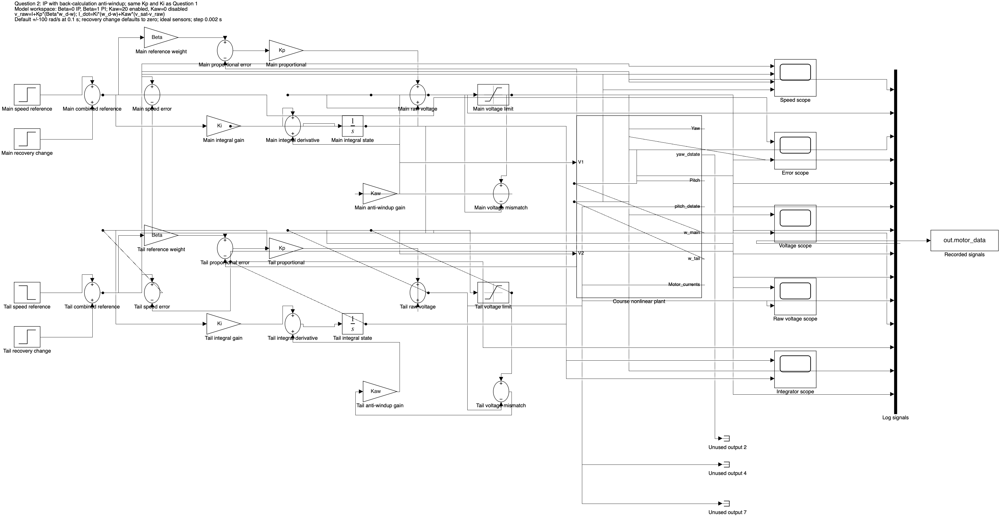
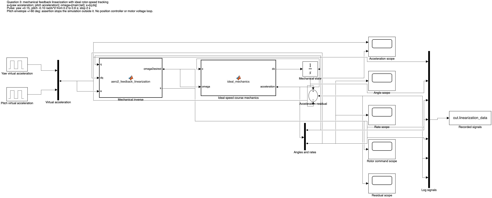
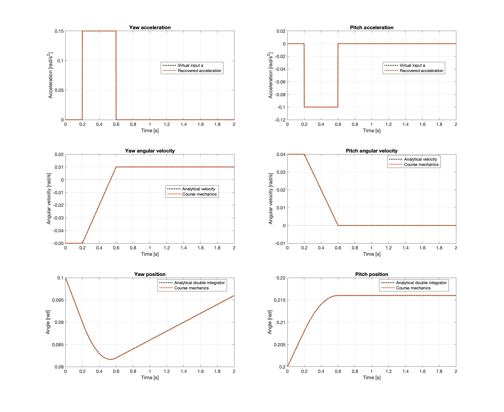
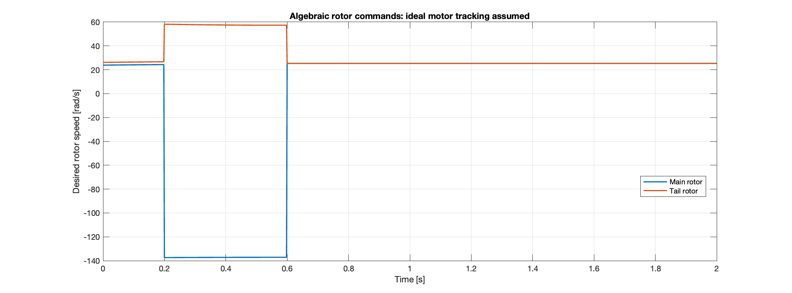

# AERO 2 laboratory development report

This report grows with each feature PR. It records the reasoning, the implemented configuration, and the validation evidence. The work begins with simulator setup, followed by Questions 1–3: PI, IP with anti-windup, and mechanical feedback linearization.

## Simple question models and separate experiments

The exercise answers are the three models directly under `simulink/`. Open these first when studying the control laws. Experiment generators, PI/IP comparison switches, recovery steps and diagnostic logging are kept in separate copies under `simulink/experiments/`.

| Question | Simple answer | Experiment copy |
|---|---|---|
| 1 — PI | `simulink/aero2_motor_pi.slx` | `simulink/experiments/aero2_motor_pi_experiment.slx` |
| 2 — IP + anti-windup | `simulink/aero2_motor_ip.slx` | `simulink/experiments/aero2_motor_ip_experiment.slx` |
| 3 — Feedback linearization | `simulink/aero2_mechanical_linearization.slx` | `simulink/experiments/aero2_mechanical_linearization_experiment.slx` |

Each model has a corresponding `_R2021a.slx` export. The original models in `course/` are unchanged. The existing open-loop setup model remains available as preparation material.

The simple motor models have one speed-reference Step block per motor, the controller, voltage limits, the supplied plant, and speed/voltage scopes. Question 2 explicitly implements `v_raw = I - Kp*omega`: there is no reference-weight selector or recovery-command sum. Its anti-windup path remains visible because it is part of the answer. Neither model contains the diagnostic logging mux or To Workspace block.




The simple Question 3 model contains one vector acceleration Step, the inverse, ideal-speed mechanics, a state integrator, angle/rate feedback and an angle scope. It starts from zero state, and the input changes from `[0;0]` to `[0.15;-0.1]` rad/s² at 0.2 s. This makes the ideal double-integrator response easy to inspect. The inverse retains its pitch-envelope assertion. Residual calculations, diagnostic outputs and logging are confined to the experiment copy.


To rebuild the simple answers and their experiment copies:

```matlab
project = setup_project;
build_motor_pi;
build_motor_ip;
build_feedback_linearization;
open_system(fullfile(project.simulink,'aero2_motor_ip.slx'));
open_system('aero2_motor_ip/Speed scope');
open_system('aero2_motor_ip/Voltage scope');
```

The builders recreate the experiment copy first, then produce the simple answer with the same equations and essential connections. `matlab/create_question_model.m` performs that reduction. The Question 1–3 `validate_*` scripts and trace exporters now use the experiment copies. Their measured results and the detailed diagnostic settings below describe those experiment copies. The diagrams labeled “Simple Question” above show the answer models; detailed diagrams later in the report show the experiment setup.

`validate_question_models` separately checks that the simple answers reproduce the experiment dynamics under matching inputs and initial conditions. It temporarily adds logging only to the loaded model, compares references, states and controller signals, then discards that instrumentation without saving it. For Question 3 the comparison temporarily configures the experiment's pulse to remain active through the run and sets its initial state to zero, matching the simple Step demonstration. Thus differences in demonstration inputs are not mistaken for controller differences.

## Simulator setup

### Purpose and changes

We need to see the plant's response to a known voltage before designing a controller. The supplied top-level diagram has incomplete controller wiring and an initialization callback that calls the missing `nlc_setup` script.

`matlab/build_simulator.m` creates `simulink/aero2_simulator.slx`, copying the course's **Twin rotor (simplified model)** subsystem unchanged into a new, connected diagram. Its dynamics, zero initial state, internal amplifier and sensors are preserved. The new model has no missing initialization callback. Its sensor switch `meas_on = 0` is stored in the model workspace, so opening it does not require running the old initialization script or leaving variables in MATLAB's base workspace.

There is no controller in this model. The signal path is:

```text
Voltage pulse → voltage limit → course nonlinear plant → scopes and logging
```

### Voltage inputs

The two Pulse Generator blocks represent voltages, not speed references. Their parameters are saved in the diagram and can be inspected by double-clicking each block.

| Setting | Main voltage input | Tail voltage input |
|---|---:|---:|
| Pulse type | Time based | Time based |
| Amplitude | +1 V | -1 V |
| Period | 10 s | 10 s |
| Pulse width | 2% | 2% |
| Phase delay | 0.1 s | 0.1 s |
| Sample time | 0, continuous | 0, continuous |

Pulse width is specified as a percentage of the period: `10 s × 2/100 = 0.2 s`. Consequently, each voltage turns on at 0.1 s and off at 0.3 s. Simulation stops at 1 s, before a second pulse can occur. Opposite signs make it easy to distinguish the two motor channels.

Each input passes through a visible Saturation block with limits of -24 and +24 V. The voltage scope and log receive the signal after this limit, so they show the voltage passed into the plant. The course subsystem retains its own internal amplifier limit as well. For the default ±1 V test neither limit clips the signal.

### What each scope shows

A Scope is Simulink's time-domain signal viewer: the horizontal axis is simulation time, while the vertical axis is the signal value. These scopes observe signals; they do not control or modify the plant.

| Scope | Traces | What to look for |
|---|---|---|
| Voltage scope | Main and tail voltages, V | Rectangular +1/-1 V pulses between 0.1 and 0.3 s |
| Rotor speed scope | Main and tail speeds, rad/s | Speeds rise in opposite directions during the pulse, then decay toward zero |
| Body angle scope | Yaw and pitch, rad | Mechanical response caused by the voltage experiment; these angles are not regulated |

Legends, grids, unit labels and a 1 s time span are configured for all three scopes. Signal names are written on the diagram and carried into the viewers.

### Solver and recording

The model uses fixed-step forward Euler (`ode1`) with a 0.002 s step. Sensor timing is retained from the course plant. `Recorded signals` saves a time series every 0.002 s in `out.simulator_data`:

| Column | Signal |
|---|---|
| 1–2 | Main and tail voltages after the visible limits |
| 3–4 | Main and tail measured rotor speeds |
| 5–6 | Measured yaw and pitch |
| 7–8 | Measured yaw and pitch rates |

The default `meas_on = 0` disables the supplied sensor noise and makes the quantization numerically negligible. The validation script also runs a separate noise-enabled smoke test. No hardware is connected.

### Reproduce the experiment

With this repository as MATLAB's Current Folder:

```matlab
project = setup_project;
model = build_simulator;              % Recreate the working model
checks = validate_simulator;          % Run the baseline checks
export_simulator_figures;            % Regenerate selected documentation figures
open_system(model);
open_system([model '/Voltage scope']);
open_system([model '/Rotor speed scope']);
open_system([model '/Body angle scope']);
out = sim(model);                     % Run the default ±1 V experiment
```

If the models already exist, `build_simulator` is unnecessary: use `open_system(fullfile(project.simulink, 'aero2_simulator.slx'))`, then press Run. The builder overwrites the working model from its source commands, so commit intentional manual diagram changes or update the builder before rebuilding.

The builder also exports `aero2_simulator_R2021a.slx`. An export alone is not proof of execution in the laboratory's actual R2021a installation.

### Validation method

`validation/validate_simulator.m` checks zero-input equilibrium, each motor channel separately, both channels together, voltage clipping and the sensor toggle. It compares the rotor responses with the independently calculated response of the course equation:

```text
ω_dot = -5.78 ω + 96.532 v
```

For a constant voltage starting from rest, speed approaches `(96.532/5.78) v` exponentially. Once the pulse ends, speed decays exponentially with rate 5.78 s⁻¹. The permitted maximum discrepancy for the ±1 V tests is 0.15 rad/s, accounting for the supplied Euler approximation. Input amplitudes, signs and pulse times are checked separately.

The tests also compare the copied dynamics script and selected plant/sensor parameters directly with the original course subsystem. Raw experiment data and the numerical check table are written to ignored `results/`.

### Diagram and scope traces

The diagram below is exported directly from the working Simulink model. The three trace figures plot the exact logged signals connected to the Scope blocks; they are not screenshots of the native Scope window or parameter dialogs. Native window capture was unreliable during this session. Double-click the blocks in the model to inspect their actual dialogs and Scope controls.


**Voltage scope.** The two channels should remain at zero outside the short test pulse. This verifies what voltage actually reaches each input after the visible limits.



**Rotor speed scope.** Each motor accelerates during the pulse, then slows after voltage returns to zero. The negative tail trace is intentional and matches its negative input. These speeds are responses, not commanded speed references.


**Body angle scope.** The arm can move because motor torque acts on the mechanical system. We observe this response without attempting to hold either angle. In particular, yaw can continue changing after the pulse because the course model has no mechanical damping and there is no yaw feedback controller yet. The small numerical scale matters: this low-voltage experiment causes only a small angle change.


### Recorded outcomes

The R2024b simulator checks pass. The dynamics script, selected amplifier/sensor parameters and initial condition match the copied course subsystem. Source course files are also checked against the baseline commit.

| Check | Measured outcome | Acceptance |
|---|---:|---|
| Scope wiring | 6 input channels verified | Voltage, rotor-speed and angle viewers receive their intended signals |
| Zero-voltage equilibrium | Maximum recorded value 0 | Below 1e-10 |
| Main-only voltage error | 0 V | Correct sign, amplitude and timing |
| Tail-only voltage error | 0 V | Correct sign, amplitude and timing |
| Both-motor voltage error | 0 V | Correct independent channels |
| Maximum motor-model discrepancy in each ±1 V test | 0.0356842 rad/s | Below 0.15 rad/s |
| Deliberate ±30 V request | Limited to ±24 V | Exact amplifier limit |
| Noise-enabled smoke test | 501 finite recorded samples with sensor effects | Sensor switch works |

This establishes a usable baseline for the next feature, the motor PI controller. It does not test a controller settling-time target, physical hardware, or execution in actual MATLAB R2021a.

## Question 1 — Motor-speed PI control

### Physical meaning and objective


The annotated photograph comes from Part II, page 4 of the supplied guide. In this helicopter configuration, the main rotor has a horizontal propeller plane and primarily produces pitch motion; the tail rotor has a vertical propeller plane and primarily produces yaw motion. Both motors also contribute coupling torques. Motor spin speeds `w_main` and `w_tail` are distinct from the body's yaw and pitch angles. The course plant inputs `V1` and `V2` are main and tail motor voltages, respectively.

Question 1 asks for PI control of the blade speed with approximately 0.3 s settling time, verified in the supplied simulation. Our desired inputs are now **speeds**, not voltages. The two PI controllers compute the voltages needed to make measured speeds follow those references. The mechanical body remains free to move; position regulation belongs to later questions.

### Derivation and gain selection

Each motor obeys the identical supplied equation

$$\dot\omega=-5.78\omega+96.532v.$$

For zero initial conditions, its voltage-to-speed transfer function is

$$P(s)=\frac{\Omega(s)}{V(s)}=\frac{96.532}{s+5.78}.$$

With error $e=\omega_d-\omega$, choose

$$v_{\mathrm{raw}}=K_pe+I,\qquad\dot I=K_ie.$$

Thus $C(s)=K_p+K_i/s$, and the unsaturated closed-loop transfer function is

$$\frac{\Omega(s)}{\Omega_d(s)}=
\frac{96.532K_ps+96.532K_i}
{s^2+(5.78+96.532K_p)s+96.532K_i}.$$

Match its denominator to critically damped poles $(s+\lambda)^2$. Using the familiar initial 2% estimate $T_s\approx4/\lambda$, set $\lambda=4/0.3=13.3333\ \mathrm{s^{-1}}$. Matching coefficients gives

$$K_p=\frac{2\lambda-5.78}{96.532}=0.2163703919,$$

$$K_i=\frac{\lambda^2}{96.532}=1.8416460633.$$

The authoritative gains are calculated from these equations in `matlab/parameters/motor_pi_parameters.m`; rounded values here are for reading. Both motors use the same gains because their supplied motor dynamics are identical. The units of $K_p$ and $K_i$ are V/(rad/s) and V/rad, respectively.

Critical damping describes the poles. The PI numerator has a zero, so the reference response can still overshoot and its exact settling time differs from $4/\lambda$. For a step of amplitude $A$ at time zero, the independent continuous-time solution is

$$\omega(t)=A\left[1-e^{-\lambda t}\left(1+(5.78-\lambda)t\right)\right].$$

This expression is used as a check against the simulation, rather than asserting that critically damped poles guarantee zero overshoot. With integral action, constant reachable references have zero steady-state error in this ideal motor model.

### Implemented Simulink solution

`matlab/build_motor_pi_experiment.m` generates `simulink/experiments/aero2_motor_pi_experiment.slx` and an R2021a export. The separate open-loop baseline remains available. The new model copies the original course nonlinear plant, internal amplifier, sensor model and zero initial state. Ideal measurements are selected with `meas_on=0` in the model workspace. Gains `Kp` and `Ki` are also stored there, so the saved model runs independently of base-workspace variables.

Each motor loop is assembled from visible Sum, Gain, Integrator and Saturation blocks:

```text
Desired speed → error → [Kp in parallel with Ki/s] → raw voltage
                  ↑                                  ↓
             measured speed ← course plant ← ±24 V limit
```

The proportional path acts on error. This is PI control; the IP rearrangement and anti-windup are Question 2 and have not been introduced here. The integral state is initialized to zero and logged in volts because it is the integral contribution to the controller output.

| Configuration | Value |
|---|---|
| Main speed Step block | 0 → +100 rad/s at 0.1 s |
| Tail speed Step block | 0 → -100 rad/s at 0.1 s |
| Step sample time | 0, continuous |
| Controller | Continuous PI integrated by the Simulink solver |
| Voltage limits | -24 to +24 V, outside and inside the copied plant |
| Solver | Fixed-step forward Euler, 0.002 s |
| Stop time | 1 s |
| Initial motor speeds and integral contributions | Zero |

The voltage is now the **controller output**, rather than a configured voltage pulse. To edit the default experiment, double-click `Main speed reference` or `Tail speed reference` and change the Step block's final speed. To inspect gains, open the model workspace or the parameter function and rebuild. There is no angle command at this stage.

| Scope | Signals |
|---|---|
| Speed scope | Main desired/measured speed, then tail desired/measured speed; four traces in rad/s |
| Error scope | Main and tail speed errors in rad/s |
| Voltage scope | Main and tail applied voltages after the visible limits, in V |

`out.motor_data` logs 14 columns: main/tail references (1–2), measured speeds (3–4), errors (5–6), raw voltages (7–8), applied voltages (9–10), integral contributions (11–12), then yaw/pitch angles (13–14). Logging uses the solver rate, so the refinement experiment also records its smaller step. All logged signals must remain finite.


### Validation and reproduction

From the repository Current Folder:

```matlab
project = setup_project;
model = build_motor_pi_experiment;
metrics = validate_motor_pi;
export_motor_pi_figures;
open_system(model);
open_system([model '/Speed scope']);
open_system([model '/Error scope']);
open_system([model '/Voltage scope']);
out = sim(model);
```

For a saved model, rebuilding is optional: `open_system(fullfile(project.experiments, 'aero2_motor_pi_experiment.slx'))`, open the scopes and press Run. Builders overwrite their generated models; implement lasting diagram changes in the builder.

`validation/validate_motor_pi.m` tests +100 and -100 rad/s on each motor independently, simultaneous opposite-sign steps, and a zero-reference equilibrium. Independent-channel tests detect swapped feedback or accidental coupling of speed commands. Signed tests detect incorrect feedback signs. Every commanded channel is compared with the analytical solution above, which detects an incorrect motor model or controller realization.

Settling time is measured **relative to the 0.1 s step**, at the first recorded sample after the last departure from a ±2 rad/s band, remaining inside until the 1 s simulation end. Acceptance is 0.24–0.36 s under our agreed ±20% interpretation of approximately 0.3 s. Final error must be below 1 rad/s. Nominal tests must have no saturation; raw and applied voltages are compared sample by sample. A half-step run at 0.001 s must preserve the timing result within 0.01 s. Raw runs, integral states, the refinement run and the metrics CSV are saved under ignored `results/`.


These are plots of the signals connected to the Scope blocks and an actual model diagram export, rather than native Scope-window screenshots. The positive and negative single-motor tests are overlaid; the simultaneous test is checked numerically and retained in the raw data.

### Measured results and conclusion

The ±100 rad/s single-axis tests and both simultaneous opposite-sign tests give the same motor metrics because the supplied motor equations are identical and independent of the mechanical body motion.

| Metric | Main motor, either sign | Tail motor, either sign |
|---|---:|---:|
| 2% settling time, measured from step | 0.318 s | 0.318 s |
| Overshoot | 3.7021% | 3.7021% |
| Absolute final error at 1 s | 0.003124 rad/s | 0.003124 rad/s |
| Peak absolute applied voltage | 21.6370 V | 21.6370 V |
| Time in voltage saturation | 0 s | 0 s |
| Maximum discrepancy from continuous analytical solution | 0.81949 rad/s | 0.81949 rad/s |

The discrepancy from the continuous formula includes the supplied Euler discretization; the independent solution has no numerical integration error. The 0.318 s result is 6% longer than the nominal 0.3 s target and lies inside our agreed 0.24–0.36 s acceptance band. The small overshoot is consistent with the PI zero despite repeated real poles. The initial proportional action demands about 21.64 V for a 100 rad/s error; the final holding voltage is about 5.99 V, matching $5.78(100)/96.532$.

Question 1 passes the stated simulation criteria. These gains have only been assessed for these reachable nominal speed commands with ideal measurements. Larger commands may saturate and wind up the integral term; Question 2 introduces IP control and anti-windup. Body-angle regulation, sensor-noise performance and physical experiments remain later stages.

With the integration step reduced to 0.001 s, both motors settle in **0.319 s**, a 0.001 s change from the nominal simulation. The exact continuous-time expression predicts approximately 0.31924 s. This supports the timing conclusion and explains the small numerical difference. All original open-loop simulator checks also pass, the copied PI-model dynamics and sensor settings match the course plant, and the five course files remain byte-identical to `course-baseline`.

MATLAB R2024b Code Analyzer reports no issues in the four new MATLAB functions. The R2021a-exported model was loaded and simulated in R2024b after clearing the workspace; its logged signals are finite. Actual R2021a execution and hardware validation have not been performed.

## Question 2 — IP control with anti-windup

### Requirement and reasoning

The second task asks us to replace PI with IP **using the same parameters** and include anti-windup feedback. We retain $K_p=0.2163703919$ and $K_i=1.8416460633$. The mechanical plant remains the supplied nonlinear model; no position controller is present.

For both structures, integral action uses the full speed error. Proportional action changes as follows:

$$\text{PI:}\quad v_{\mathrm{raw}}=I+K_p(\omega_d-\omega),$$

$$\text{IP:}\quad v_{\mathrm{raw}}=I-K_p\omega.$$

The implementation provides both using a reference weight $\beta$:

$$v_{\mathrm{raw}}=I+K_p(\beta\omega_d-\omega),\qquad
\beta=1\text{ for PI},\quad\beta=0\text{ for IP}.$$

For an unsaturated motor, the closed-loop denominator is unchanged:

$$D(s)=s^2+(5.78+96.532K_p)s+96.532K_i=(s+13.3333)^2.$$

The IP numerator is $96.532K_i$, whereas PI has $96.532(K_ps+K_i)$. Thus IP removes the reference-response zero. For a step of amplitude $A$ from rest, IP gives

$$\omega(t)=A\left[1-(1+\lambda t)e^{-\lambda t}\right].$$

This response is monotonic with our repeated real poles. Its exact continuous 2% settling time solves $(1+\lambda T_s)e^{-\lambda T_s}=0.02$, giving approximately **0.438 s**. It would be incorrect to expect exactly the Question 1 timing after changing the numerator while retaining the poles. Question 2 explicitly preserves the gains, so we report the difference rather than retuning it away. At the instant of the reference step, PI produces approximately 21.64 V; IP starts at zero voltage and builds its integral contribution.

### Back-calculation anti-windup

The motor voltage is limited to ±24 V. When raw voltage exceeds that limit, the motor cannot receive the requested action, but an ordinary integrator keeps accumulating error. This can delay recovery after a reachable command is restored.

We use the actual limited voltage in a back-calculation path:

$$v_{\mathrm{sat}}=\operatorname{sat}_{[-24,24]}(v_{\mathrm{raw}}),$$

$$\dot I=K_i(\omega_d-\omega)
+K_{\mathrm{aw}}(v_{\mathrm{sat}}-v_{\mathrm{raw}}),\qquad
K_{\mathrm{aw}}=\frac{1}{T_t}=20\ \mathrm{s^{-1}},\quad T_t=0.05\ \mathrm{s}.$$

During positive saturation the correction is negative, opposing integral buildup; negative saturation reverses its sign. Without saturation, raw and applied voltage are equal and this term is exactly zero. The integral contribution has units of volts. It is **not** clipped to ±24 V: it must also compensate the proportional feedback term $-K_p\omega$. Anti-windup limits excess accumulation through feedback rather than imposing a fixed integral clamp.

### Implemented files, blocks and selection

`matlab/parameters/motor_ip_parameters.m` imports the original PI parameters and adds the reference weight, tracking time and recovery-step time. `matlab/build_motor_ip_experiment.m` extends the saved PI model into a separate `simulink/experiments/aero2_motor_ip_experiment.slx`, retaining Question 1 as a comparison baseline. It also exports an R2021a version. The original course files are unchanged.

For each motor, inspect these additions:

| Block | Purpose |
|---|---|
| Reference weight and proportional error | Form $\beta\omega_d-\omega$ for the proportional gain |
| Voltage mismatch | Subtract raw voltage from the applied ±24 V limited voltage |
| Anti-windup gain | Multiply that difference by $K_{\mathrm{aw}}$ |
| Integral derivative | Add the anti-windup correction to $K_i e$ before integration |
| Recovery change and combined reference | Add an optional second speed step for saturation/recovery tests |

The model workspace stores `Beta=0` and `Kaw=20` by default: IP with anti-windup. `Beta=1` selects PI; `Kaw=0` disables anti-windup. These selections are independent, permitting controlled comparisons. For example, after opening the model:

```matlab
ws = get_param('aero2_motor_ip_experiment','ModelWorkspace');
assignin(ws,'Beta',0);   % IP; use 1 for PI
assignin(ws,'Kaw',20);   % Anti-windup; use 0 to disable
```

The parameter function sets builder defaults; the workspace values select the currently loaded model. Validation uses temporary `SimulationInput` overrides and retains the saved defaults.

Default first Step blocks command main +100 and tail -100 rad/s at 0.1 s. The recovery Step blocks change the command by zero at 1.1 s, so they have no effect in the default 1 s run. All reference blocks are continuous (`SampleTime=0`). For the stress test, the first steps command +800/-800 rad/s; second steps add -700/+700 rad/s at 1.1 s, returning to +100/-100 rad/s. Simulation runs until 5 s. Both tests retain ideal measurements and the 0.002 s Euler step.

The stress request is intentionally unreachable: the nominal motor model and ±24 V limit permit at most approximately $96.532(24)/5.78=400.8$ rad/s at steady state. These are simulated voltages and speeds, not approved hardware operating commands.

The existing Speed, Error and Voltage scopes retain their Question 1 channel order. Two new scopes show main/tail **raw voltage** and **integral contribution**. The same 14-column `out.motor_data` layout records references, speeds, errors, raw voltages, applied voltages, integral contributions and yaw/pitch angles. Compare raw and applied voltage to identify saturation.



### Validation method and reproduction

```matlab
project = setup_project;
model = build_motor_ip_experiment;
[nominal, recovery] = validate_motor_ip;
export_motor_ip_figures;
open_system(model);
open_system([model '/Speed scope']);
open_system([model '/Voltage scope']);
open_system([model '/Raw voltage scope']);
open_system([model '/Integrator scope']);
out = sim(model);
```

For saved models, rebuilding is optional. `validation/validate_motor_ip.m` compares PI, IP and IP with anti-windup for both signed pairs of ±100 rad/s commands. It checks agreement with independent analytical responses, no nominal saturation, monotonic IP behavior and equality of unsaturated IP results with anti-windup enabled/disabled. The original gains and course dynamics are checked directly.

The saturation test compares IP with and without anti-windup, in both voltage directions, using the same unreachable command and return time. It requires finite logged signals, actual saturation at ±24 V, final speed error below 0.1 rad/s, faster recovery with anti-windup, and less than half the peak integral accumulation. For this finite-duration experiment, an additional 250 V peak integral bound detects excessive accumulation; it is a test acceptance threshold, not an integrator clamp or a universal bound for arbitrary commands. Recovery time is measured from the 1.1 s return command until speed enters and remains within ±2 rad/s of its restored ±100 rad/s target. The saturation test is repeated with a 0.001 s integration step, requiring recovery-time agreement within 0.02 s. A zero-reference test checks equilibrium.

Raw recordings, the refinement run and CSV metrics are saved in ignored `results/`. Figures below plot the exact logged Scope signals and export the actual diagram; they are not native-window screenshots.


### Results and interpretation

For both motors and both command signs, the nominal results are:

| Metric | PI, no anti-windup | IP, no anti-windup | IP with anti-windup |
|---|---:|---:|---:|
| 2% settling time from the 0.1 s step | 0.318 s | 0.434 s | 0.434 s |
| Overshoot | 3.7021% | 0% | 0% |
| Peak absolute applied voltage | 21.6370 V | 7.3591 V | 7.3591 V |
| Absolute final speed error at 1 s | 0.003124 rad/s | 0.006958 rad/s | 0.006958 rad/s |
| Time in saturation | 0 s | 0 s | 0 s |

IP is slower but monotonic, consistent with the changed numerator and unchanged poles. Anti-windup has no effect on these unsaturated IP responses; the recorded arrays with it enabled and disabled agree within 1e-9. We have not retuned the gains to conceal the timing difference requested by the exercise.

For the intentionally unreachable ±800 rad/s command, followed by a return to ±100 rad/s at 1.1 s:

| Metric | IP without anti-windup | IP with anti-windup |
|---|---:|---:|
| Recovery settling time after return | 1.898 s | 0.570 s |
| Peak absolute integral contribution over the full run | 869.91 V | 147.26 V |
| Time saturated after return | 1.372 s | 0.042 s |
| Peak absolute applied voltage over the full run | 24 V | 24 V |
| Absolute final speed error at 5 s | Below 1e-8 rad/s | Below 1e-8 rad/s |

These values are the same for both motors and sign directions. Without anti-windup, the stored integral action keeps the voltage saturated well after the reference has become reachable. Back-calculation reduces that stored excess and allows the loop to recover about 70% faster. The peak integral contribution is about 83% smaller. Both variants eventually recover; the improvement concerns transient behavior, not a different feasible steady-state target.

Question 2 meets the intended simulation objectives: unchanged gains, a verified IP reference response, effective anti-windup in both directions, finite states and reduced integral accumulation. The speed controller is still independent of body-angle regulation. The tests are simulation evidence and do not authorize applying the stress commands to the physical apparatus.

The half-step saturation run recovers in **0.572 s**, versus 0.570 s at the supplied step. Independent single-motor tests keep the uncommanded motor at rest, and the Question 1 regression suite still passes. Code Analyzer reports no issues in the four new functions. The R2021a export runs in R2024b after clearing the workspace, with finite recorded signals; actual R2021a execution remains unverified. All five course files are byte-identical to the course baseline.

The native scopes default to a 1 s time span for the nominal experiment. If manually running the 5 s stress test, change their Time span to 5 s to view the full transient. The exported recovery figure already shows the complete 5 s record.

## Question 3 — Mechanical feedback linearization

### Objective and modeling assumption

The third item in [Part II of the course guide](../course/Automatic_Control_III_Computer_Room_II.pdf), page 6, asks us to assume that the motor loops track perfectly, so $\omega=\omega_d$, and treat desired rotor speeds as the new inputs. We must linearize the yaw/pitch dynamics, identify the resulting states and determine the validity range. This stage does not yet design the 3 s position controller; that is Question 4.

Use the signal order

$$q=\begin{bmatrix}\psi\\\theta\end{bmatrix},\qquad
\dot q=\begin{bmatrix}\dot\psi\\\dot\theta\end{bmatrix},\qquad
\omega_d=\begin{bmatrix}\omega_{m,d}\\\omega_{t,d}\end{bmatrix}.$$

Here yaw and pitch describe the AERO 2 body's orientation; rotor speeds describe propeller spin. Perfect tracking removes the two motor states from this particular test bench. Its mechanical state is

$$x=\begin{bmatrix}q\\\dot q\end{bmatrix}
=\begin{bmatrix}\psi&\theta&\dot\psi&\dot\theta\end{bmatrix}^{T}.$$

The full voltage-driven plant still has six states. We retain the PI/IP models for later cascade validation rather than pretending that their measured delay has disappeared physically.

### Derivation of the inverse

From the simplified course model on page 5, with zero mechanical damping:

$$M_q(q)\ddot q+c_q(q,\dot q)+g_q(q)=\Gamma(\theta)s,$$

$$s=\begin{bmatrix}\omega_m|\omega_m|\\\omega_t|\omega_t|\end{bmatrix}.$$

The signed squared speed is essential: negative rotor speed reverses the modeled torque. Squaring speed without its sign would lose that behavior.

Using the supplied parameters,

$$M_q=\begin{bmatrix}
J_\psi\cos^2\theta+j_\psi\sin^2\theta&0\\0&J_\theta
\end{bmatrix},$$

$$c_q=\begin{bmatrix}
-(J_\psi-j_\psi)\sin(2\theta)\dot\theta\dot\psi\\
\tfrac12(J_\psi-j_\psi)\sin(2\theta)\dot\psi^2
\end{bmatrix},\qquad
 g_q=\begin{bmatrix}0\\G\sin\theta\end{bmatrix},$$

$$\Gamma(\theta)=\begin{bmatrix}\cos\theta&0\\0&1\end{bmatrix}
\begin{bmatrix}-k_t&Lk_f\\Lk_f&k_t\end{bmatrix}.$$

Introduce a virtual acceleration input $a=[a_\psi,a_\theta]^T$ and request the torque needed for $\ddot q=a$:

$$\tau_d=M_q a+c_q+g_q.$$

Solve for the signed squared rotor speeds, then invert each component:

$$\boxed{s=\Gamma(\theta)\backslash\left(M_q a+c_q+g_q\right)},$$

$$\boxed{\omega_d=\operatorname{sign}(s)\sqrt{|s|}}.$$

The operations in the second box are componentwise. `matlab/mechanics/aero2_feedback_linearization.m` implements a matrix solve, not an explicitly calculated inverse. At $s_i=0$, `sign(0)*sqrt(0)` returns exactly zero without division by speed.

Substitute the result into the original mechanical equation:

$$\ddot q=M_q^{-1}\left[\Gamma s-c_q-g_q\right]
=M_q^{-1}\left[M_q a+c_q+g_q-c_q-g_q\right]=a.$$

Gravity, velocity coupling and rotor cross-axis coupling are canceled in this exact model. A zero requested acceleration can therefore require nonzero rotor speeds: the controller may need to balance gravity or velocity-dependent torques.

### Linearized states and dynamics

The mechanical state coordinates already contain the output and its first derivative, so choose $z=[q^T,\dot q^T]^T=x$. The resulting system is two double integrators:

$$\dot z=
\underbrace{\begin{bmatrix}0_{2\times2}&I_2\\0_{2\times2}&0_{2\times2}\end{bmatrix}}_{A}z+
\underbrace{\begin{bmatrix}0_{2\times2}\\I_2\end{bmatrix}}_{B}a,
\qquad q=\underbrace{\begin{bmatrix}I_2&0_{2\times2}\end{bmatrix}}_C z.$$

Equivalently, $\ddot\psi=a_\psi$ and $\ddot\theta=a_\theta$. In the signed squared-speed input coordinates, the vector relative degree is $(2,2)$ and accounts for all four ideal mechanical states; there are no remaining internal mechanical zero dynamics in this reduced model. The motor dynamics have been assumed ideal, not proven absent in the real system.

This is not a stabilizing position controller. With $a=0$, existing angular velocities remain constant. Question 4 will choose $a$ using angle errors and measured angular velocities.

### Validity and physical feasibility

1. **Mechanical inertia.** Both diagonal inertia terms are positive for every pitch because the supplied inertias are positive. Inverting $M_q$ introduces no pitch singularity here.
2. **Rotor torque map.** Its determinant is

   $$\det\Gamma(\theta)=-\cos\theta\left(k_t^2+(Lk_f)^2\right).$$

   Thus the inverse fails at $\theta=\pi/2+k\pi$. Near those pitches, large rotor commands may be needed even before the matrix becomes singular. Our implementation uses the conservative **simulation envelope** $|\theta|\le60^\circ$; leaving it raises an assertion and stops the run. This is not an approved hardware travel limit.
3. **Zero rotor speed.** The signed square root is continuous and defined at zero, so the algebraic cancellation remains evaluable there. Its derivative is unbounded at zero. Consequently, the input transformation is not a smooth diffeomorphism through zero speed. The smooth local feedback interpretation in the course linearization theory applies away from zero rotor speeds, with $\cos\theta\ne0$. Passing through zero also challenges the ideal instantaneous motor-tracking assumption.
4. **Actuator feasibility.** The inverse does not enforce motor voltage limits. A constant rotor command must at least satisfy $|5.78\omega_d/96.532|\le24$ V in the nominal motor model. Dynamic tracking additionally requires $|\dot\omega_d+5.78\omega_d|\le96.532(24)$; steps in ideal rotor command cannot be followed instantaneously by finite-voltage motors. These are checks for later cascade work, not limits silently applied to this ideal inverse.
5. **Model and measurement accuracy.** Exact cancellation assumes the supplied simplified parameters and exact angles/rates. Noise, parameter errors, unmodeled effects and finite motor bandwidth will produce residual acceleration errors in the complete system.

The chosen envelope avoids the pitch singularity; it does not guarantee actuator feasibility or hardware safety for arbitrary virtual accelerations.

### Implementation and visible simulation configuration

| File | Role |
|---|---|
| `matlab/parameters/aero2_mechanical_parameters.m` | Supplied mechanical constants, simulation envelope, initial state and pulse amplitudes |
| `matlab/mechanics/aero2_mechanical_terms.m` | Computes the inertia, velocity terms, gravity and rotor torque map |
| `matlab/mechanics/aero2_feedback_linearization.m` | Matrix solve, signed square root and pitch-envelope assertion |
| `matlab/build_feedback_linearization_experiment.m` | Builds the ideal-speed mechanical Simulink test bench and R2021a export |
| `validation/validate_feedback_linearization.m` | Independent course-equation substitution, time simulation and envelope-stop tests |
| `validation/export_feedback_linearization_figures.m` | Exports the actual diagram and plots of logged Scope signals |

`simulink/experiments/aero2_mechanical_linearization_experiment.slx` contains a dedicated **Mechanical inverse** MATLAB Function block and **Ideal-speed course mechanics** block. The inverse embeds the three pure MATLAB functions so that the saved model does not depend on their external path. The plant block embeds the original course dynamics code unchanged except for a renamed local entry point. It supplies the computed rotor speeds algebraically, then retains only the four mechanical derivatives; it neither integrates the discarded motor derivatives nor simulates motor voltages. The new working model uses ideal state measurements, rather than the original sensor blocks, consistently with the derivation.

The Integrator block stores the four-state mechanical vector; a Demux separates angles and rates for feedback. The experiment commands **accelerations**, not desired positions or motor voltages:

| Setting | Value |
|---|---|
| Initial yaw/pitch | 0.1 / 0.2 rad |
| Initial yaw/pitch rates | -0.05 / +0.04 rad/s |
| Yaw virtual acceleration | +0.15 rad/s² from 0.2 to 0.6 s |
| Pitch virtual acceleration | -0.10 rad/s² from 0.2 to 0.6 s |
| Pulse Generator settings | Period 10 s, width 4%, phase delay 0.2 s, continuous sample time 0 |
| Solver | Fixed-step forward Euler, 0.002 s |
| Stop time | 2 s |
| Pitch envelope | ±60°, enforced inside the inverse |

The nonzero initial pitch and rates exercise compensation beyond the rest configuration. Acceleration pulse width is `10 × 4/100 = 0.4 s`. Double-click the two Pulse Generator blocks to inspect or edit the virtual inputs; change `X0` in the model workspace for initial conditions.

| Scope | What it shows |
|---|---|
| Acceleration scope | First vector port: requested yaw/pitch acceleration; second: acceleration recovered by the course mechanics |
| Angle scope | Actual yaw/pitch angles |
| Rate scope | Actual yaw/pitch angular velocities |
| Rotor command scope | Main/tail desired rotor speeds, assumed perfectly tracked |
| Residual scope | Requested minus recovered yaw/pitch acceleration |

`out.linearization_data` records 14 columns: requested acceleration (1–2), recovered acceleration (3–4), yaw/pitch (5–6), angular rates (7–8), main/tail rotor commands (9–10), signed squared speeds (11–12), acceleration residuals (13–14). Each vector follows yaw/pitch order except rotor quantities, which follow main/tail order.



### Validation method and reproduction

```matlab
project = setup_project;
model = build_feedback_linearization_experiment;
checks = validate_feedback_linearization;
export_feedback_linearization_figures;
open_system(model);
open_system([model '/Acceleration scope']);
open_system([model '/Angle scope']);
open_system([model '/Rotor command scope']);
open_system([model '/Residual scope']);
out = sim(model);
```

Rebuilding is optional for the saved model. The model builder is the source of lasting diagram changes. The original course files remain untouched.

The validation script extracts the original course dynamics into a temporary oracle function. Across 180 combinations of yaw, pitch (including ±60°), angular velocities and virtual accelerations, it substitutes the inverse's computed speeds into that independent implementation and checks acceleration error below 1e-10 rad/s². It also checks $\omega_d|\omega_d|=s$, exact zero handling and rejection of an initially out-of-envelope request. The embedded saved inverse is checked against its MATLAB source, and the saved plant is checked against the original course dynamics.

The time simulation compares recovered acceleration with the pulse input and compares angles with the analytical double-integrator response. A 0.001 s rerun checks improved integration accuracy. A separate test starts just inside +60° with outward pitch velocity and verifies that crossing the envelope stops the simulation with an explicit diagnostic. Raw runs and the numerical checks CSV are generated in ignored `results/`.





These figures are exports of the actual model and logged signals, not native Scope-window screenshots. No position-settling claim is made in Question 3.

### Measured results and conclusion

| Check | Measured result | Acceptance |
|---|---:|---|
| Independent course-equation substitutions | 180 cases | All finite and within the selected envelope |
| Maximum recovered acceleration error | 2.2204e-16 rad/s² | Below 1e-10 rad/s² |
| Maximum signed square reconstruction error | 1.4552e-11 (rad/s)² | Below 1e-8 (rad/s)² |
| Maximum dynamic acceleration residual | 5.5511e-17 rad/s² | Below 1e-10 rad/s² |
| Maximum angle discrepancy from analytical double integrators, 0.002 s step | 6.0e-5 rad | Below 0.001 rad |
| Maximum angle discrepancy, 0.001 s step | 3.0e-5 rad | Smaller than nominal-step error |
| Exact zero input at zero state | Both rotor commands exactly zero | No NaN or division by zero |
| Initially out-of-envelope request | Rejected with pitch-envelope diagnostic | Required |
| Simulation crossing the envelope | Stopped with pitch-envelope diagnostic | Required |

The residuals are floating-point roundoff, not evidence of physical measurement noise. The angle discrepancy is integration error: forward Euler approximates the integral chain, and halving its step halves that error. The nonzero initial rates explain why yaw initially decreases even though the later yaw acceleration pulse is positive. After the pulse, yaw continues at its remaining velocity; feedback linearization alone does not regulate angle.

Question 3 passes its algebraic and ideal-speed simulation checks. The next step is to choose the virtual acceleration from yaw/pitch position errors and rates in Question 4, targeting the guide's approximately 3 s settling time. Finite-bandwidth motor-loop effects are assessed when building the complete cascade, rather than being folded into the perfect-tracking assumption here.

MATLAB R2024b Code Analyzer reports no issues in the six new functions. Both the native model and R2021a export run in R2024b after clearing the workspace and restoring the default MATLAB path, confirming that their embedded equations do not require external helper files at simulation time. Actual execution in R2021a and hardware testing remain unverified. The five original course files are byte-identical to `course-baseline`.

## Validation of the simple/experiment separation

All three simple models reproduce their experiment copy's recorded dynamics exactly under matched inputs and initial states: the maximum difference is **0** for each question. For Questions 1–2 the comparison covers references, speeds, errors, raw/applied voltages, integral contributions and body angles. For Question 3 it covers virtual acceleration, mechanical angles/rates and rotor commands. Temporary comparison logging is discarded without saving it to the simple models.

The existing PI, IP/anti-windup and feedback-linearization acceptance suites pass against the separately named experiment copies, preserving the previously reported numerical results. MATLAB Code Analyzer passes the eight new/refactored builder and equivalence-check functions. The simple R2021a exports run in R2024b with the default MATLAB path; actual R2021a execution remains unverified. Course source files are unchanged.
