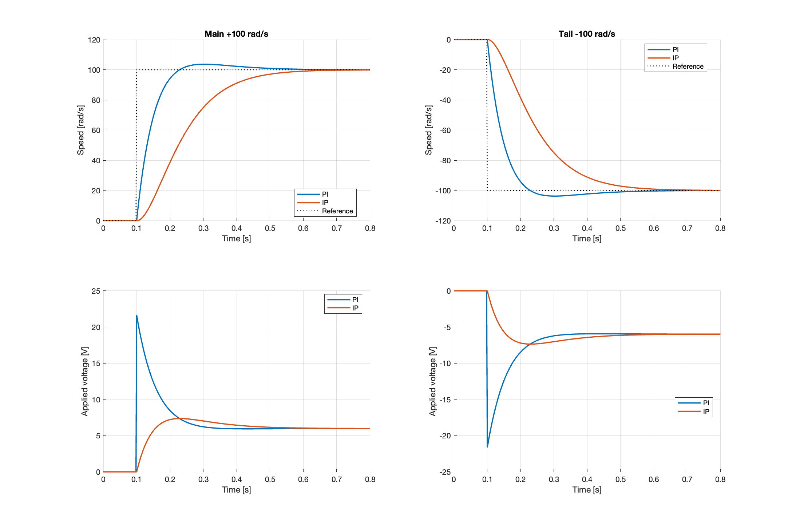
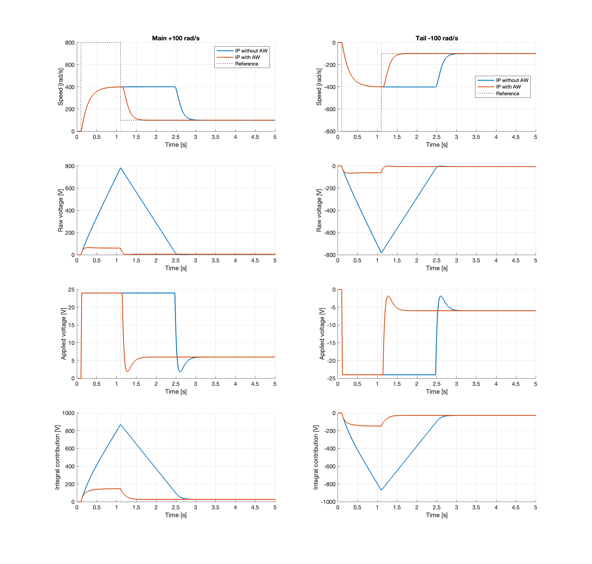
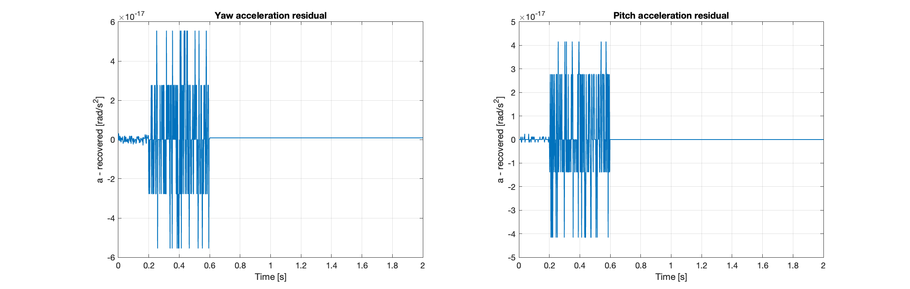
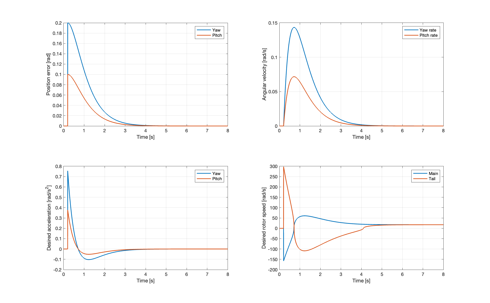
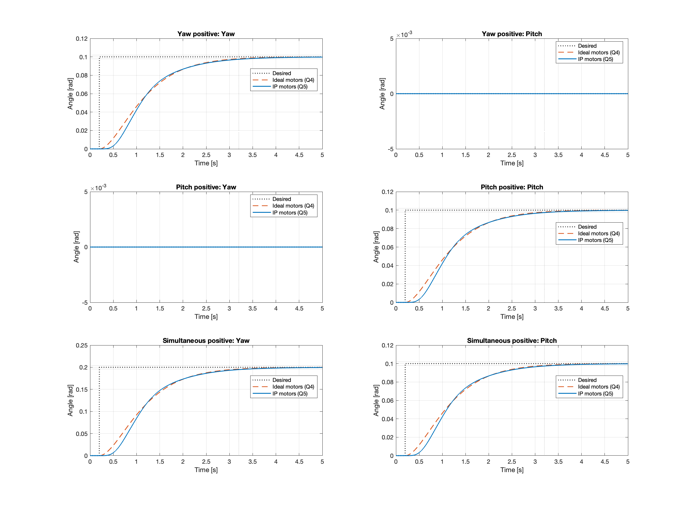
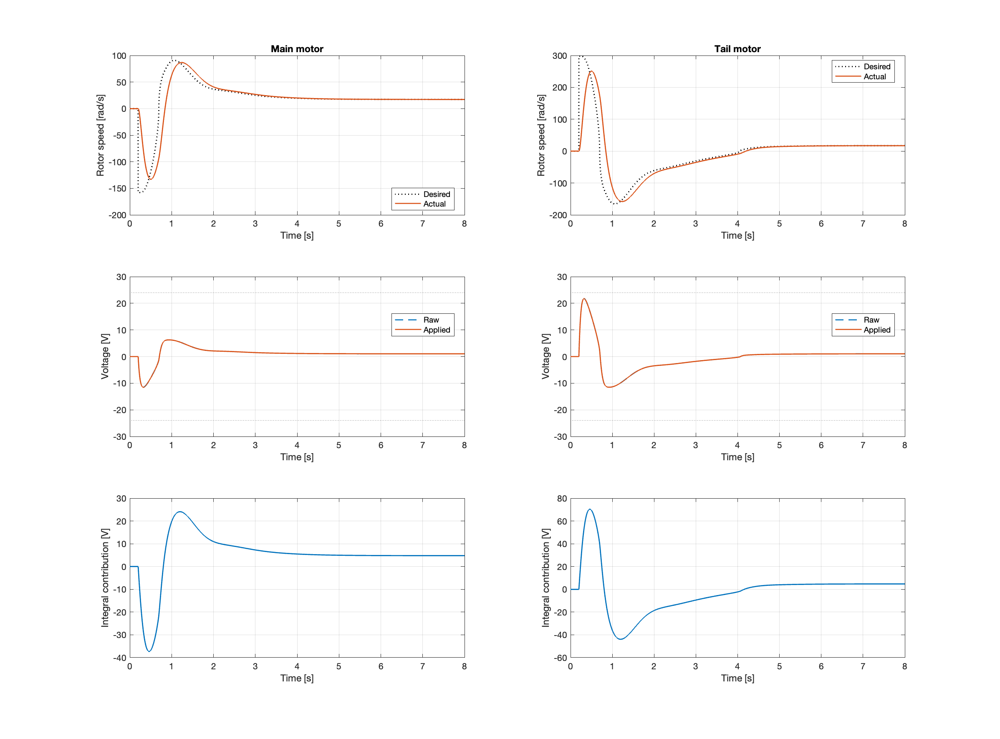
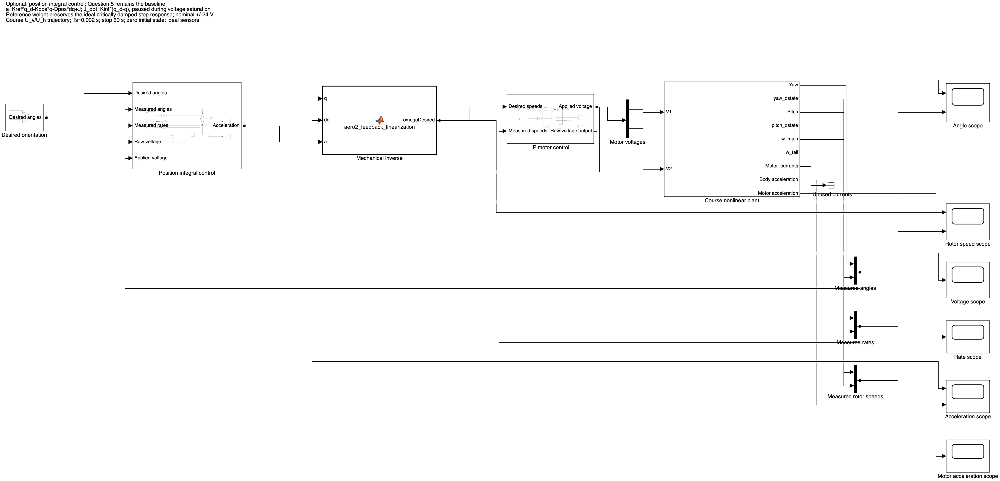
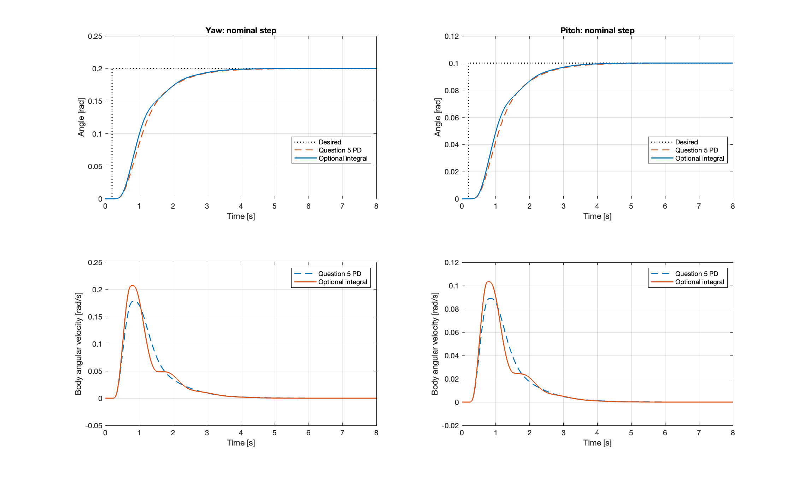

# AERO 2 laboratory report — Part II

This report follows [Part II of the laboratory guide, pages 4–6](../course/Automatic_Control_III_Computer_Room_II.pdf). Questions 1–5 and the optional position-integral controller are implemented and simulated. Question 4 tests ideal motor tracking; Question 5 connects the IP motor loops to the supplied nonlinear plant. Hardware validation remains a later step requiring professor approval.

## The physical system and signals


The main rotor primarily produces pitch motion; the tail rotor primarily produces yaw motion. Both also affect the other axis through coupling.

| Symbol | Meaning | Order when written as a vector |
|---|---|---|
| $q$ | AERO 2 orientation, rad | Yaw $\psi$, pitch $\theta$ |
| $\dot q$ | Angular velocity, rad/s | Yaw rate, pitch rate |
| $\omega$ | Propeller speed, rad/s | Main rotor, tail rotor |
| $v$ | Applied motor voltage, V | Main motor, tail motor |

The plant inputs `V1` and `V2` are the main and tail motor voltages. Propeller speed and body angular velocity are different quantities. Questions 1–2 control propeller speeds. Later questions use those speeds to control yaw and pitch.

## Which model should I open?

Start with the **simple answer models** in `simulink/`. They contain the essential control connections, a basic reference and basic scopes.

| Question | Simple answer model |
|---|---|
| 1 — PI motor control | [aero2_motor_pi.slx](../simulink/aero2_motor_pi.slx) |
| 2 — IP with anti-windup | [aero2_motor_ip.slx](../simulink/aero2_motor_ip.slx) |
| 3 — Feedback linearization | [aero2_mechanical_linearization.slx](../simulink/aero2_mechanical_linearization.slx) |
| 4 — Yaw/pitch position control | [aero2_position_control.slx](../simulink/aero2_position_control.slx) |
| 5 — Complete cascade | [aero2_cascade_control.slx](../simulink/aero2_cascade_control.slx) |
| Optional — Position integral action | [aero2_position_integral.slx](../simulink/aero2_position_integral.slx) |

Separate copies in `simulink/experiments/` contain recovery-step generators, comparison switches and detailed logging. Those blocks support validation; they are not extra parts of the required controller. Experiment filenames add `_experiment` before `.slx`.

For example, with the repository as MATLAB's Current Folder:

```matlab
project = setup_project;
open_system(fullfile(project.simulink,'aero2_motor_ip.slx'));
open_system('aero2_motor_ip/Speed scope');
open_system('aero2_motor_ip/Voltage scope');
```

Press **Run**. A Scope displays its connected signals against simulation time. Double-click reference blocks to inspect their settings.

## Preparation — Check the supplied simulator

Before designing feedback, we checked that known voltages produce the expected motor response:

```math
\dot\omega=-5.78\omega+96.532v.
```

The separate [open-loop preparation model](../simulink/aero2_simulator.slx) copies the supplied plant and applies +1 V to the main motor and -1 V to the tail motor from 0.1 to 0.3 s. Its Pulse Generator settings are period 10 s, width 2%, delay 0.1 s and continuous sample time 0. Voltage is limited to ±24 V; simulation ends at 1 s.


Its Voltage, Rotor speed and Body angle scopes show the applied inputs, motor response and resulting yaw/pitch motion. No position feedback is present.

**Result:** zero voltage and zero initial state remain at rest. The maximum speed discrepancy from the analytical motor response is 0.0357 rad/s, below the 0.15 rad/s acceptance threshold. Voltage clipping and the sensor switch also pass their checks. See [validate_simulator.m](../validation/validate_simulator.m).

## Question 1 — PI motor-speed control

### What the guide asks

Design a PI controller for the propeller speeds with approximately **0.3 s settling time**, and verify it in simulation.

### How we chose the gains

The supplied motor equation gives the transfer function

```math
P(s)=\frac{96.532}{s+5.78}.
```

Define the speed error $e=\omega_d-\omega$. The PI controller is

```math
v_{\mathrm{raw}}=K_pe+I,\qquad \dot I=K_ie.
```

The closed-loop denominator is

```math
s^2+(5.78+96.532K_p)s+96.532K_i.
```

We match it to $(s+\lambda)^2$, giving two repeated real poles. Using $T_s\approx4/\lambda$ as a starting estimate:

```math
\lambda=\frac4{0.3}=13.3333.
```

```math
K_p=\frac{2\lambda-5.78}{96.532}=0.2163704.
```

```math
K_i=\frac{\lambda^2}{96.532}=1.8416461.
```

Both motors use these gains because their supplied motor equations are identical. The calculation is in [motor_pi_parameters.m](../matlab/parameters/motor_pi_parameters.m).

The PI transfer function also has a numerator zero. Therefore, repeated real poles alone do not guarantee zero overshoot or an exact 0.3 s settling time; we measure the response in simulation.

### Simple implementation


Each loop calculates speed error, adds proportional and integral action, limits voltage to ±24 V and feeds back measured speed.

| Setting | Value |
|---|---|
| Main reference | 0 → +100 rad/s at 0.1 s |
| Tail reference | 0 → -100 rad/s at 0.1 s |
| Initial motor speeds and integral states | Zero |
| Step block sample time | 0, continuous |
| Sensors | Ideal setting, `meas_on=0` |
| Solver / stop time | Forward Euler, 0.002 s step / 1 s |
| Speed scope | Main desired/measured speed, then tail desired/measured speed |
| Voltage scope | Main/tail voltages after the ±24 V limits |

The controller computes voltage; we no longer prescribe voltage pulses. The AERO 2's yaw and pitch are not regulated at this stage.

### Simulation and result

The [PI experiment copy](../simulink/experiments/aero2_motor_pi_experiment.slx) adds error plots and logging. We test each motor independently, both command signs, simultaneous commands and zero reference using [validate_motor_pi.m](../validation/validate_motor_pi.m).


| Measured result | Both motors, either command sign |
|---|---:|
| Settling time | **0.318 s** |
| Overshoot | 3.70% |
| Absolute final error at 1 s | 0.00312 rad/s |
| Peak absolute voltage | 21.64 V |
| Time in saturation | 0 s |

**Conclusion:** the PI meets our agreed 0.24–0.36 s interpretation of “approximately 0.3 s.” A 0.001 s integration step gives 0.319 s, supporting the timing result.

## Question 2 — IP control with anti-windup

### What the guide asks

Replace PI with IP **using the same gains**, and include anti-windup feedback.

### What changes from PI

The integral term still uses the speed error. Proportional action now uses measured speed:

```math
\text{PI:}\quad v_{\mathrm{raw}}=I+K_p(\omega_d-\omega),
```

```math
\text{IP:}\quad v_{\mathrm{raw}}=I-K_p\omega.
```

A reference step therefore causes no immediate proportional voltage jump in IP. Keeping the gains preserves the closed-loop poles, but removes the PI reference-response zero. With our repeated real poles, the ideal IP step response is monotonic and slower. IP does not guarantee zero overshoot for arbitrary gains or plants.

### Why we add anti-windup

The amplifier cannot apply more than ±24 V. During saturation, ordinary integral action can keep accumulating error even though the requested voltage cannot be applied. This stored action can delay recovery when the reference changes. Saturation can also occur temporarily for a reachable reference.

We feed the difference between applied and requested voltage back into the integrator:

```math
v_{\mathrm{sat}}=\mathrm{sat}_{[-24,24]}(v_{\mathrm{raw}}),
```

```math
\dot I=K_i(\omega_d-\omega)+K_{\mathrm{aw}}(v_{\mathrm{sat}}-v_{\mathrm{raw}}),
```

```math
K_{\mathrm{aw}}=\frac1{0.05}=20\ \mathrm{s^{-1}}.
```

If raw voltage exceeds +24 V, the correction is negative and opposes integral buildup. Without saturation, the correction is zero. The integral contribution is not itself clipped to ±24 V; it must also compensate the term $-K_p\omega$.

### Simple implementation


The reference settings, gains, initial states, solver and two basic scopes are the same as Question 1. The visible additions calculate `applied voltage - raw voltage`, multiply it by `Kaw`, and add it before the integrator. Settings are in [motor_ip_parameters.m](../matlab/parameters/motor_ip_parameters.m).

**There is one reference Step per motor.** Recovery steps and PI/IP selection are only in the [IP experiment copy](../simulink/experiments/aero2_motor_ip_experiment.slx).

### Simulation and result

[validate_motor_ip.m](../validation/validate_motor_ip.m) first compares identical ±100 rad/s commands:

| Measured result | PI | IP, with or without anti-windup |
|---|---:|---:|
| Settling time | 0.318 s | **0.434 s** |
| Overshoot | 3.70% | **0%** |
| Peak absolute voltage | 21.64 V | 7.36 V |
| Time in saturation | 0 s | 0 s |



IP settles more slowly because its numerator changed. We retain the gains as instructed by Question 2. The unsaturated IP results are identical with anti-windup enabled and disabled.

To test windup, the experiment requests ±800 rad/s at 0.1 s, then returns to ±100 rad/s at 1.1 s. The second Step adds ∓700 rad/s to the first reference. The initial request is unreachable: the nominal motor approaches only about 401 rad/s at 24 V. Simulation ends at 5 s.



| Measured result | Without anti-windup | With anti-windup |
|---|---:|---:|
| Recovery time after the return command | 1.898 s | **0.570 s** |
| Peak absolute integral contribution | 869.91 V | **147.26 V** |
| Time saturated after the return | 1.372 s | **0.042 s** |

Both motors and both sign directions give these results. Applied voltage remains within ±24 V. A 0.001 s step gives 0.572 s recovery.

**Conclusion:** IP gives the expected same-gain comparison, and anti-windup reduces excess integral accumulation and improves recovery. It does not make an unreachable speed achievable.

## Question 3 — Mechanical feedback linearization

### What the guide asks

Assume perfect motor tracking, $\omega=\omega_d$, and find a control law that linearizes the yaw/pitch dynamics. The guide also explicitly asks us to:

> Identify the state variables of the linearized system and determine the validity range of the resulting control law.

### Start with the mechanical equations

The simplified mechanical model is

```math
M_q(q)\ddot q+c_q(q,\dot q)+g_q(q)=\Gamma(\theta)s,
```

```math
s=\begin{bmatrix}
\omega_m|\omega_m| \\
\omega_t|\omega_t|
\end{bmatrix}.
```

Here $M_q$ describes inertia, $c_q$ contains velocity-dependent terms, $g_q$ describes gravity and $\Gamma$ maps rotor action to yaw/pitch torque. Their expressions from page 5 of the guide are

```math
M_q=\begin{bmatrix}
J_\psi\cos^2\theta+j_\psi\sin^2\theta&0 \\
0&J_\theta
\end{bmatrix},
```

```math
c_q=\begin{bmatrix}
-(J_\psi-j_\psi)\sin(2\theta)\dot\theta\dot\psi \\
\frac12(J_\psi-j_\psi)\sin(2\theta)\dot\psi^2
\end{bmatrix},
```

```math
g_q=\begin{bmatrix}
0 \\
G\sin\theta
\end{bmatrix},
```

```math
\Gamma(\theta)=\begin{bmatrix}
\cos\theta&0 \\
0&1
\end{bmatrix}
\begin{bmatrix}
-k_t&Lk_f \\
Lk_f&k_t
\end{bmatrix}.
```

### Write the plant as state space

The mechanical equation above is second order. To write it as $\dot x=f(x,u)$, include both angles and angular velocities in the state:

```math
x=\begin{bmatrix}
x_1 & x_2 & x_3 & x_4
\end{bmatrix}^{T}
=\begin{bmatrix}
\psi & \theta & \dot\psi & \dot\theta
\end{bmatrix}^{T}.
```

The mechanical plant inputs are the two propeller spin speeds:

```math
u=\begin{bmatrix}
u_1 \\
u_2
\end{bmatrix}
=\begin{bmatrix}
\omega_m \\
\omega_t
\end{bmatrix}.
```

Under perfect tracking, these equal the commanded speeds. They are inputs here, rather than extra motor states. Rearranging the mechanical equation gives the two accelerations. In first-order form:

```math
\dot x=f(x,u)=\begin{bmatrix}
x_3 \\
x_4 \\
F_\psi(x,u) \\
F_\theta(x,u)
\end{bmatrix}.
```

For the supplied model, define $\Delta J=J_\psi-j_\psi$ and $D(x_2)=J_\psi\cos^2x_2+j_\psi\sin^2x_2$. Then

```math
F_\psi(x,u)=
\frac{\cos x_2[-k_tu_1|u_1|+Lk_fu_2|u_2|]
+\Delta J\sin(2x_2)x_3x_4}{D(x_2)},
```

```math
F_\theta(x,u)=
\frac{Lk_fu_1|u_1|+k_tu_2|u_2|
-\frac12\Delta J\sin(2x_2)x_3^2-G\sin x_2}{J_\theta}.
```

The first two state equations describe how angles change. The last two calculate body angular acceleration from the current state and rotor speeds. The measured output is $y=[x_1,x_2]^T=q$.

### What the nonlinear inverse does

Introduce a new command $a=[a_\psi,a_\theta]^T$: the **desired yaw and pitch angular accelerations**, in rad/s². It specifies how we want the body angular velocities to change. It is not the current acceleration, a new state, or a propeller speed.

The inverse $u=\alpha(x,a)$ answers: “Given the current angles and angular velocities, which rotor speeds will produce acceleration $a$?” Its calculation has three steps:

1. Calculate the torque needed for that acceleration: $\tau_d=M_q a+c_q+g_q$.
2. Solve $\Gamma(\theta)s=\tau_d$ for the signed squared rotor speeds.
3. Recover the desired speeds: $\omega_d=\mathrm{sign}(s)\sqrt{|s|}$, component by component.

Writing these steps together defines the nonlinear controller:

```math
u=\alpha(x,a)=\mathrm{sign}(s)\sqrt{|s|},
\qquad s=\Gamma(\theta)^{-1}(M_q a+c_q+g_q).
```

The code solves the matrix equation with `\` rather than calculating an explicit inverse. The functions $M_q$, $c_q$, $g_q$ and $\Gamma$ are evaluated at the current state $x$.

Substitution shows why this works:

```math
\begin{aligned}
\ddot q &= M_q^{-1}(\Gamma s-c_q-g_q) \\
&= M_q^{-1}(M_q a+c_q+g_q-c_q-g_q) \\
&= a.
\end{aligned}
```

This is **feedback linearization**, not a Taylor approximation around an equilibrium. The nonlinear terms are evaluated at the current state and canceled in the ideal model.

The implementation uses a matrix solve and signed square root in [aero2_feedback_linearization.m](../matlab/mechanics/aero2_feedback_linearization.m). The equations and constants are in [aero2_mechanical_terms.m](../matlab/mechanics/aero2_mechanical_terms.m) and [aero2_mechanical_parameters.m](../matlab/parameters/aero2_mechanical_parameters.m).

### State variables of the linearized system

The state coordinates do not change: $z=x$. Substituting $u=\alpha(x,a)$ into the plant gives

```math
\dot z=f\bigl(z,\alpha(z,a)\bigr)=\begin{bmatrix}
z_3 \\
z_4 \\
a_\psi \\
a_\theta
\end{bmatrix}.
```

Equivalently, this is the familiar linear form $\dot z=Az+Ba$:

```math
\dot z=
\begin{bmatrix}
0&0&1&0 \\
0&0&0&1 \\
0&0&0&0 \\
0&0&0&0
\end{bmatrix}z+
\begin{bmatrix}
0&0 \\
0&0 \\
1&0 \\
0&1
\end{bmatrix}a.
```

The four states are still **yaw angle, pitch angle, yaw angular velocity and pitch angular velocity**. Acceleration appears in the derivatives of the velocity states; it is not an additional state.

| System | State | Input |
|---|---|---|
| Mechanical plant alone | $x=[\psi,\theta,\dot\psi,\dot\theta]^T$ | Propeller speeds $u=[\omega_m,\omega_t]^T$ |
| Nonlinear inverse + mechanical plant | The same state, $z=x$ | Desired body angular acceleration $a=[a_\psi,a_\theta]^T$ |

The physical plant still receives rotor speeds. The inverse makes the combined system respond to $a$ as two double integrators: $\ddot\psi=a_\psi$ and $\ddot\theta=a_\theta$.

### Why this helps with position control

The next controller can ask for a body acceleration without directly handling gravity and rotor coupling. The inverse handles those effects when it calculates the propeller speeds.

Question 4 below chooses an acceleration of the form

```math
a=K_p^q(q_d-q)-K_d^q\dot q.
```

The first term accelerates toward the desired orientation; the second brakes according to angular velocity. Since the compensated mechanics gives $\ddot q=a$, the result is

```math
\ddot q+K_d^q\dot q+K_p^q q=K_p^q q_d.
```

This is a linear second-order position-control problem. Its gains are selected for the 3 s settling-time target in Question 4 below. These position gains are separate from the motor PI/IP gains.

### Validity range of the control law

The cancellation is exact for the ideal model, subject to these conditions:

- **Pitch:** $\det\Gamma=-\cos\theta[k_t^2+(Lk_f)^2]$, so we require $\cos\theta\ne0$. Around horizontal pitch, the mathematical interval is $-90^\circ<\theta<90^\circ$. At either endpoint the rotor torque map is singular. The inertia matrix remains invertible because its diagonal entries are positive.
- **Implemented envelope:** the simulation uses the narrower interval $|\theta|\le60^\circ$ and stops if it is exceeded. This is our simulation restriction, not a hardware travel limit or an equilibrium-based approximation.
- **Zero rotor speed:** the signed square root is defined at zero, but its derivative is unbounded there. Algebraic cancellation remains evaluable at zero; a smooth local inverse additionally requires both commanded rotor speeds to be nonzero.
- **Physical feasibility:** the derivation assumes correct parameters, exact angles/rates and perfect motor tracking. Real motors have finite voltage and bandwidth. The inverse can request speeds or speed changes they cannot achieve, so the full cascade must be checked separately.

### Simple implementation


The simple model starts with zero angles and rates. One vector Step changes virtual acceleration from `[0;0]` to `[0.15;-0.1]` rad/s² at 0.2 s. It runs for 2 s with the 0.002 s Euler step. The Angle scope shows yaw and pitch.

This model commands acceleration, not angle setpoints. The inverse calculates rotor speeds; the ideal-speed mechanics uses them immediately. The mechanics block outputs `dx`, the four state derivatives. The **Mechanical state** integrator produces `x`; **Angles and rates** separates it into `q` and `dq` for feedback. There is no position controller yet.

The simple model now exposes all three motion quantities directly:

| Scope | Signals | Units |
|---|---|---|
| **Angle scope** | Yaw and pitch position | rad |
| **Rate scope** | Yaw and pitch body angular velocity | rad/s |
| **Acceleration scope** | Commanded yaw/pitch acceleration on input 1; actual yaw/pitch acceleration on input 2 | rad/s² |

Actual acceleration comes directly from the mechanical equations, not from numerically differentiating a measured velocity. The command and actual traces should overlap under ideal motor tracking. These body velocities are distinct from the main/tail propeller speeds.

```matlab
open_system('aero2_mechanical_linearization/Angle scope');
open_system('aero2_mechanical_linearization/Rate scope');
open_system('aero2_mechanical_linearization/Acceleration scope');
```

Press **Run** to fill the Scopes. The report's plots below use the separate pulse experiment and nonzero initial rates. The simple model retains its original acceleration step and zero initial state, so its curves differ: acceleration stays constant after 0.2 s, velocity ramps, and position follows a parabola.

### Separate simulation experiment and result

The [feedback-linearization experiment](../simulink/experiments/aero2_mechanical_linearization_experiment.slx) uses a different demonstration input to test the cancellation:

| Setting | Experiment value |
|---|---|
| Initial yaw/pitch | 0.1 / 0.2 rad |
| Initial yaw/pitch rates | -0.05 / +0.04 rad/s |
| Acceleration pulse | Yaw +0.15, pitch -0.10 rad/s² from 0.2 to 0.6 s |
| Pulse settings | Period 10 s, width 4%, delay 0.2 s, continuous sample time 0 |
| Solver / stop time | Euler, 0.002 s / 2 s |

Its scopes show requested/recovered acceleration, angles, rates, rotor commands and acceleration error. [validate_feedback_linearization.m](../validation/validate_feedback_linearization.m) also substitutes computed rotor speeds into the original course equations at 180 representative states and acceleration commands.


Read this figure by rows:

- **Top:** requested and recovered accelerations overlap, confirming the cancellation.
- **Middle — angular velocity:** yaw starts at -0.05 rad/s. The positive acceleration pulse brakes it, crosses zero near 0.533 s, and leaves +0.01 rad/s after 0.6 s. Pitch starts at +0.04 rad/s; its negative pulse brings it to zero at 0.6 s. These are body angular velocities, not propeller spin speeds.
- **Bottom — position:** yaw decreases while its velocity is negative and increases after its velocity becomes positive. It is not being commanded back to its initial angle: it will pass that angle if the simulation continues. Pitch becomes flat because its final velocity is zero. The dotted curves are the analytical responses; the orange curves come from the nonlinear course mechanics.

The angular-velocity prediction is obtained by integrating the acceleration pulse once:

```math
\dot q(t)=\dot q(0)+a_0\left[\max(t-0.2,0)-\max(t-0.6,0)\right].
```

Here $a_0=[0.15,-0.10]^T$ rad/s². After the pulse, the final rates are $[-0.05,0.04]^T+0.4[0.15,-0.10]^T=[0.01,0]^T$ rad/s. Zero acceleration then preserves these rates; it does not stop yaw motion or mean the motors are switched off.



The separate residual figure shows acceleration errors around $10^{-17}$ rad/s². Its spikes are floating-point roundoff, not sensor noise or physical oscillation.

| Check | Measured result |
|---|---:|
| Maximum acceleration error across 180 substitutions | $2.22\times10^{-16}$ rad/s² |
| Maximum acceleration error during the time simulation | $5.55\times10^{-17}$ rad/s² |
| Maximum angle error against analytical response, 0.002 s step | $6.0\times10^{-5}$ rad |
| Same comparison with a 0.001 s step | $3.0\times10^{-5}$ rad |
| Zero input at zero state | Exactly zero rotor commands |
| Leaving the pitch envelope | Simulation stops with a diagnostic |

**Conclusion:** the compensated ideal mechanics behaves as two double integrators. No equilibrium approximation was needed. Choosing $a$ to regulate position and meet the 3 s target is Question 4.

## Question 4 — AERO 2 yaw/pitch position control

### What the guide asks

Using measured angles $q$ and angular velocities $\dot q$, design a linear controller that drives the AERO 2 to a desired orientation $q_d$ with approximately **3 s settling time**.

We retain Question 3's ideal motor-tracking assumption. This question closes the position loop around the compensated mechanics; it does not yet include the actual motor response or voltage limits.

### Control law and gain selection

Question 3 gives $\ddot q=a$. We now calculate $a$ from the position error and angular velocity:

```math
a=K_p^q(q_d-q)-K_d^q\dot q.
```

The proportional term accelerates toward the target. The rate term provides braking. The nonlinear inverse then converts this desired body acceleration into the required main/tail rotor speeds.

For a constant target, the error $e=q_d-q$ obeys

```math
\ddot e+K_d^q\dot e+K_p^q e=0.
```

Use identical, independent critically damped dynamics for yaw and pitch. Matching the characteristic polynomial to $(s+\lambda)^2$ gives

```math
K_p^q=\lambda^2 I_2,\qquad K_d^q=2\lambda I_2.
```

For a step from rest, the normalized error is $(1+\lambda t)e^{-\lambda t}$. Its exact 2% settling condition is

```math
(1+3\lambda)e^{-3\lambda}=0.02.
```

Solving it gives $\lambda=1.9446406$ s⁻¹, so the scalar gains applied to each axis are

```math
K_q=3.7816269,\qquad D_q=3.8892811.
```

The familiar $4/\lambda$ rule is only an estimate. Here we use the exact critically damped step response to target 3 s directly. The calculation is in [position_control_parameters.m](../matlab/parameters/position_control_parameters.m). There is no reference differentiation or outer-loop integral action.

### Simple implementation


Open [aero2_position_control.slx](../simulink/aero2_position_control.slx). Its signal chain is:

```text
Desired yaw/pitch → position/rate feedback → desired acceleration a
                 → nonlinear inverse → rotor speeds → ideal-speed mechanics
```

The **Position error** block forms $q_d-q$. **Position gain** multiplies it by `Kq`; **Rate feedback gain** multiplies $\dot q$ by `Dq`. **Desired acceleration** subtracts the rate contribution. The inverse, mechanical state and angle/rate feedback are inherited from Question 3.

| Setting | Value |
|---|---|
| Desired orientation | `[0.2;0.1]` rad: yaw first, pitch second |
| Step time | 0.2 s, from `[0;0]` |
| Step sample time | 0, continuous |
| Initial angles and angular velocities | Zero |
| Gains in the model workspace | `Kq=3.7816269`, `Dq=3.8892811` (stored at full precision) |
| Solver / stop time | Forward Euler, 0.002 s / 8 s |
| Measurements and motors | Ideal state measurements and perfect rotor-speed tracking |
| Pitch simulation envelope | ±60°, enforced by the inverse |

The **Angle scope** receives desired yaw/pitch on its first vector input and measured yaw/pitch on its second. There are no experiment selectors or logging bundles in this simple answer.

### Separate experiments and measured results

The [position-control experiment](../simulink/experiments/aero2_position_control_experiment.slx) adds error, rate, acceleration, rotor-command and residual scopes. [validate_position_control.m](../validation/validate_position_control.m) tests yaw-only ±0.1 rad, pitch-only ±0.1 rad, and simultaneous commands `[0.2;0.1]` and `[-0.2;-0.1]` rad.


The dotted reference is compared with the simulated angle. Single-axis tests also show that the uncommanded axis stays at zero. The vertical line is **3 s after the command**, at absolute simulation time 3.2 s; the settling-time measurement starts at the 0.2 s step.

| Metric | Result across the signed step tests |
|---|---:|
| 2% settling time | **2.996 s** |
| Rise time, 10–90% | 1.724 s |
| Overshoot | 0% |
| Largest absolute final position error at 8 s | $8.15\times10^{-7}$ rad |
| Largest requested main/tail rotor speed | 178.56 / 298.00 rad/s |
| Maximum uncommanded-axis motion in the single-axis tests | $2.05\times10^{-19}$ rad |
| Settling time with a 0.001 s integration step | **2.998 s** |



The tests also compare the trajectories with the analytical critically damped response, check zero-reference equilibrium, and verify convergence from nonzero initial angles and rates. A deliberately excessive pitch reference confirms that the simulation stops on leaving the envelope. All recorded signals remain finite in the accepted runs.

**Conclusion:** the ideal yaw/pitch position controller meets the 3 s settling target. It controls orientation rather than rotor speed. The requested rotor speeds can change instantly in this ideal simulation; this is not possible with finite-voltage motors. Question 5 must replace that assumption with the IP loops and measure the resulting performance.

### Reproduce Question 4

```matlab
project = setup_project;
build_position_control;
build_position_control_experiment;
metrics = validate_position_control;
export_position_control_figures;
open_system(fullfile(project.simulink,'aero2_position_control.slx'));
open_system('aero2_position_control/Angle scope');
```

Press **Run** to view the simple model. Rebuilding is optional for the saved models. `build_position_control` creates the simple answer; `build_position_control_experiment` makes the diagnostic copy. Only that copy records `out.position_data`, with paired columns for references (1–2), angles (3–4), rates (5–6), virtual acceleration (7–8), main/tail speeds (9–10), position errors (11–12), recovered acceleration (13–14) and acceleration residuals (15–16).

## Question 5 — Connect and validate the complete controller

### What the guide asks

Implement the complete controller in the supplied simulator and check the specifications. We now replace Question 4's perfect motor tracking with the actual motor equations and the IP controllers from Question 2. No gains are retuned.

### What changes physically

The nonlinear inverse requests rotor speeds. Motors cannot reach them instantly: the IP loops must generate a voltage, limited to ±24 V, to accelerate or brake each rotor.

The complete chain is:

```text
Desired angles → position/rate feedback → desired body acceleration
               → nonlinear inverse → desired rotor speeds
               → IP + anti-windup → motor voltages → supplied nonlinear plant
```

The plant state is now $x=[\psi,\theta,\dot\psi,\dot\theta,\omega_m,\omega_t]^T$. Its physical inputs are the two motor voltages. The controller also has two integral states, one per motor. Unlike the ideal model, the complete closed loop is not just two double integrators.

Writing $s(\omega)=[\omega_m|\omega_m|,\omega_t|\omega_t|]^T$, the actual body acceleration is

```math
\ddot q=a+M_q(q)^{-1}\Gamma(\theta)\left[s(\omega)-s(\omega_d)\right].
```

The extra term is zero only when the motors track perfectly. It explains why the complete cascade can differ from Question 4 even though the position gains have not changed.

### Simple implementation, inputs and scopes


Open [aero2_cascade_control.slx](../simulink/aero2_cascade_control.slx). The position feedback and **Mechanical inverse** come from Question 4. **IP motor control** contains two identical, independent loops, represented together using two-element main/tail vectors:


The proportional term uses measured speed. The integral term uses speed error and the difference between limited and raw voltage. The supplied **Course nonlinear plant**, including its amplifier, mechanical/motor equations, noise and quantizer, is copied unchanged.

| Setting | Value |
|---|---|
| Desired orientation Step | Yaw/pitch `[0;0]` → `[0.2;0.1]` rad at 0.2 s; sample time 0 |
| Position gains | `Kq=3.7816269`, `Dq=3.8892811` |
| Motor gains | `Kp=0.2163704`, `Ki=1.8416461`, `Kaw=20` |
| Initial plant state and IP integral states | Zero |
| Motor voltage | Generated by the IP loops; each channel limited to ±24 V |
| Measurement effects | Model workspace `meas_on=0` for ideal sensors; `1` enables supplied noise and quantization |
| Solver / stop time | Forward Euler, 0.002 s / 8 s |
| Sensor-noise update period | Supplied 0.002 s; unchanged during solver refinement |
| Pitch simulation envelope | ±60°, enforced by the nonlinear inverse |

These figures are Simulink diagram exports, not UI screenshots. There is no manually imposed voltage pulse in Question 5: voltage is the controller's output.

| Basic Scope | Connected signals |
|---|---|
| **Angle scope** | Desired and measured yaw/pitch vectors |
| **Rotor speed scope** | Desired and measured main/tail speed vectors |
| **Voltage scope** | Applied main/tail voltages |

The simple model has no logging bundle or experiment selectors. The [experiment copy](../simulink/experiments/aero2_cascade_control_experiment.slx) adds a selectable reference recording and detailed logging. It also exposes the true simulated state for comparison with noisy measurements, without changing the dynamics.

### Step-test results

[validate_cascade_control.m](../validation/validate_cascade_control.m) repeats the positive and negative yaw-only 0.1 rad, pitch-only 0.1 rad, and simultaneous `[0.2;0.1]` rad tests. Settling is measured from the 0.2 s command, using ±2% of each commanded angle.



| Ideal-measurement test | Ideal motors, Q4 | Complete cascade, Q5 | Peak applied voltage, either motor |
|---|---:|---:|---:|
| Yaw-only ±0.1 rad | 2.996 s | 3.204 s | 12.33 V |
| Pitch-only ±0.1 rad | 2.996 s | 3.210 s | 13.04 V |
| Simultaneous ±`[0.2;0.1]` rad | 2.996 s | Yaw 3.206 s; pitch 3.210 s | 21.76 V |

All these tests have **0% overshoot and no voltage saturation**. The largest final angle error at 8 s is $7.98\times10^{-6}$ rad. Integral contributions remain below 70.38 V; they are internal controller terms, not applied voltages. A large integral contribution can cancel the proportional feedback while the applied voltage remains below 24 V.

The real motor dynamics increase settling time by about **0.21 s**, or 7% relative to the ideal result. The cascade meets our working interpretation of approximately 3 s: **2.4–3.6 s**, pending the professor's convention.



The rotor commands change before the measured speeds can follow. Raw and applied voltage overlap in these nominal tests because neither motor saturates. Question 2's separate recovery experiment remains the evidence for anti-windup under saturation.


The additional checks confirm zero-input rest, convergence from nonzero initial angles/rates, and a stop when an excessive pitch command leaves the envelope. Halving the integration step to 0.001 s gives settling times **3.207–3.212 s** in the representative tests. The largest coarse/fine angle difference is $1.74\times10^{-4}$ rad, so the timing conclusion is unchanged. The simple and experiment models give identical default signals, with maximum difference **0**.

### Sensor effects

All six signed tests are repeated with the supplied sensor effects. We report final-window statistics over 6–8 s, rather than using noisy crossings to claim a deterministic settling time.


For the simultaneous positive command:

| Metric over 6–8 s | Yaw | Pitch |
|---|---:|---:|
| True angle-error RMS | 0.000181 rad | 0.001368 rad |
| Measured angle-error mean | 0.0000247 rad | 0.001758 rad |
| Measured angle-error standard deviation | 0.000760 rad | 0.000450 rad |

Across all signed sensor tests, final true-error RMS stays below 0.000440 rad for yaw and 0.001790 rad for pitch; peak voltage is 21.90 V. The sensor model quantizes yaw in approximately 0.001534 rad increments and pitch in 0.003068 rad increments. The physical simulated angle can therefore differ from the value reported by the sensor, leaving a small offset rather than exact convergence to the reference. These are simulation results, not hardware measurements.

### Supplied smooth reference

The validation script reproduces the original initialization script's 60 s references, including its factor of two. This tests tracking; it does not establish step settling time. The controller still uses position and measured-velocity feedback, with no desired-velocity or acceleration feedforward.


| Tracking result over the full 60 s | Ideal sensors | Noise and quantization |
|---|---:|---:|
| Yaw error RMS | 0.09941 rad | 0.09945 rad |
| Pitch error RMS | 0.05975 rad | 0.05969 rad |
| Peak absolute yaw error | 0.2866 rad | 0.2879 rad |
| Peak absolute pitch error | 0.1407 rad | 0.1425 rad |
| Peak applied voltage | 6.47 V | 6.92 V |

Signals and integrators remain bounded, and peak absolute pitch stays below 0.575 rad (32.95°). There is visible tracking lag. Passing the constant-step specification does not imply accurate tracking of a changing reference. Trajectory feedforward would be a separate extension, not part of this implementation.

**Conclusion:** the complete simulated cascade meets the nominal angle-step timing criterion with the original gains, while respecting voltage and pitch limits. Sensor effects leave small residual errors; moving references show lag. The next required stage is professor review before section-by-section hardware validation. The optional position integrator is developed separately below; it does not replace this baseline.

### Reproduce and visualize Question 5

```matlab
project = setup_project;
build_cascade_control;
build_cascade_control_experiment;
metrics = validate_cascade_control;
validate_question_models(5);
export_cascade_control_figures;
open_system(fullfile(project.simulink,'aero2_cascade_control.slx'));
open_system('aero2_cascade_control/Angle scope');
open_system('aero2_cascade_control/Rotor speed scope');
open_system('aero2_cascade_control/Voltage scope');
```

Press **Run** to visualize the saved simple model; rebuilding is optional. Double-click **IP motor control** to inspect its connections. Raw recordings and four metric tables are saved under `results/cascade_*`. The diagnostic output `out.cascade_data` has columns: reference angles 1–2, measured angles 3–4, measured rates 5–6, desired acceleration 7–8, desired rotor speeds 9–10, measured rotor speeds 11–12, raw voltages 13–14, applied voltages 15–16, IP integral states 17–18, true angles 19–20, true rates 21–22 and true rotor speeds 23–24.

The saved models and R2021a exports are simulated in MATLAB R2024b. Actual R2021a execution and hardware testing remain unverified.

## Optional — Position integral action

### Purpose and controller

The guide asks us to add position integral action without significantly changing settling time. The motor IP integrators already control rotor speed; these new integrators accumulate **yaw/pitch position error**. They help reject persistent external torques that the nominal inverse does not know about.

Question 5 remains unchanged. The separate optional controller uses

```math
\dot J=K_i^q(q_d-q),\qquad
 a=K_p^q(bq_d-q)-K_d^q\dot q+J.
```

Here $J$ is an acceleration contribution, in rad/s². It already includes the integral gain. The reference weight $b$ prevents the new integral action from substantially changing the nominal step response. Derivative feedback still acts on measured velocity, so there is no differentiated reference step.

### Gain selection

With ideal motor tracking and a constant reference, each axis has characteristic polynomial

```math
s^3+K_d^q s^2+K_p^q s+K_i^q.
```

Choose the three stable poles at $-\lambda$, using Question 4's $\lambda=1.9446406$ s⁻¹. Matching $(s+\lambda)^3$ gives

```math
K_d^q=3\lambda,\qquad K_p^q=3\lambda^2,\qquad K_i^q=\lambda^3.
```

We also choose $b=1/3$. The ideal reference-to-angle transfer function becomes

```math
\frac{Q(s)}{Q_d(s)}
=\frac{bK_p^q s+K_i^q}{s^3+K_d^q s^2+K_p^q s+K_i^q}
=\frac{\lambda^2(s+\lambda)}{(s+\lambda)^3}
=\frac{\lambda^2}{(s+\lambda)^2}.
```

This preserves the original ideal 3 s step response from rest. The additional pole remains part of the internal and disturbance dynamics; it has not disappeared from the system. The matching is nominal and does not guarantee an identical response with finite motor tracking or saturation.

[The parameter function](../matlab/parameters/position_integral_parameters.m) stores the gains. The diagram uses `Kref=b*Kpos`, so the acceleration sum is `Kref*q_d - Kpos*q - Dpos*dq + J`.

| Parameter | Value |
|---|---:|
| `Kref` | 3.7816269 |
| `Kpos` | 11.3448808 |
| `Dpos` | 5.8339217 |
| `Kint` | 7.3539 (stored at full precision) |
| Reference weight `b` | 1/3 |

### Simple model and outer anti-windup




The figures above are Simulink diagram exports. Open [aero2_position_integral.slx](../simulink/aero2_position_integral.slx). Double-click **Position integral control** to see the gains, integral contribution and anti-windup gate. The default reference is still yaw 0.2 rad and pitch 0.1 rad at 0.2 s, from rest. The motor IP gains, nominal ±24 V limits, 0.002 s solver step, ideal sensors and three basic Scopes are retained from Question 5.

The new outer anti-windup rule pauses **both** position integrators whenever either motor's raw voltage differs from its limited voltage. Otherwise, $\dot J=K_i^q(q_d-q)$. Both axes pause because rotor action is coupled. This conservative rule prevents accumulation during voltage saturation; it does not actively discharge stored integral action or account for every possible hardware constraint. The motor-loop back-calculation remains active as well.

The simple plant is copied unchanged. Only the [experiment copy](../simulink/experiments/aero2_position_integral_experiment.slx) adds external torque injection, temporary voltage-authority changes, an outer anti-windup comparison parameter and logging. External torque is added through $\Delta\ddot q=M_q(q)^{-1}\tau_d$; the nonlinear inverse is not told its value.

### Nominal results and tradeoff

The same six signed single-axis and simultaneous steps used in Question 5 are repeated.

| Metric | Question 5 PD | Optional integral controller |
|---|---:|---:|
| Settling time | 3.204–3.210 s | **3.042–3.050 s** |
| Overshoot | 0% | Less than 0.025% |
| Peak voltage across nominal tests | 21.76 V | **23.66 V** |
| Nominal saturation duration | 0 s | 0 s |
| Largest final angle error at 8 s | $7.98\times10^{-6}$ rad | $1.03\times10^{-5}$ rad |



The optional controller keeps settling near 3 s, with a very small overshoot. It uses more voltage and leaves less actuator margin. Its main benefit is disturbance rejection, not a large improvement in the already accurate nominal model. A nonzero final $J$ is normal: it balances the weighted proportional feedback even when the position error is zero.

### Constant-disturbance comparison

At 5 s, apply an unknown constant yaw torque of +0.010 N m and pitch torque of -0.008 N m. Hold the desired angles at `[0.2;0.1]` rad. Both controllers use the same disturbed plant. Measure the final errors over 18–20 s with ideal sensors.

| Axis | PD mean position error | With integral action |
|---|---:|---:|
| Yaw | -0.004166 rad | Below $10^{-9}$ rad in magnitude |
| Pitch | +0.002953 rad | Below $10^{-9}$ rad in magnitude |


The PD controller needs a persistent position error to generate the acceleration command that balances the unknown torque. The integrator stores that compensation, allowing the angle error to return to numerical zero. The tests also reverse both torque signs and verify rejection again. These tiny residuals belong to the ideal simulated model, not a claim of achievable hardware accuracy.

### Outer windup and recovery

A separate stress experiment temporarily reduces the available voltage to **±2 V** until 4 s, then restores **±24 V**. The yaw reference is 0.4 rad from 0.2 s; at 4 s it changes to 0.05 rad. Pitch stays at zero. This is an artificial loss-of-authority test, not a different nominal actuator specification.

| Stress-test metric | Outer anti-windup off | Outer anti-windup on |
|---|---:|---:|
| Peak outer integral contribution | 10.368 rad/s² | 0.3783 rad/s² |
| Peak yaw angle over the full test | 1.0475 rad | 0.1028 rad |
| Settling after the 4 s return, ±0.001 rad band | 7.534 s | 4.786 s |


The motor-loop anti-windup is enabled in both runs. It cannot prevent the separate position integrators from accumulating. Pausing the outer integrators sharply reduces stored action and subsequent overshoot, although recovery is still not instantaneous. The validation checks that $J$ is unchanged over each saturated Euler update when outer anti-windup is enabled.

### Other checks and reproduction

Validation also checks the independent ideal augmented-state response, zero-reference rest, the ±60° pitch stop, noisy measurements, and solver refinement. With integral action disabled and the original PD gains restored in the experiment, the default Question 5 angles/rates agree within $10^{-10}$. The optional simple and experiment copies give identical default signals (maximum difference 0).

With sensor effects enabled, final-window true-error RMS over 6–8 s is 0.000607 rad for yaw and 0.000341 rad for pitch. Exact convergence is not expected. Halving the integration step gives nominal settling of 3.050 s for yaw and 3.044 s for pitch, preserves disturbance rejection, and changes anti-windup recovery from 4.786 to 4.790 s. R2021a exports are run in the available R2024b installation; actual R2021a execution and hardware testing remain separate checks.

```matlab
project = setup_project;
build_position_integral;
build_position_integral_experiment;
validate_position_integral;
validate_position_integral_models;
export_position_integral_figures;
open_system(fullfile(project.simulink,'aero2_position_integral.slx'));
open_system('aero2_position_integral/Angle scope');
```

The experiment records `out.integral_data`. Its first 24 columns match the Question 5 logging order; columns 25–26 are the outer integral contribution and 27–28 are the applied external torques. Raw data and metrics go under `results/position_integral_*`.

**Conclusion:** optional integral action rejects constant model-mismatch torques while retaining approximately 3 s nominal settling. It adds tuning complexity, slightly more overshoot and higher peak voltage. Outer anti-windup is necessary when actuator saturation prevents the position loop from achieving its command.

## Rebuild and repeat the checks

Saved models can be opened without rebuilding. To regenerate both the simple answers and their experiment copies:

```matlab
project = setup_project;
build_motor_pi;
build_motor_ip;
build_feedback_linearization;
build_position_control;
build_position_control_experiment;
build_cascade_control;
build_cascade_control_experiment;
```

Builders overwrite generated models. Put lasting diagram changes in the builder code.

Run the experiment checks and regenerate their figures with:

```matlab
validate_motor_pi;
validate_motor_ip;
validate_feedback_linearization;
validate_position_control;
validate_cascade_control;
validate_question_models;
export_motor_pi_figures;
export_motor_ip_figures;
export_feedback_linearization_figures;
export_position_control_figures;
export_cascade_control_figures;
```

`validate_question_models` confirms that simple and experiment copies give the same dynamics under matching inputs and initial conditions. The maximum recorded difference is **0** for Questions 1–5. For Question 3 it matches the experiment input and initial state to the simple model before comparing them.

To open a detailed experiment, use its full path:

```matlab
open_system(fullfile(project.experiments,'aero2_motor_ip_experiment.slx'));
```

Only the experiment copies save detailed data: motor experiments return `out.motor_data`, the linearization experiment returns `out.linearization_data`, the position experiment returns `out.position_data`, and the cascade experiment returns `out.cascade_data` when run with `out = sim(model)`. Validation saves raw recordings and numerical tables under ignored `results/`. The simple answer models have no saved diagnostic logging blocks.

## How to interpret the evidence

Settling time is measured from the command change until the response enters and stays within ±2% of the step amplitude, through the end of the run. The ±20% allowance around 0.3 s is our planning convention, subject to the professor's interpretation of “approximately.”

Controller-performance results use ideal measurements and the supplied simplified model. Figures are actual Simulink diagram exports or plots of logged signals, not native Scope-window screenshots. The original course files are unchanged.

Validation was performed in MATLAB R2024b. The models include R2021a exports tested in R2024b; actual execution in R2021a and physical hardware testing remain unverified.
